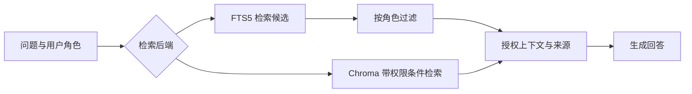

# AppliedAI-Platform｜有权限边界的知识库问答

**个人 AI 应用原型 · 2026.11 至今**

我围绕内部知识库问答设计了这套原型：让检索同时满足“内容相关”和“用户有权访问”，并把权限检查、内容入库和工具异常处理纳入验收。产品构思、需求拆解、方案取舍与修复推进由我负责；使用 AI 编程工具辅助实现与调试。

## 场景与目标

员工查找制度或业务资料时，最相关的文档可能包含其无权查看的内容。如果受限片段已经进入模型上下文，再要求模型“不要透露”，资料暴露的边界就难以控制。

我把首要目标设为：**未授权片段不能进入生成上下文，同时保留合法查询的可用性。**

## 我负责的工作

- 将问答需求拆成入库、权限检查、检索、上下文组织与工具调用环节，明确各环节的输入、输出和失败情况。
- 对比提示词约束、输出过滤和检索层权限检查，选择在形成生成上下文前执行访问控制，并用权限开关对照检查行为。
- 推进 SQLite FTS5 与本地持久化 Chroma 两种检索后端的实现，整理分块检查和工具错误分支，形成可追问的评测记录。

## 关键方案与取舍

| 决策 | 选择及原因 | 需要承担的代价 |
|---|---|---|
| 权限检查的位置 | 在检索层控制返回给模型的片段，避免只依靠提示词或答案过滤 | 必须保证身份、文档标签及取数路径正确；过滤过严也会影响正常查询 |
| 两种检索后端 | 用 FTS5 全文检索与本地 Chroma 向量检索对照权限行为 | 需要保持索引和权限数据一致；已有结果不说明某后端效果或性能更优 |
| 工具执行的失败处理 | 区分执行异常、超时和未知工具，返回可识别的错误类型 | 错误被识别后，仍需按真实任务设计恢复或人工处理方式 |

FTS5 路径先获取候选再过滤；Chroma 路径在查询中传入允许访问的文档条件。两者共同控制的是进入生成上下文的资料。

## 已有评测

以下为 **2026 年 11 月 2 日留存的本地原型报告**，不是生产运行数据；工具选择部分使用固定 mock 模型用例。

| 检查 | 留存结果 | 结果说明 |
|---|---|---|
| FTS5 权限对照 | 9 个越权查询用例：ACL 开启 0/9，关闭 9/9 | 统计受限标记是否进入检索上下文 |
| Chroma 权限对照 | 同组 9 个用例：ACL 开启 0/9，关闭 9/9 | 验证第二种检索路径中的权限行为 |
| 入库分块检查 | 5 篇种子文档、5 个标记探针，调整前后及当前 FTS 检查均为 5/5 | 两种分块配置均保留了被检查的关键标记 |
| mock 工具选择 | 10/10 与预期工具集合匹配 | 证明固定模拟用例的路由行为 |
| 工具异常分支 | 执行异常、超时、未知工具均返回预期错误类型 | 检查失败分类，不等同于真实任务恢复成功 |

## 当前边界

权限结果针对检索上下文中的标记，不是提示注入防护分数或真实模型安全保证；工具评测不代表真实模型的任务完成率。后续需要补充同题授权查询、标签误配、撤权同步和真实任务的失败恢复验证，再判断权限保护与正常使用体验是否同时达标。

## 面试中可以展开的两个问题

1. 为什么把权限检查放在生成上下文形成之前？如何避免“全部拒绝”带来的表面安全？
2. 如何区分工具选择正确、工具执行成功和用户任务完成，并为三者分别设计验收？

## 资料来源

源码与完整报告位于私有项目仓库，可在面试中展示。以下为仓库内相对路径：

- `app/rag/search.py`、`app/rag/chroma_store.py`：检索与权限实现。
- `reports/attack_eval.md`、`reports/attack_eval_chroma.md`：权限逐例对照。
- `reports/ingest_quality.md`：分块与标记覆盖检查。
- `reports/agent_eval.md`、`app/eval/agent_eval.py`：mock 工具选择及异常分支。

[返回作品集](../README.md)
