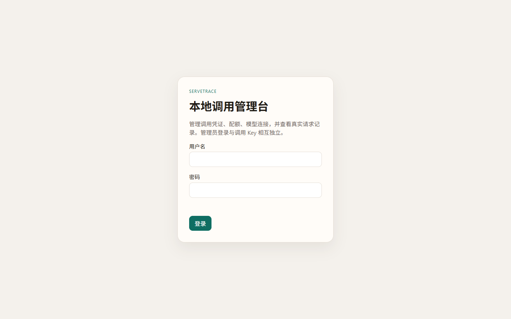

# AppliedAI & ServeTrace · 企业知识库权限问答与大模型转发网关

个人原型（2026.11） · 检索层前置 ACL、工具调用契约与非流式转发网关 · [查看完整全线 PRD](../prds/appliedai-servetrace-prd.md)

## 1. 同一个知识库，不同身份能检索到哪些依据？

员工和外部访客面对同一个知识库，允许读取的资料边界不同。提示词保密依赖模型自律，生成后过滤发生在受限切片已被读入上下文之后。我选择在**检索层按用户身份前置过滤密级**，只有当前身份有权查看的文档片段才参与检索与上下文拼装；权限撤销后，历史会话同步脱敏并从后续多轮上下文中剔除受限片段。

### 访客身份（`bob`）前置权限隔离实测

演示库内共存有 `public`（1 篇）、`internal`（2 篇）与 `secret`（2 篇）共 5 篇分密级基础文档。使用未授权访客账号 `bob` 登录时（见下图左下角身份标识），可见与可检索范围在检索层即被严格限制为唯一 1 篇 `public` 文档 `Onboarding Handbook`，所有 `internal` 与 `secret` 切片零暴露：

### 全密级管理员身份（`admin`）经网关引用溯源实测

切换为具备 `public / internal / secret` 全密级权限的管理员 `admin` 提问“仓库代号是什么？”时，本地 `Qwen3.5-27B` 与 `BGE` 中文嵌入跑通引用溯源与来源卡片回查（注：下图为 **`admin` 全权限管理员视角**；因管理员拥有全部 5 篇演示文档权限且默认检索 `top_k=5` 与基础演示语料篇数相等，候选来源区完整列出 5 篇授权切片，模型精确引用 `[1] 青浦演示手册` 作答；模型调用异常时显式报错，绝不静默降级为模拟回答）：

## 2. 5 篇分密级文档正反对照验收

在 5 篇分密级演示文档上，对同一组受限资料问题分别使用未授权身份（`bob`）与授权身份（`admin`）测试，并附加公开文档基线题检验是否误拦合法查询，两条检索路径使用完全相同的评测集：

| 检索验收维度 | SQLite FTS5 | Chroma 向量检索 |
| --- | ---: | ---: |
| 未授权身份命中目标受限资料 | `0/9` | `0/9` |
| 授权身份命中同一目标资料 | `9/9` | `9/9` |
| 公开题基线对照（1 道公开题 × guest/admin 各查 1 次） | `2/2` | `2/2` |

只测第一行时，“什么都查不到”的坏系统也能得 `0/9`；后两行同步验证授权召回与公开查询未被误伤。该对照验证小语料上的权限过滤逻辑生效，大规模语料的语义排序质量需另行评测。

**工具调用契约。** 工具白名单注册表定义可调用项并在执行前校验参数，对执行失败、超时、未知工具分别返回结构化错误提示；Mock 环境 `10/10` 固定路由用例与 3 类异常分支全部通过，真实模型多步自主规划列为后续迭代项。

## 3. ServeTrace 转发网关与日志规则

AppliedAI 通过自建 ServeTrace 网关调用模型服务：API Key 创建时明文仅展示一次，列表仅保留掩码；停用返回 `403`，删除返回 `401`；超出单 Key 滑动窗口配额时返回 `429` 与 `Retry-After` 重试引导。

每次调用透传 `X-Request-Id`，问答端记录端到端总耗时（`ask_elapsed_ms`）与网关往返耗时（`llm_http_ms`），网关侧记录处理转发耗时与结果状态（`success / rate_limited`），且默认不落盘完整提示词以保护业务隐私：

[下一案例 · 数据分析与 SQL](data-analysis.md) · [返回目录](README.md)
