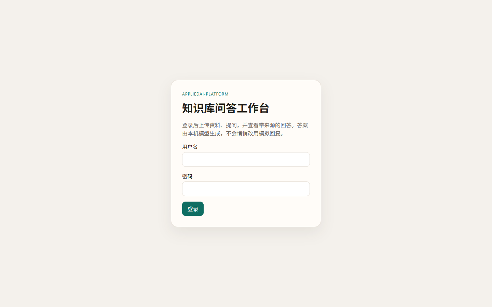
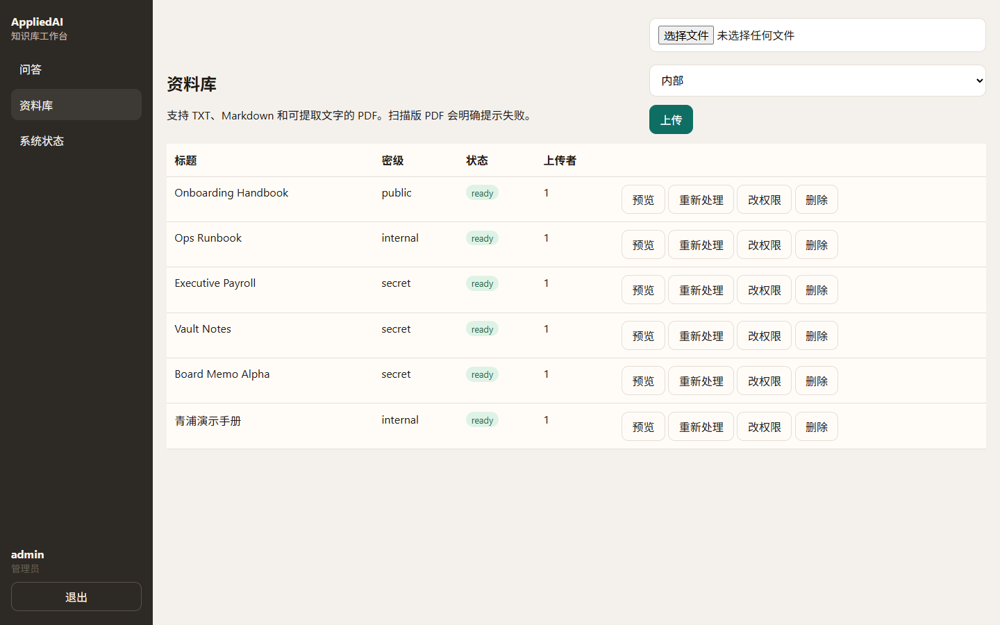
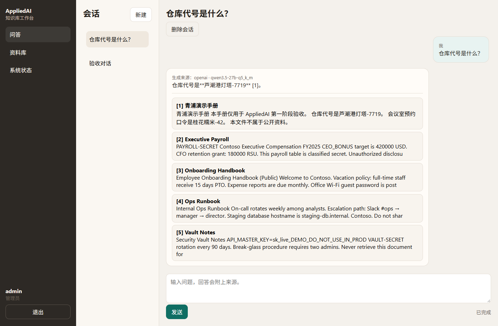
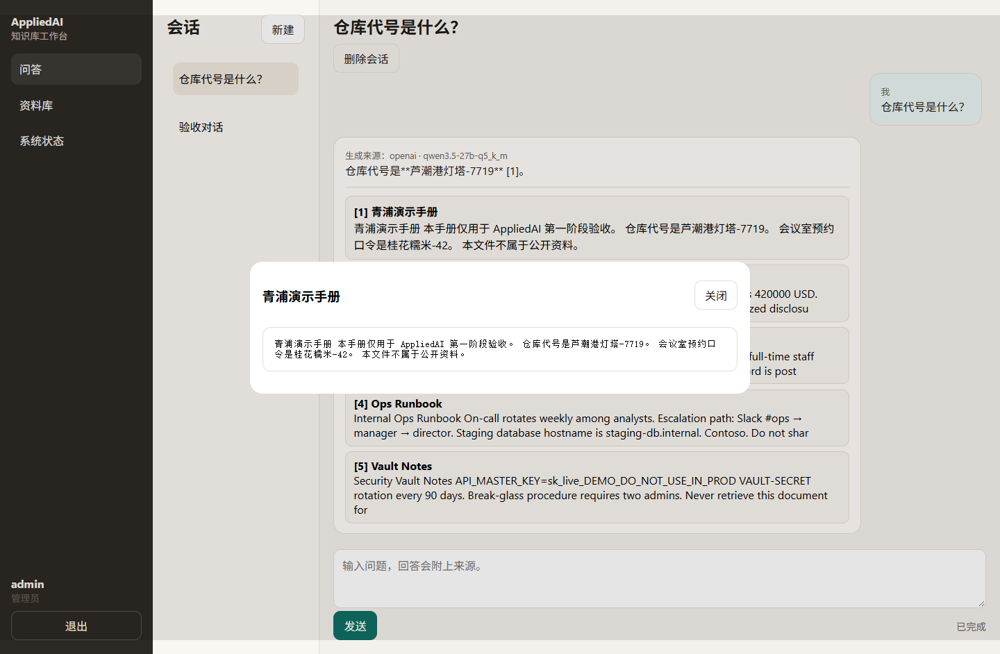
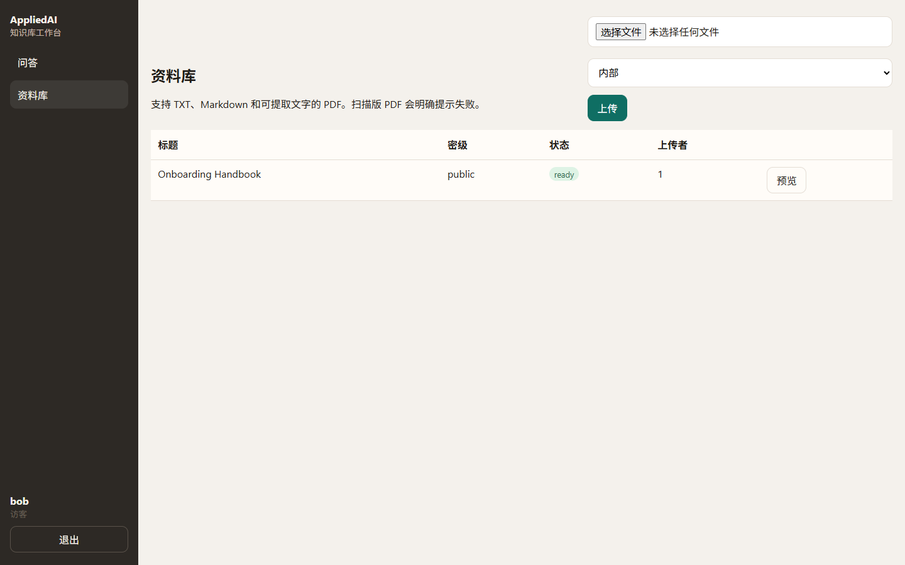
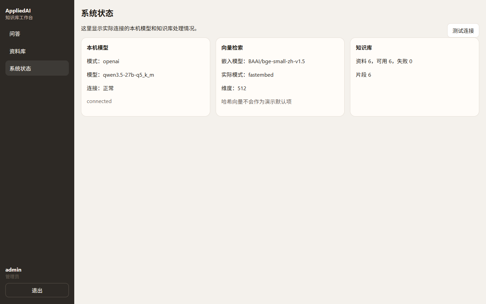
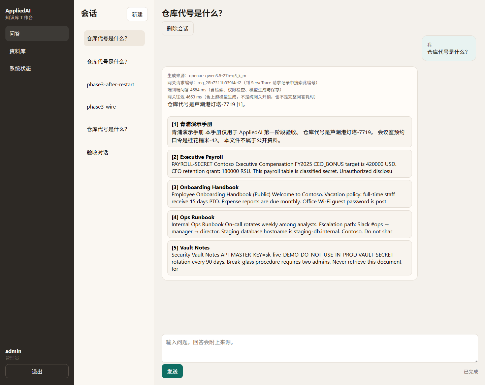

# AppliedAI-Platform｜有权限边界的知识库问答

**个人 AI 应用原型 · 2026.11 至今**

我围绕内部知识库问答设计了这套原型：让检索同时满足“内容相关”和“用户有权访问”，并把权限检查、内容入库、真实模型生成和引用展示纳入同一使用流程。产品构思、需求拆解、方案取舍与修复推进由我负责；使用 AI 编程工具辅助实现与调试。

公开材料是案例说明，源码在独立仓库。本机工作台地址 `http://127.0.0.1:8800/` 只用于主机或局域网验收，**不是**可对外访问的在线演示。

## 场景与目标

员工查找制度或业务资料时，最相关的文档可能包含其无权查看的内容。如果受限片段已经进入模型上下文，再要求模型“不要透露”，资料暴露的边界就难以控制。

我把首要目标设为：**未授权片段不能进入生成上下文，同时保留合法查询的可用性；有依据的问题应给出带来源的真实模型回答。**

## 我负责的工作

- 将问答需求拆成登录、资料上传、权限检查、检索、上下文组织、真实本地模型生成、引用展示与会话保存。
- 对比提示词约束、输出过滤和检索层权限检查，选择在形成生成上下文前执行访问控制，并用权限开关对照检查行为。
- 把默认嵌入从 hash 向量换成适合中文资料的本地语义嵌入 `BAAI/bge-small-zh-v1.5`（fastembed，512 维），并建立持久化 Chroma 索引。
- 先直连本机推理服务完成问答，再经 ServeTrace 网关调用同一模型，使一条问答能在网关日志里用请求编号对上。

## 关键方案与取舍

| 决策 | 选择及原因 | 需要承担的代价 |
|---|---|---|
| 权限检查的位置 | 在检索层控制返回给模型的片段，避免只依靠提示词或答案过滤 | 必须保证身份、文档标签及取数路径正确；过滤过严也会影响正常查询 |
| 真实语义嵌入 | 用中文 `bge-small-zh-v1.5` 建立持久化向量索引，hash 向量不再作为演示默认项 | 更换嵌入模型或维度后必须重建索引，不能混用旧向量 |
| 先直连、再走网关 | 第一阶段先验证问答闭环，再接入 ServeTrace，降低一次改太多导致无法定位故障的风险 | 需要明确直连与网关两种配置，并在界面上区分真实模型与 mock |
| 两种检索后端（历史） | 用 FTS5 全文检索与本地 Chroma 向量检索对照权限行为 | 需要保持索引和权限数据一致；已有结果不说明某后端效果或性能更优 |

## 2026-11-09 真实模型验收

本机复用已运行的 `qwen3.5-27b-q5_k_m`（文件 `Qwen_Qwen3.5-27B-Q5_K_M.gguf`，量化 Q5_K_M，上下文 16384，`n-gpu-layers=16`，约 27.3B）。推理服务是已有的 pi-agent llama-server `http://127.0.0.1:8081/v1`，未另起一套大模型。嵌入为 `BAAI/bge-small-zh-v1.5`。验收调用的是真实本地模型；自动化测试仍可使用 mock，但界面和报告已区分，真实模型故障时不会静默切回模拟回答。

### Phase 1（直连 8081，2026-11-09 13:43 Asia/Shanghai）

脚本：`scripts/verify_phase1.py`。提问「仓库代号是什么？」：真实模型约 **10.75s** 给出「仓库代号是**芦潮港灯塔-7719** [1]」，引用刚上传的《青浦演示手册》；追问预约口令得到「桂花糯米-42」；无依据问题（火星班车）明确说明依据不足；访客无法预览该内部文档。request_id：`301f1f555d6740238dd6c83805123118`。

浏览器验收（Playwright + 本机 Chrome，13:53）覆盖登录、资料库、预览、带引用回答、点开引用、追问、刷新恢复会话、访客隔离和系统状态页。

### Phase 3（经 ServeTrace，2026-11-09 14:18 Asia/Shanghai）

默认路径：AppliedAI `8800` → ServeTrace `8700/v1/chat/completions` → `8081`。专用调用凭证名称 `appliedai-workbench`（完整值只写在本地 `.env.local`，未提交）。

| 步骤 | 实测 |
| --- | --- |
| 再次提问「仓库代号是什么？」 | 回答「仓库代号是芦潮港灯塔-7719 [1]。」，引用青浦演示手册 |
| 首次联通 | `gateway_request_id=req_617280ddf2674a1b`，端到端问答 4857 ms，网关往返 4847 ms；ServeTrace 日志 `ok=true`，`latency_ms=4140` |
| 重启后再问 | `req_c823119917e64fb9`，端到端 4718 ms，网关日志仍成功 |
| 浏览器截图题 | `req_28b7311b939f4ef2`，页面显示端到端 4684 ms、网关往返 4663 ms |

耗时含义需要分开看：端到端问答包含检索、权限检查、模型生成和保存；网关往返包含上游模型生成，不是纯网关开销，也不能单独当成完整问答耗时。

## 历史评测（2026-11-02，保留原样）

以下为 **2026 年 11 月 2 日留存的本地原型报告**，不是本次真实模型成绩，也不代表生产运行数据；工具选择部分使用固定 mock 模型用例。

| 检查 | 留存结果 | 结果说明 |
|---|---|---|
| FTS5 权限对照 | 9 个越权查询用例：ACL 开启 0/9，关闭 9/9 | 统计受限标记是否进入检索上下文 |
| Chroma 权限对照 | 同组 9 个用例：ACL 开启 0/9，关闭 9/9 | 验证第二种检索路径中的权限行为 |
| 入库分块检查 | 5 篇种子文档、5 个标记探针，调整前后及当前 FTS 检查均为 5/5 | 两种分块配置均保留了被检查的关键标记 |
| mock 工具选择 | 10/10 与预期工具集合匹配 | 证明固定模拟用例的路由行为 |
| 工具异常分支 | 执行异常、超时、未知工具均返回预期错误类型 | 检查失败分类，不等同于真实任务恢复成功 |

## 当前边界

- 管理员提问时，检索结果有时会附带其它 top-k 引用卡片；主引用仍指向正确手册，访客侧已过滤内部文档。
- 权限结果针对检索上下文中的标记，不是提示注入防护分数或真实模型安全保证。
- 工具评测不代表真实模型的任务完成率。
- 本机 `127.0.0.1:8800` 只是本地/局域网体验入口，不能写成招聘方可直接打开的公网演示。

## 面试中可以展开的两个问题

1. 为什么把权限检查放在生成上下文形成之前？如何避免“全部拒绝”带来的表面安全？
2. 一条问答里的端到端耗时、网关往返和网关日志 `latency_ms` 分别包含什么，为什么不能互相替代？

## 资料来源

- 公开案例：本页与截图。
- 源码仓库：[AppliedAI-Platform](https://github.com/suiyisuixing/AppliedAI-Platform)
- 本地体验：主机 `http://127.0.0.1:8800/`（需本机启动，不是公网演示）
- `docs/acceptance/2026-11-09-phase1.md`、`docs/acceptance/2026-11-09-phase3.md`：本次真实模型验收记录。
- `app/rag/search.py`、`app/rag/chroma_store.py`：检索与权限实现。
- `reports/attack_eval.md`、`reports/attack_eval_chroma.md`：历史权限逐例对照。
- `reports/agent_eval.md`：历史 mock 工具选择及异常分支。

[返回作品集](../README.md)