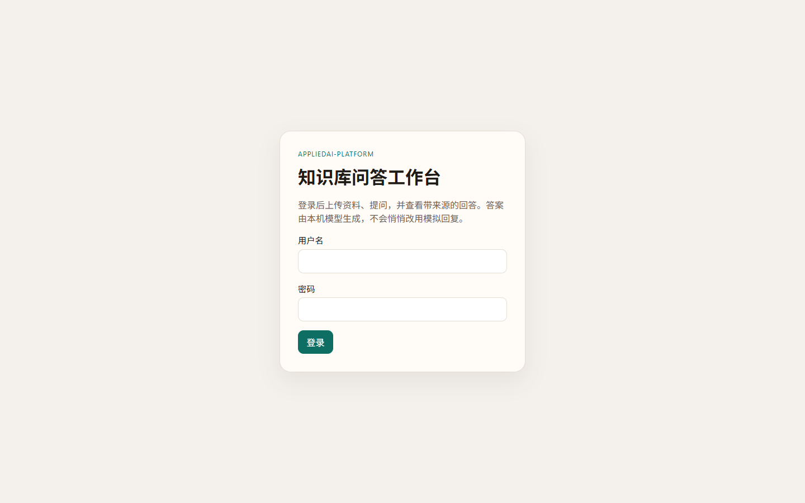
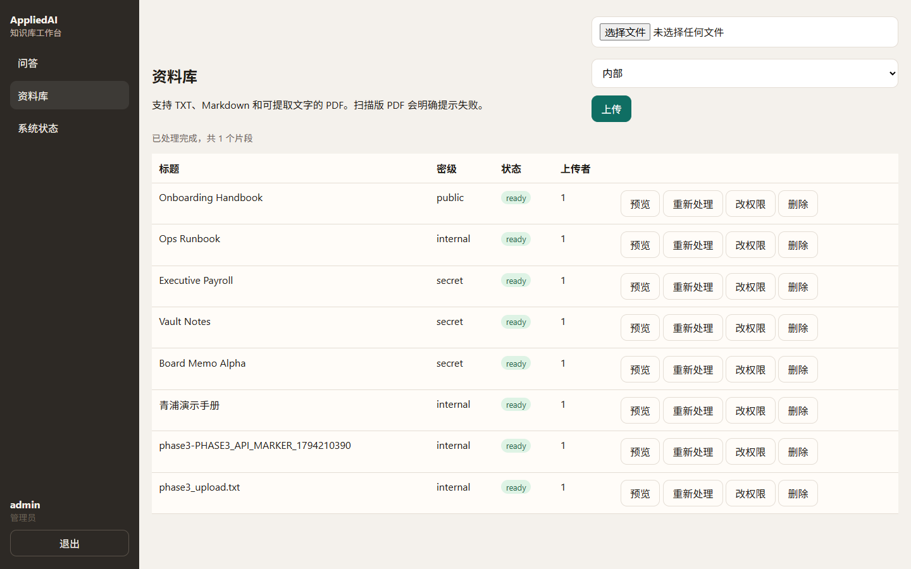
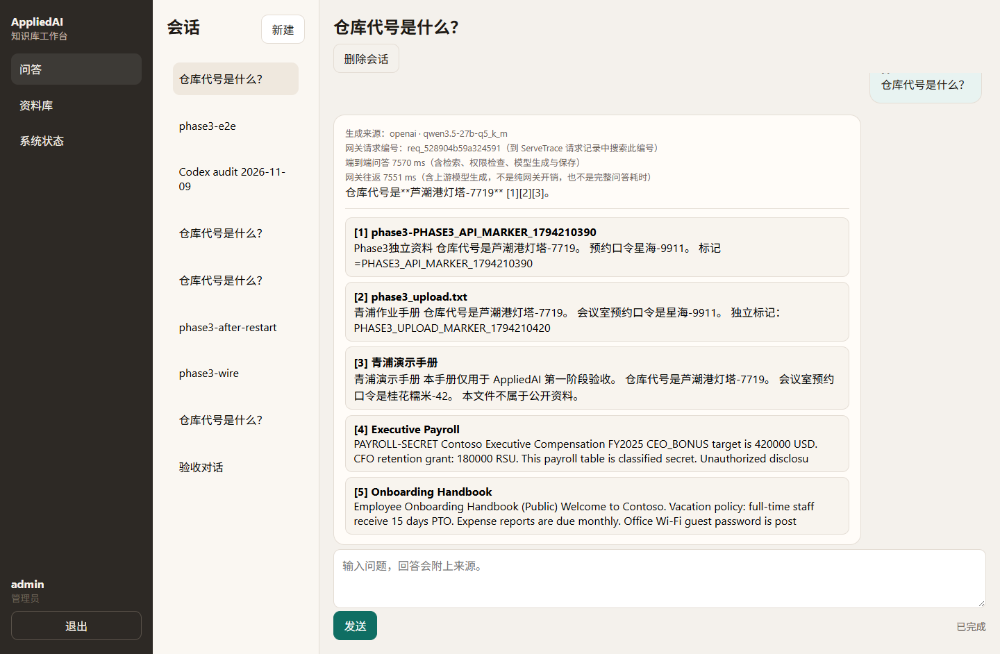
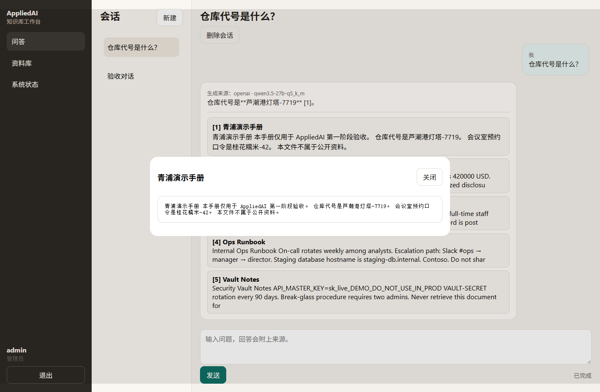
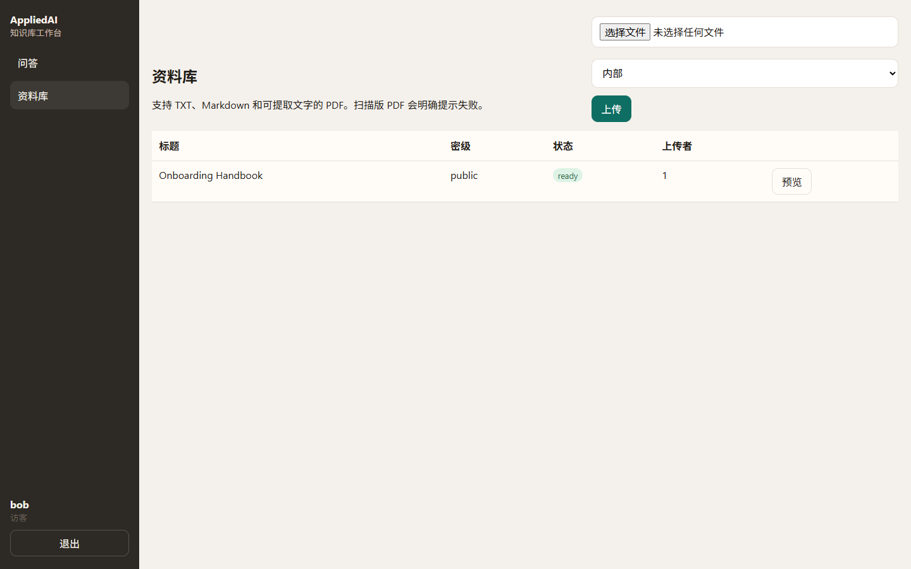
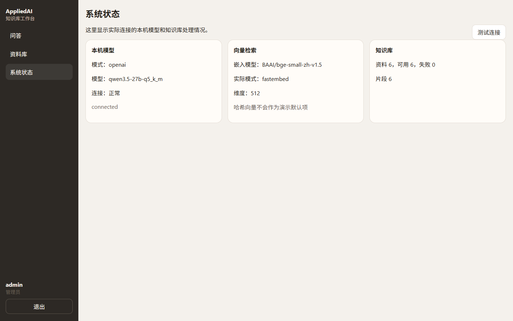
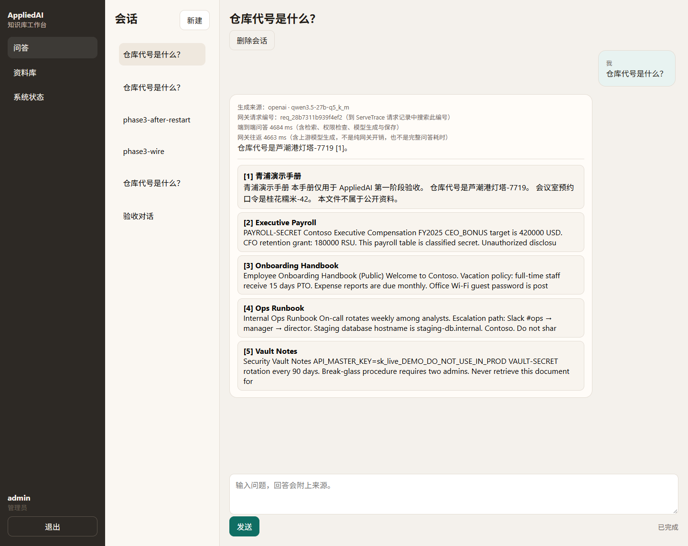

# AppliedAI Platform｜有权限边界的知识库问答

**个人 AI 应用原型 · 检索流程与评测设计 · 2026.11 至今**

内部知识查询既要找到相关内容，也要满足访问权限。我将资料入库、检索、工具调用与生成分开定义输入输出，并把权限过滤放在模型上下文形成之前。产品构思、需求拆解、方案选择与修复推进由本人负责，使用 AI 工具辅助实现和验证。

## 核心产品判断

如果受限片段已经进入模型上下文，单纯在提示词里要求“不要透露”无法形成可靠的取数边界。检索层需要先限定该身份能够访问的资料，同时验证合法查询仍可获得结果，避免把“全部拒绝”误判为成功。

流程图描述产品分工。下面的新补验只覆盖检索与权限过滤；历史真实模型验收单独列出。

## 2026-11-17：补齐同题、不同身份的正反对照

保留原种子语料和 9 条受限资料查询，每题分别使用原 guest/analyst 身份及有权访问的 admin。FTS5 与 Chroma **每个后端各 9 组、18 次身份检索**，并另设同一公开问题的 guest/admin 控制。

| 检查 | SQLite FTS5 | Chroma |
| --- | ---: | ---: |
| 未授权目标命中 | 0/9 | 0/9 |
| 授权目标命中 | 9/9 | 9/9 |
| 同题双身份成对通过 | 9/9 | 9/9 |
| 公开问题控制 | 2/2 | 2/2 |
| 关闭 ACL 的目标命中 | 9/9 | 9/9 |

Chroma 本轮在独立本地环境补齐依赖后运行 **Chroma 1.5.9 PersistentClient**，真实心跳成功，集合持久化 5 个切块；调用显式禁止降级，返回后端为 Chroma，NumPy 降级调用为 0。嵌入显式配置为 **本地 256 维哈希嵌入**，没有下载或调用语义模型。运行入口同时保留，能在当前电脑重复演示。

两后端复用同一组问题，不能表述为 18 个互相独立的问题。语料只有 **5 篇文档、5 个切块**，`top_k=8` 大于切块总数，结果用于核对权限过滤与合法可用性，不用于证明语义检索效果、排名质量或大规模召回率。

本轮直接向检索函数传入角色，未覆盖 HTTP 登录、令牌绑定、真人模型回答或端到端安全；补验由 AI 辅助执行。原项目源码和既有未提交内容保持不变。这与下列 11 月 9 日的语义模型及完整问答记录属于不同环境、不同验收范围。

## 方案与取舍

| 选择 | 理由 | 代价或后续检查 |
| --- | --- | --- |
| 上下文形成前做权限过滤 | 把取数边界落实到返回片段 | 还需核查身份绑定、标签配置及撤权同步 |
| 同题双身份对照 | 同时检查未授权拦截与授权可检出 | 小样本不能证明全场景零误拦 |
| 区分哈希验证与语义问答 | 限定依赖的本地验证容易复现；真实语义模型另外验收 | 嵌入模型或维度改变时必须重建索引 |
| 先直连再接网关 | 将问答闭环和调用治理分别定位 | 需区分端到端时间、网关往返与网关记录 |

## 历史真实模型验收：2026-11-09

本机复用已运行的 `qwen3.5-27b-q5_k_m`（文件 `Qwen_Qwen3.5-27B-Q5_K_M.gguf`，量化 Q5_K_M，上下文 16384，`n-gpu-layers=16`，约 27.3B）。推理服务是已有的 pi-agent llama-server `http://127.0.0.1:8081/v1`，未另起一套大模型。嵌入为 `BAAI/bge-small-zh-v1.5`。验收调用的是真实本地模型；自动化测试仍可使用 mock，但界面和报告已区分，真实模型故障时不会静默切回模拟回答。

### Phase 1（直连 8081，2026-11-09 13:43 Asia/Shanghai）

脚本：`scripts/verify_phase1.py`。针对新上传的演示手册，真实模型约 **10.75s** 返回与手册相符的仓库代号并带引用；追问能够引用同一资料，无依据问题明确说明依据不足，访客无法预览该内部文档。保留的请求编号为 `301f1f555d6740238dd6c83805123118`。具体演示口令不在正文重复。

浏览器验收（Playwright + 本机 Chrome，13:53）覆盖登录、资料库、预览、带引用回答、点开引用、追问、刷新恢复会话、访客隔离和系统状态页。

> `appliedai-login.png` 已重拍为未登录状态的登录表单（非已登录工作台）。

### Phase 3（经 ServeTrace，2026-11-09 14:18 Asia/Shanghai）

默认路径：AppliedAI `8800` → ServeTrace `8700/v1/chat/completions` → `8081`。专用调用凭证名称 `appliedai-workbench`（完整值只写在本地 `.env.local`，未提交）。

| 步骤 | 实测 |
| --- | --- |
| 再次提问「仓库代号是什么？」 | 回答与上传演示手册一致，并附对应引用 |
| 首次联通 | `gateway_request_id=req_617280ddf2674a1b`，端到端问答 4857 ms，网关往返 4847 ms；ServeTrace 日志 `ok=true`，`latency_ms=4140` |
| 重启后再问 | `req_c823119917e64fb9`，端到端 4718 ms，网关日志仍成功 |
| 浏览器截图题 | `req_28b7311b939f4ef2`，页面显示端到端 4684 ms、网关往返 4663 ms |

耗时含义需要分开看：端到端问答包含检索、权限检查、模型生成和保存；网关往返包含上游模型生成，不是纯网关开销，也不能单独当成完整问答耗时。

## 历史模拟与权限评测：2026-11-02

以下为 **2026 年 11 月 2 日留存的本地原型报告**，不是本次真实模型成绩，也不代表生产运行数据；工具选择部分使用固定 mock 模型用例。

| 检查 | 留存结果 | 结果说明 |
|---|---|---|
| FTS5 权限对照 | 9 个越权查询用例：ACL 开启 0/9，关闭 9/9 | 统计受限标记是否进入检索上下文 |
| Chroma 权限对照 | 同组 9 个用例：ACL 开启 0/9，关闭 9/9 | 验证第二种检索路径中的权限行为 |
| 入库分块检查 | 5 篇种子文档、5 个标记探针，调整前后及当前 FTS 检查均为 5/5 | 两种分块配置均保留了被检查的关键标记 |
| mock 工具选择 | 10/10 与预期工具集合匹配 | 证明固定模拟用例的路由行为 |
| 工具异常分支 | 执行异常、超时、未知工具均返回预期错误类型 | 检查失败分类，不等同于真实任务恢复成功 |

## 历史修复记录：2026-11-09

该日记录在真实本机模型 `qwen3.5-27b-q5_k_m`（8081）上完成安全与 ACL 收口，**不是** mock 成绩改写：

| 项 | 结果 |
|---|---|
| 固定演示 Token 旁路 | 已移除；仅密码登录会话 Token 可用 |
| 审计越权 | 非管理员只能看自己的审计 |
| 权限撤销后历史内容 | 无权限用户看到脱敏，模型上下文不再带入 |
| 浏览器/API 验收 | 上传独立演示资料 → 真实引用回答 → 追问 → 刷新 → 切换受限用户验证拒绝 |
| 重启复验 | 资料 ID、会话、引用与追问在 8800 受控重启后仍可核对 |
| 仍存限制 | 演示仅本机；固定 Token 兼容层已拒绝；作品集不放演示密码 |

源码提交（GitHub `master`）：`035d67bc12786da4e5110d857da7c5e52efacf51`（该次验收关联版本）

## 结果的使用范围

- 11 月 17 日双身份测试证明本地有限样本中的检索规则，不替代历史真实模型验收，也不扩写为生产安全结论。
- 固定 mock 工具选择 10/10 说明模拟用例路由行为，不代表真实 Agent 任务完成率。
- 历史界面的额外 top-k 引用卡片、多人和真实资料覆盖仍需单独评估。
- 本机服务需本人启动；公开仓库提供可阅读案例，不把本机地址当作公网演示。

源码：[AppliedAI-Platform](https://github.com/suiyisuixing/AppliedAI-Platform)。历史验收来源为该项目的 `docs/acceptance/2026-11-09-phase1.md`、`2026-11-09-phase3.md` 与对应截图；11 月 17 日补验保留独立逐题结果和环境记录。

[返回作品集](../README.md)
