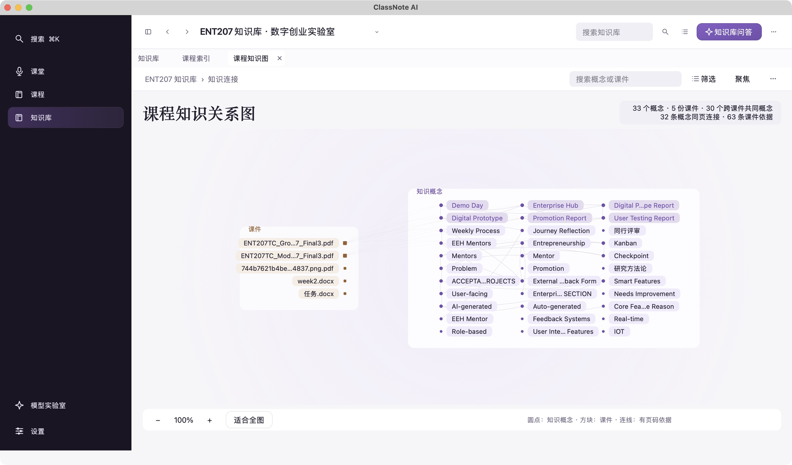
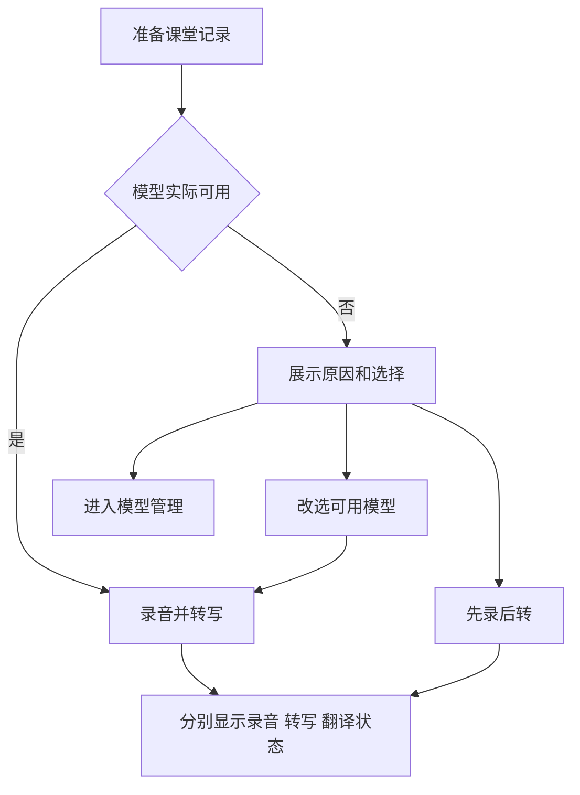

# ClassNote AI｜把课堂记录与课后整理放进同一工作台

**个人项目 · 产品设计与原型迭代 · 2026.05 至今**

ClassNote AI 面向大学生双语课堂记录与课后整理，覆盖录音、转写、翻译、笔记、课件和课程知识库。本人负责需求拆解、流程设计、方案选择与修复推进，使用 AI 工具辅助编码和调试。

## 场景与任务

课堂上要持续记录，课后要回到具体课程查找资料、整理笔记。只把录音、字幕和文件放在不同工具里，用户难以确认记录是否完整，也难以接续后续整理。因此将课堂记录和资料导航组织在一个 macOS 工作台中，并优先保留本机音频与课程资料的处理路径。

2026-11-17 已安装 Build 1050 的真实 ENT207 课程资料知识图，包含 5 份资料。截图展示资料组织与导航；不代表课堂转写、翻译质量，也不是下述 76.8 分钟历史续录的截图。

## 一次课堂故障中的产品判断

历史课堂中，音频持续保存，但字幕和翻译未出现。排查发现所选 Small 转写模型尚未安装。只显示“没有文字”，用户无法判断麦克风是否故障，也不知道课堂内容是否仍被保留。

处理优先级是先确认并保全音频，再处理转写依赖。设计中将“录音保存”“转写”“翻译”分开呈现，提供明确的处理分支。

| 方案 | 用户获得什么 | 需要接受的代价 |
| --- | --- | --- |
| 开课前检查模型实际可用性 | 提前发现缺失、损坏或无法加载的模型 | 增加一次检查，文件存在不等于可加载 |
| 改选可用的 Base 模型 | 在当前模型不可用时获得替代路径 | 需用户确认，模型能力与资源消耗会改变 |
| 先录后转 | 暂时无法转写时继续保存课堂音频 | 当堂没有字幕，课后仍需补转写 |
| 分阶段状态与恢复入口 | 清楚知道哪一步失败、哪些内容仍保留 | 需维护各阶段状态和相应提示 |

流程图为产品分支说明，不是一次测试的运行轨迹。

## 迭代与验证

- 历史修复找回约 **76.8 分钟已保存续录**，对应 4,609.141333 秒，并在 Build 1005 安装版验证可重开课程。
- 已清理片段和休眠期间未录制内容仍缺失，课程保留部分完成状态及缺口。
- 推进竖版课件布局、翻页与知识库导航优化；各项修复保留对应记录，不拼接为同一次课堂测试。

该恢复量说明保存内容的可访问性，不能解释为转写准确率、学习效率或用户增长。多人长期使用效果尚无可引用的完整测量。

## 实现与交付

macOS 桌面应用，Python / PySide6；faster-whisper / CTranslate2 本地推理。项目交付包括原型、PRD、方案比较、问题清单和修复验收记录。

面试可展开：为什么先区分音频是否保留；先录后转解决了什么、牺牲了什么；如何判断一个“已安装”的模型真的可用。

[返回作品集](../README.md)
