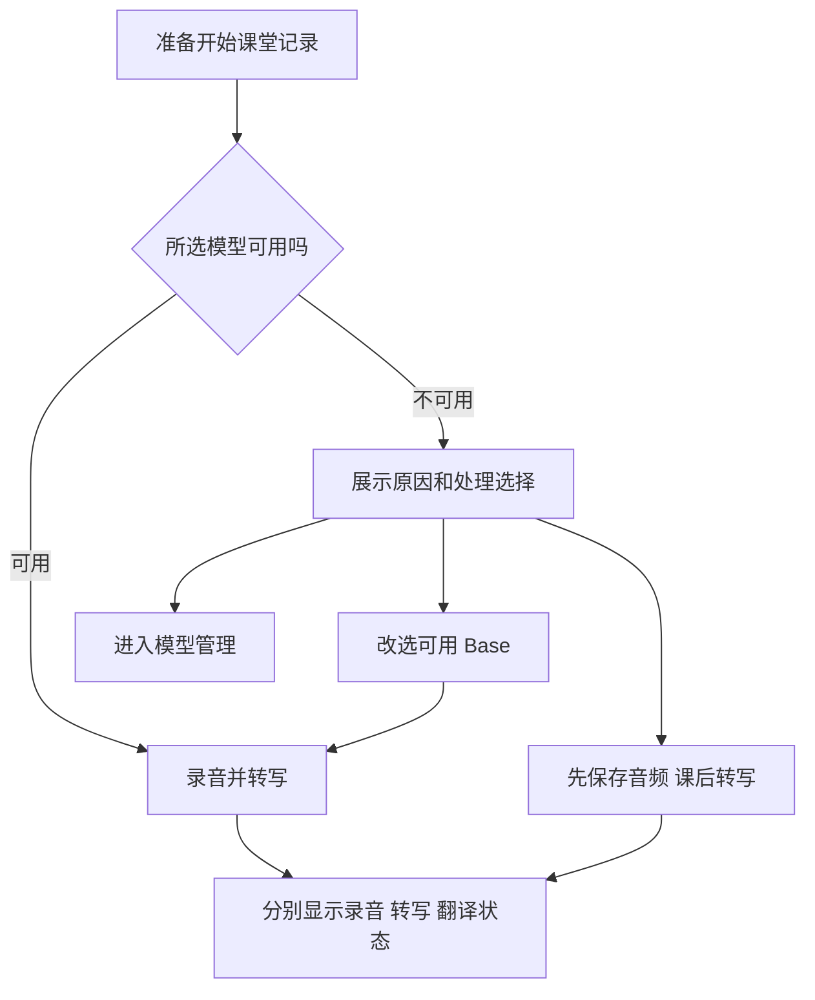
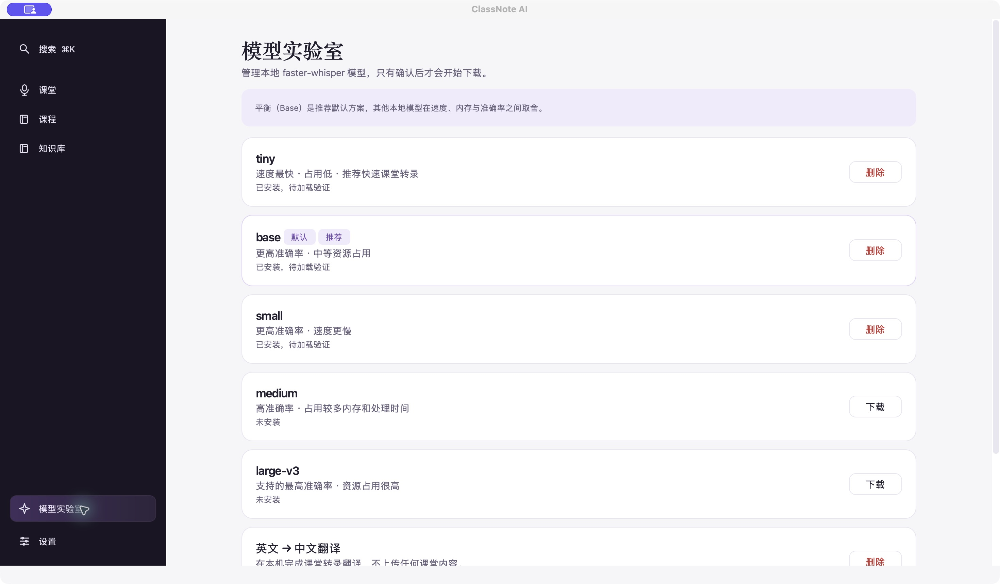

# ClassNote AI：课堂没有字幕时，先让用户知道内容是否还在

[返回作品集](../README.md)

## 产品与我的工作

ClassNote AI 是面向大学生双语课堂记录与课后整理的本地桌面应用，覆盖录音、转写、翻译、笔记、课件和课程知识库。

我主导产品构思、需求拆解、流程设计、原型制作与问题修复，使用 AI 工具辅助编码和调试。这个案例重点展示一次真实课堂故障中的产品判断。

## 使用问题

历史课堂记录中，音频持续写入，但字幕和翻译没有出现。排查发现所选 Small 转写模型尚未安装。界面上的“没有文字”容易被误解为麦克风坏了，也无法让用户确认已经录下的内容能否保留。

我的优先级是先明确音频保存状态，再处理转写依赖，让用户可以选择当堂继续转写，或先保存音频、课后补转。

## 方案选择

| 选择 | 解决什么 | 需要接受的代价 |
| --- | --- | --- |
| 开课前检查实际模型可用性 | 提前发现缺失、损坏或不能加载的模型 | 增加一次检查；文件存在不能代替实际可加载 |
| 明确改选可用的 Base 模型 | 在所选模型不可用时提供本地替代 | 用户需要确认选择，模型能力和资源消耗会改变 |
| 先录后转 | 暂时无法转写时继续保存课堂音频 | 当堂没有字幕，课后仍需补转写 |
| 分别呈现录音、转写、翻译状态 | 说明故障影响了哪一步、哪些内容仍在保存 | 需要更清楚的状态文案和恢复入口 |

流程图说明产品分支，不是一次实测运行轨迹。

## 真实界面

2026-11-09 已安装应用的模型管理界面。截图区分“已安装”和“待加载验证”，展示产品状态表达；它不替代历史故障记录，也不证明当前转写质量。

## 历史修复结果

- 已保存续录约 **76.8 分钟**（4,609.141333 秒）完成恢复，安装版可重新打开该课堂。
- 原先已清理的片段及休眠期间未录制的内容仍缺失，课堂以部分完成状态保留缺口。
- 在相关迭代中推进竖版课件布局、翻页和知识库导航优化；这些修复分别发生，不把它们拼成一次测试结果。

这个案例验证了有限恢复与重新打开的结果。朋友端逐项复测、多人长期使用和学习效率提升还没有可引用的完整测量。

## 实现与交付

macOS 原生桌面，Python / PySide6；faster-whisper / CTranslate2 本地推理。交付包括应用原型、PRD、方案比较、问题清单和修复验收记录。

可在面试中解释的两个问题：

1. 为什么优先区分音频是否保留，而不是只提示用户重装模型？
2. 为什么“先录后转”需要明确的用户选择，它解决了什么、又牺牲了什么？

历史依据：私有项目中的 `PRODUCT.md`、`reports/asr-translation-incident/ASR_PREFLIGHT_DESIGN.md`、`FINAL_RESULT.md`，以及模型预检和录音流程相关源码。
