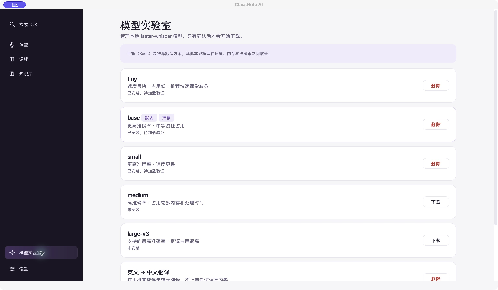

# ClassNote AI · 本地优先的双语课堂工作台

个人项目（2026.05 – 2026.11） · macOS 安装版主力实测交付（另含 Windows 打包配置） · [查看完整全线 PRD](../prds/classnote-ai-prd.md)

上全英文授课专业课时，学生往往需要边看竖版 PDF 课件，边录音、看双语字幕和记笔记。教室网络常有波动，课后复习又要按专业术语找回当时的原声与课件页。ClassNote AI 把课堂采集、本地 `faster-whisper` 转写翻译与课后知识检索整合进单一桌面工作台（主力在 macOS 构建交付 DMG 安装版并完成真实课堂实测与恢复验收，仓库内同时编写了 Windows PyInstaller 打包配置规格 `installer/windows/classnoteai.spec`）。

## 1. 录音还在继续，为什么字幕一直空白？

一次真实课堂自用时，所选的本地转写模型未安装，底层录音虽在继续，字幕区却始终空白，学生无法判断究竟是麦克风没录上还是模型缺失。我据此确立**核心课堂录音保存绝对优先于 AI 转写依赖**的设计原则：

| 环节 | 学生能看到或执行的操作 |
| --- | --- |
| 开始上课前 | 后台预检所选本地模型，严格区分“已安装，待加载验证”与“已验证可用”；缺失时可一键改选已装 Base 模型或进入先录后转。 |
| 课堂录制中 | 音频分片落盘、实时转写、双语翻译拆成三组独立状态提示；转写停滞绝不中断底层录音，学生可随时确认音频正在安全保存。 |
| 课后与恢复 | 重开课程补跑离线转写与翻译；历史课堂中断后经续录恢复流程找回了约 **76.8 分钟**有效音频（461 个分片、0 重复字幕）。 |

## 2. 为什么要把本地模型选择做成“模型实验室”界面？

端侧大模型体积与内存占用差异显著，直接影响轻薄本跟课流畅度。模型实验室列出 `tiny`、`base`（默认推荐）、`small`、`medium` 和 `large-v3` 五档，用非技术语言向学生直观说明速度、内存和识别准确率的取舍，且所有权重仅在学生显式确认后才下载，课堂音频与笔记默认零上传。

结合自用与同学试用反馈，我持续迭代了竖版 PDF 课件翻页、知识库 `⌘K` 导航、完整 PRD 与用户排障 FAQ，并完成 macOS 安装版（DMG）交付与课程重开验证。

[下一案例 · AppliedAI Platform & ServeTrace](appliedai-platform.md) · [返回目录](README.md)
