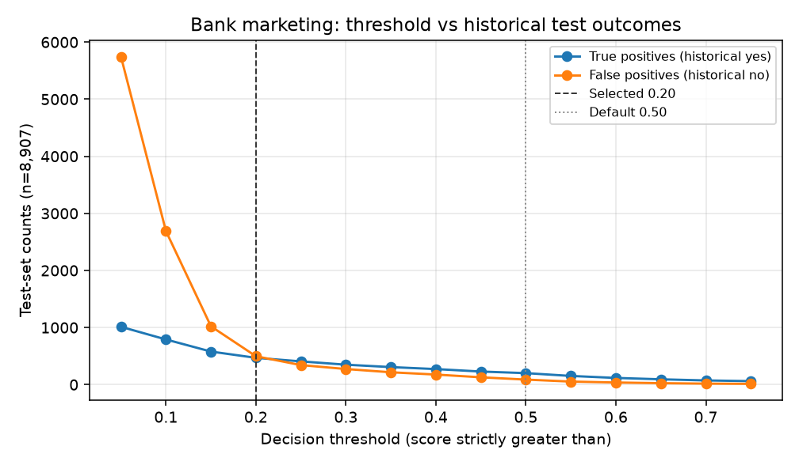

# 数据分析与 SQL · 银行外呼与 Film DB

## 银行营销：明天该给哪些人打电话？

外呼名单取决于两件事：多打一通的成本，以及团队一天最多能拨多少通。使用 UCI Bank Marketing 的 45,211 条样本建模时，我先去掉了外呼结束后才知道的通话时长 `duration`。预处理与 PySpark 逻辑回归均在训练集上拟合，以下比较来自 8,907 条独立测试样本。

**按成本选阈值。** 将阈值从 0.50 降到 0.20 后，多选出 677 人，其中 268 人在历史记录中为正例、409 人为误报，新增人群的历史命中率为 39.6%。下表按“历史命中人数 × 假设单客价值 − 入选人数 × 单次外呼成本”估算净值。

| 单次外呼成本 / 单客价值 | 阈值 0.20 净值 | 阈值 0.50 净值 | 两个阈值中净值较高者 |
| --- | ---: | ---: | --- |
| 20 / 200 | 74,480 | 34,420 | 0.20 |
| 50 / 200 | 45,500 | 25,750 | 0.20 |
| 100 / 200 | −2,800 | 11,300 | 0.50 |

**按通数选 Top-K。** 如果今天只有 200 通预算，就按模型得分取前 200 人。可以直接读出这批人里有多少历史正例，以及增加预算后命中率如何变化。

| 名单容量 | 历史正例数 | 历史命中率 |
| ---: | ---: | ---: |
| 100 | 81 | 81.0% |
| 200 | 148 | 74.0% |
| 500 | 296 | 59.2% |
| 966（对应阈值 0.20） | 469 | 48.6% |

成本和单客价值均为敏感性分析的假设。要估计电话本身带来的增量转化，需要设置未外呼的随机对照组。

## Film DB：电影评分覆盖率的分母是什么？

4 张归档源表共有 38,105 行。经 PostgreSQL 暂存、类型与日期清洗、外键检查，38,006 行进入正式表，99 行按原因隔离，保留原始记录供回查。

| 正式表 | 入库行数 | 数据质量处理 |
| --- | ---: | --- |
| films | 4,949 | 作为统计电影覆盖率的总体。 |
| people | 8,397 | 兼容 ISO 和 Excel 序列日期，恢复 83 个出生年与 1 个死亡年。 |
| roles | 19,715 | 隔离 76 条找不到影片的角色关联。 |
| reviews | 4,945 | 隔离 23 条异常评分，其中 19 条缺影片 ID、4 条外键无效。 |

4,945 条有效评分只覆盖 **952 部**不同的电影。因此电影评分覆盖率是 **952 ÷ 4,949 = 19.2%**。同一电影收到多条评分时，计算覆盖率只计一次。项目汇总了 12 条分析 SQL 和 4 张视图。[Film DB 源码](https://github.com/suiyisuixing/film-database-system)

[返回案例目录](README.md) · [四页作品集 PDF](../portfolio/yu-wei-portfolio.pdf)
