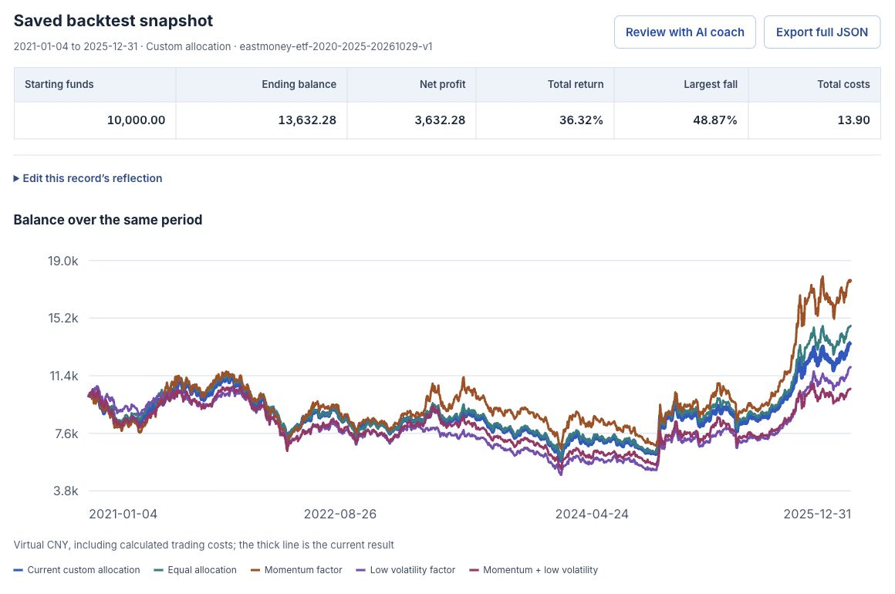

# QuantLab｜把 AI 建议接到可确认的模拟操作

**课程团队项目 · 产品功能迭代 · 2026.10 至今**

QuantLab 为投资学习提供历史比较、模拟练习与复盘。本人负责回测、AI 教练等功能修改，并联系校外导师；将市场数据、个人记录、知识库与教练组织为可连续使用的产品流程。

[正式站入口](https://edmund45501.softr.app/?lang=zh)

## 场景与产品选择

学习者需要知道一项模拟方案在历史数据中如何运行，以及结果来自哪些假设。模型能够解释和整理建议，但收益、费用、资金曲线应有可复核的计算来源。因此将模型建议与计算执行分开，并在两者之间保留参数校验和用户确认。

模型解释引擎给出的事实，计算结果不由模型自由生成。用户可以核对方案、修改参数，再决定是否执行。

## 数据与体验一起定义

- 统一 **6 只 ETF、1,416 个共同有效交易日**的历史快照口径；区分复权收益序列与实际收盘价。
- 明确费用、调仓生效时点和最大回撤，支持原计划对照与逐月核查。
- 保存配置、数据与计算版本，支持记录重开、笔记更新与复盘追溯。

2026-11-17 正式站已保存结果区域的实际截图，展示结果标题、表格、资金曲线与图例。该图不用于证明 AI 当次问答，也不是目标用户试用记录。

## 上线与验证

2026-11-15 已发布至 Softr 正式站，并完成保存记录重开、笔记更新、Flash 计划生成及载入后确认步骤的功能验收。另保留 2026-11-12 Pro 与 Flash 正式站问答及引用记录。

功能实现与验收包含 AI 辅助。当前没有可用于简历的独立目标用户样本或增长数据。历史模拟使用虚拟资金，用于课程学习；结果不代表真实投资收益。联系导师这一事实也不等同于已取得导师评审结论。

## 可展开的产品问题

1. 为什么模型生成的方案需要经过参数校验与用户确认？
2. 当历史结果发生变化时，如何追溯数据、配置和计算版本？
3. 为什么区分“方案解释”和“数值计算”，这会怎样影响产品流程？

[返回作品集](../README.md)
