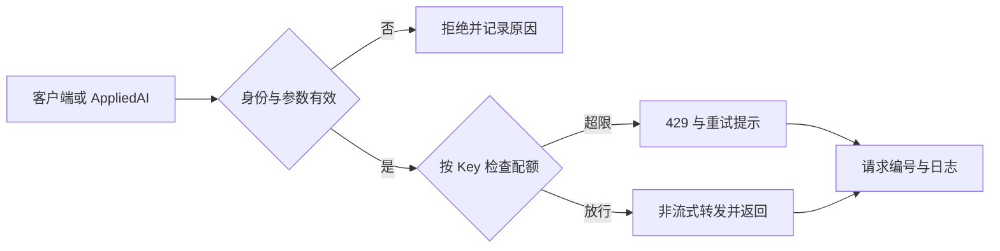
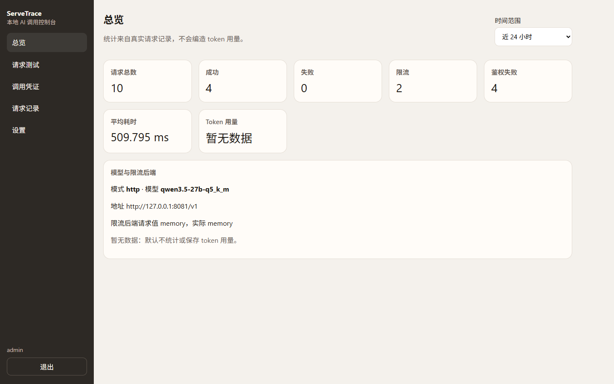
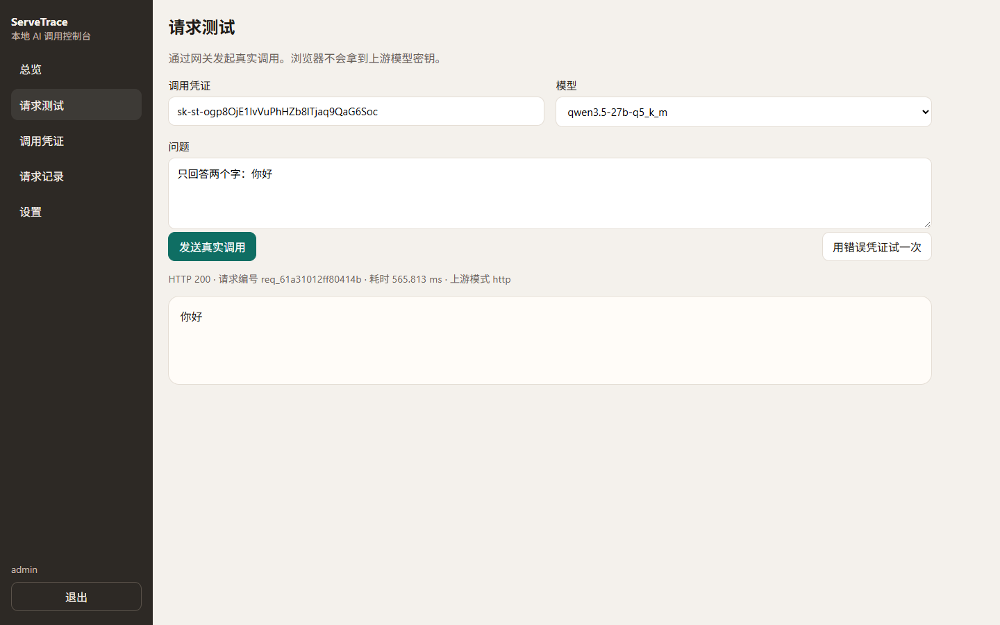
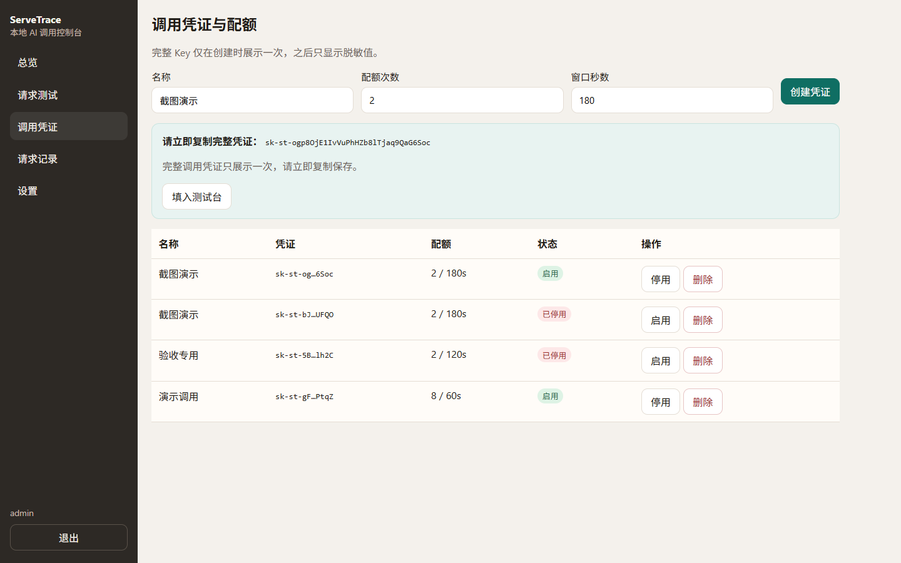
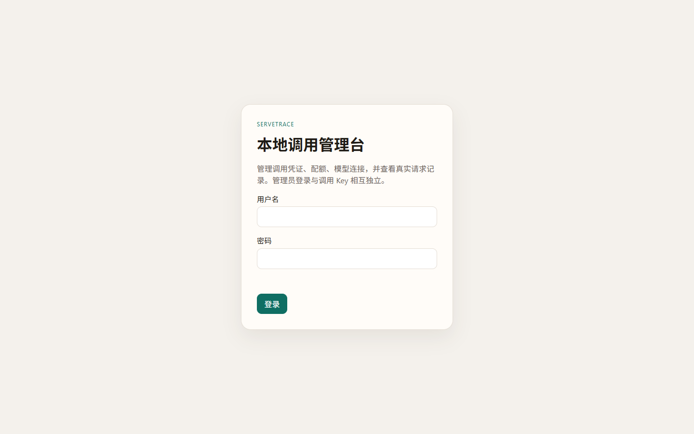
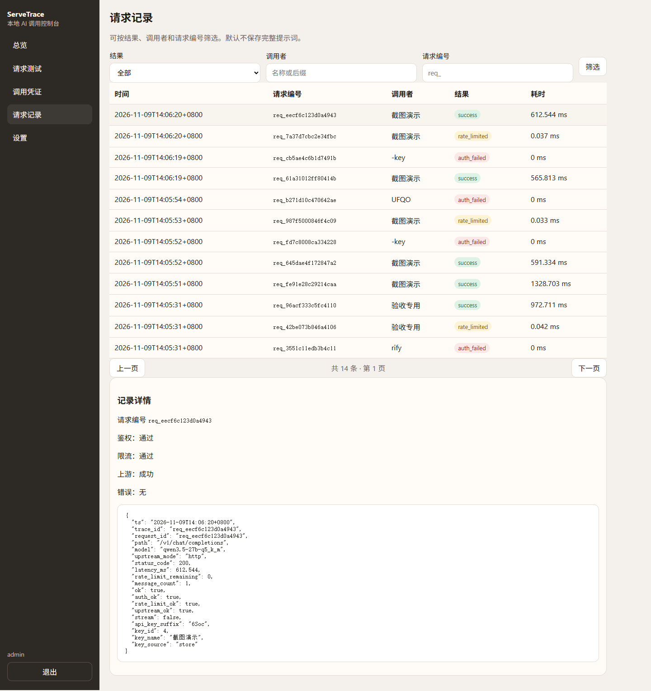
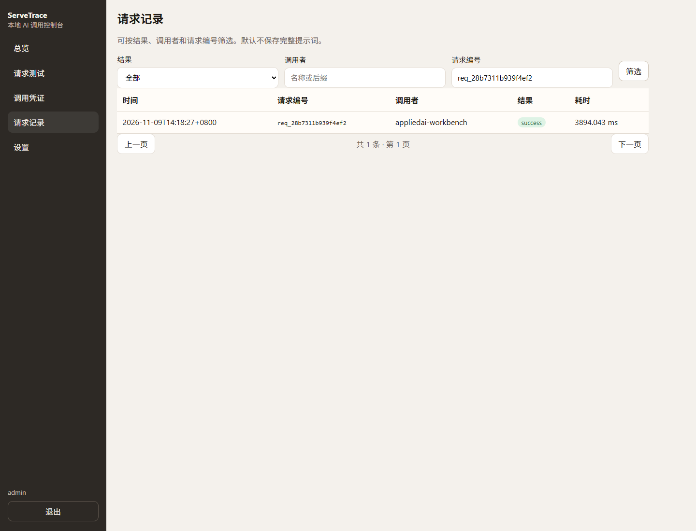
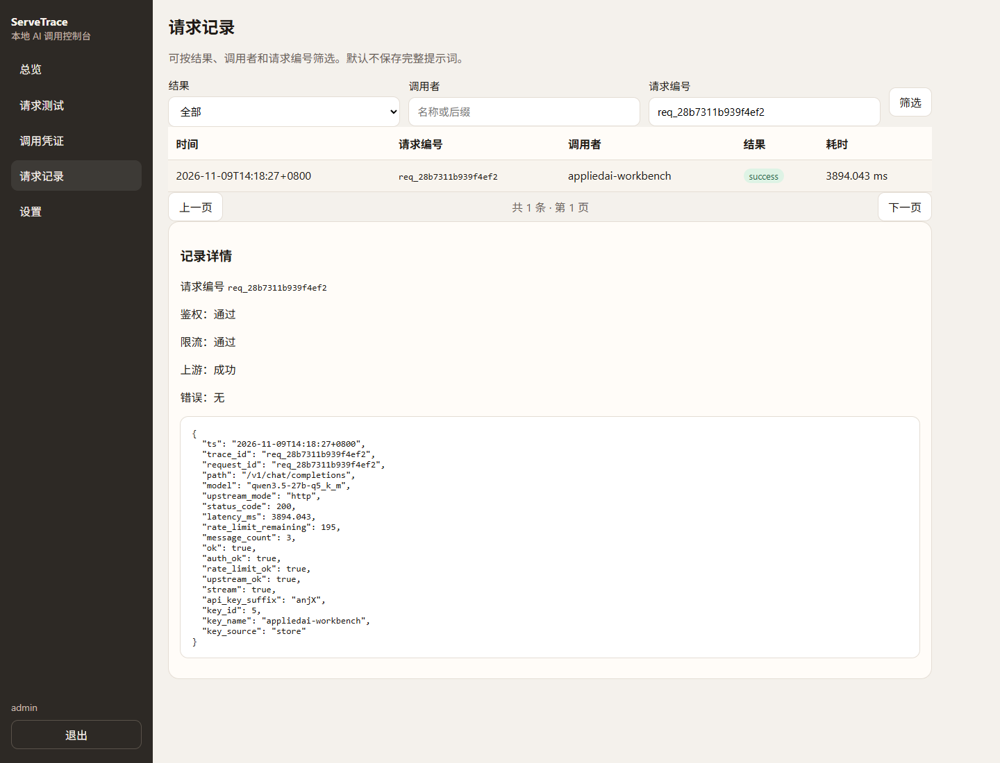

# ServeTrace｜非流式调用中的鉴权、配额与请求定位

**个人调用治理原型 · 技术补充案例 · 2026.11 至今**

围绕多个客户端调用模型服务时的共同问题，设计统一入口：谁能调用，超限后何时重试，以及出现错误后如何找到对应请求。本人负责需求拆解、规则与失败分支设计、修复推进，使用 AI 工具辅助实现和调试。

## 已实现范围与产品规则

当前接口处理 **非流式转发**；`stream=true` 明确返回 400 与 `stream_not_supported`。流式首包、分块传输和中断恢复不属于已实现能力，不能用非流式请求记录推断。

| 调用问题 | 规则与反馈 | 需要注意的范围 |
| --- | --- | --- |
| 谁可以调用 | Bearer Key 鉴权；无效身份拒绝 | 管理权限与调用权限分别检查 |
| 何时可以重试 | 按 Key 配额；超限返回 429 与 Retry-After | 客户端还需退避，重试会增加调用量 |
| 怎样定位失败 | 请求编号关联响应、列表与详情 | 请求记录不等于跨服务分布式追踪 |
| 怎样调用模型 | 非流式请求完整返回后展示结果 | 不声称支持流式响应 |

## 如何区分下列历史记录

保留 2026-11-09 的真实本地模型调用，以及 2026-11-02 使用 mock 上游的协议用例。11 月 9 日不同记录分别出现 Redis 已联通与 Redis 不可用、实际使用 memory 的状态；它们反映不同运行阶段，不能混用“当前”概括。本轮核对的是非流式实现与公开表述，未重新启动模型或 Redis 复验历史环境。

## 历史管理台与真实模型验收：2026-11-09

> 公开截图于 2026-11-09 20:14（Asia/Shanghai）重拍：凭证页无创建横幅完整 Key；测试台输入为掩码占位；请求记录页为日志列表（非登录页）。旧暴露尾号 Key 保持停用，报告不复述完整值。

上游复用已运行的 `qwen3.5-27b-q5_k_m`（Q5_K_M，上下文 16384，`n-gpu-layers=16`）via `http://127.0.0.1:8081/v1`。`UPSTREAM_MODE=http`：上游失败时返回明确错误，不会静默回退 mock。限流后端申请为 redis，本机 Redis（127.0.0.1:6379）已联通：redis_wired=true；健康检查与真实 Key 配额探测可见 X-RateLimit-Backend=redis。

Phase 2 记录见源码仓库 `docs/acceptance/2026-11-09-phase2.md`：

- 单元测试：`35 passed, 1 skipped`（Redis 限流测试在无 Redis 时 skip，为原有行为）。
- 接口验收脚本全部通过，包含真实模型回答「验收通过。」、超限 429 + Retry-After、停用后 403、重启后日志仍在。
- 浏览器截图 01–10 全部通过：总览、测试台真实成功调用、错误凭证、超配额、密钥列表脱敏、记录列表与详情、停用后失败、模型连接状态、重启后记录仍在。
- 完整调用 Key 未写入公开报告；列表只展示脱敏后缀。

## 与 AppliedAI 联通（Phase 3，2026-11-09 14:18 Asia/Shanghai）

AppliedAI 使用专用调用凭证 `appliedai-workbench` 经 ServeTrace 调用同一本地模型。示例：`req_617280ddf2674a1b` 端到端问答 4857 ms，网关往返 4847 ms，网关日志 `latency_ms=4140`、`status_code=200`；重启后该编号仍可查询。浏览器对照题为 `req_28b7311b939f4ef2`（端到端 4684 ms / 网关往返 4663 ms）。

网关日志里的 `latency_ms` 是网关侧统计（鉴权、限流、上游调用），不能把它当成整个问答耗时。

## 历史协议评测：2026-11-02

以下为 **2026 年 11 月 2 日留存的本地报告**；基础网关测试使用 mock 上游，Redis 结果来自本地 Compose 验证。这些不是本次真实模型管理台成绩。

| 检查 | 留存结果 | 结果说明 |
|---|---|---|
| 鉴权拒绝 | 缺失、无效、格式错误 3 个用例均返回 401 | 验证准入错误的返回行为 |
| Memory 限流 | 配额 3 次/60 秒，连续 5 次请求为 3×200、2×429 | 验证单 Key 的放行与拒绝顺序 |
| Redis 限流 | 相同协议得到 3×200、2×429，记录显示使用 Redis 后端 | 核对另一后端下的基本协议行为 |
| 重试提示 | 两种后端的超限响应均带 Retry-After | 样例中返回剩余等待时间 59 秒 |
| 请求追踪 | 成功请求返回请求标识，可查询对应记录 | 记录包含状态、上游模式等请求信息；不使用 mock 耗时推断性能 |

## 同日另一运行阶段的修复记录：2026-11-09

该阶段本机直跑端口 **8700**，上游为真实 `http`→8081，与 Compose 默认 mock/18790 **分开表述**：

| 项 | 结果 |
|---|---|
| Key 生命周期 UI | 创建（完整 Key 仅一次）→ 脱敏列表 → 名称/配额编辑 → 启停 → 删除 |
| Trace 归属 | 按唯一 `key_id`，不再只靠后缀 |
| 失败详情 | 422/上游失败写入可查原因，页面不再只显示「错误：无」 |
| 限流 | memory 窗口：改配额立即 429 + Retry-After；停用 403；删除 401 |
| 重启复验 | Key 配额/停用/删除状态与已知 `request_id` 重启后仍可逐条核对 |
| Redis（ST-6） | **外部阻塞**：本机 Docker 引擎不可用且无 Redis；页面如实显示 memory。解除条件见交付说明 |
| 截图 | 已替换为 2026-11-09 脱敏新图；历史曾暴露的 Key 已在本机停用（报告不复述旧值） |

源码提交（GitHub `main`）：`53929382aa2ca58122fb386b6158c8aeb44f7142`（该次验收关联版本）

## 结果范围与后续问题

- 历史协议与真实调用支持有限范围的鉴权、配额、错误反馈和请求查询，不证明生产吞吐、商业收益或多实例配额一致性。
- memory 模式窗口计数在进程重启后会重置，持久化的 Key 配额配置与窗口计数是不同数据。
- 默认不保存完整提示词；拿不到 token 用量时显示暂无数据。
- 本机端口仅用于本人启动后的演示，公开仓库不提供可直接访问的模型服务。

可以展开的产品问题：什么情况下需要统一调用入口；拒绝和上游出错时哪些信息应交给客户端；为什么网关往返耗时不能当作纯网关开销。

源码：[ServeTrace](https://github.com/suiyisuixing/ServeTrace)。历史真实模型验收见 `docs/acceptance/2026-11-09-phase2.md`；当前非流式约束见接口的 `stream_not_supported` 分支。

[返回作品集](../README.md)
