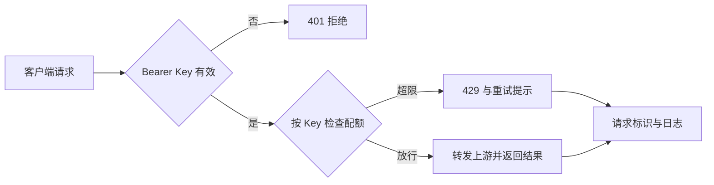

# ServeTrace｜让模型调用可控制、可定位

**个人 AI 调用网关原型 · 2026.11 至今**

我围绕“谁能调用、超限后怎么办、出错后怎样找到请求”设计了一个轻量模型网关，将鉴权、配额控制与请求记录放到同一入口。产品构思、需求拆解、方案取舍与修复推进由我负责；使用 AI 编程工具辅助实现与调试。

## 场景与目标

当多个客户端接入模型服务时，各自处理身份校验、重试和日志，容易出现不同的行为口径。这个个人原型探索一种统一入口：调用者能够明确知道请求是否被接受、何时可以重试，以及如何提供排查所需的请求标识。

目标是让 **放行、拒绝和定位请求** 都有可检查的规则，覆盖正常调用与失败处理。

## 我负责的工作

- 将调用需求拆为身份准入、按 Key 配额、超限重试提示与请求查询，明确正常及失败分支的接口行为。
- 设计内存与 Redis 两种限流配置下相同的验收口径，用连续请求检查放行数量、拒绝结果及重试提示。
- 推进请求标识、结构化日志和查询入口的实现，整理鉴权、限流与追踪样例，便于从客户端现象回查请求记录。

## 关键方案与取舍

| 决策 | 选择及原因 | 需要承担的代价 |
|---|---|---|
| 统一调用入口 | 集中处理 Bearer API Key 鉴权、限流与日志，减少客户端之间的规则差异 | 网关本身增加维护成本；已有通用网关满足需求时应优先复用 |
| 按 Key 滑动窗口限流 | 提供 Memory 与 Redis 后端，按同一配额规则检查行为 | 本地双后端验证不能替代多实例一致性和故障验证 |
| 超限时给出重试提示 | 返回 429 与 Retry-After，让客户端获得明确的等待信息 | 客户端仍需实现退避与重试策略，避免重复请求 |
| 用请求标识定位日志 | X-Request-Id 关联响应与请求级 JSONL 记录，并支持查询 | 请求级记录不能代替跨服务分布式追踪 |

## 已有评测

以下为 **2026 年 11 月 2 日留存的本地报告**；基础网关测试使用 mock 上游，Redis 结果来自本地 Compose 验证。

| 检查 | 留存结果 | 结果说明 |
|---|---|---|
| 鉴权拒绝 | 缺失、无效、格式错误 3 个用例均返回 401 | 验证准入错误的返回行为 |
| Memory 限流 | 配额 3 次/60 秒，连续 5 次请求为 3×200、2×429 | 验证单 Key 的放行与拒绝顺序 |
| Redis 限流 | 相同协议得到 3×200、2×429，记录显示使用 Redis 后端 | 核对另一后端下的基本协议行为 |
| 重试提示 | 两种后端的超限响应均带 Retry-After | 样例中返回剩余等待时间 59 秒 |
| 请求追踪 | 成功请求返回请求标识，可查询对应记录 | 记录包含状态、上游模式等请求信息；不使用 mock 耗时推断性能 |

## 当前边界

已有结果支持本地鉴权、配额和请求查询的有限协议行为，不证明生产吞吐、成本收益或多实例配额一致性。追踪范围限于网关内的请求记录；真实上游故障、流中断、客户端取消与重试策略需要进一步联调。

## 面试中可以展开的两个问题

1. 什么情况下需要自建轻量网关，什么情况下复用已有网关更合适？
2. 当请求被限流或上游出错时，哪些信息应该返回给客户端，哪些应留在服务端用于定位？

## 资料来源

源码与完整报告位于私有项目仓库，可在面试中展示。以下为仓库内相对路径：

- `app/auth.py`、`reports/auth_deny.json`：Bearer 鉴权及拒绝样例。
- `app/rate_limit.py`、`reports/rate_limit.md`、`reports/rate_limit_redis.md`：限流实现和两后端对照。
- `app/api/main.py`、`app/trace.py`、`reports/trace_sample.json`：响应、请求标识与日志查询。
- `scripts/run_gateway_reports.py`：本地报告生成口径。

[返回作品集](../README.md)
