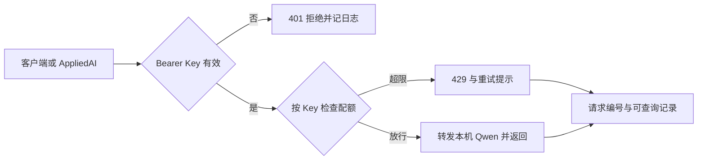
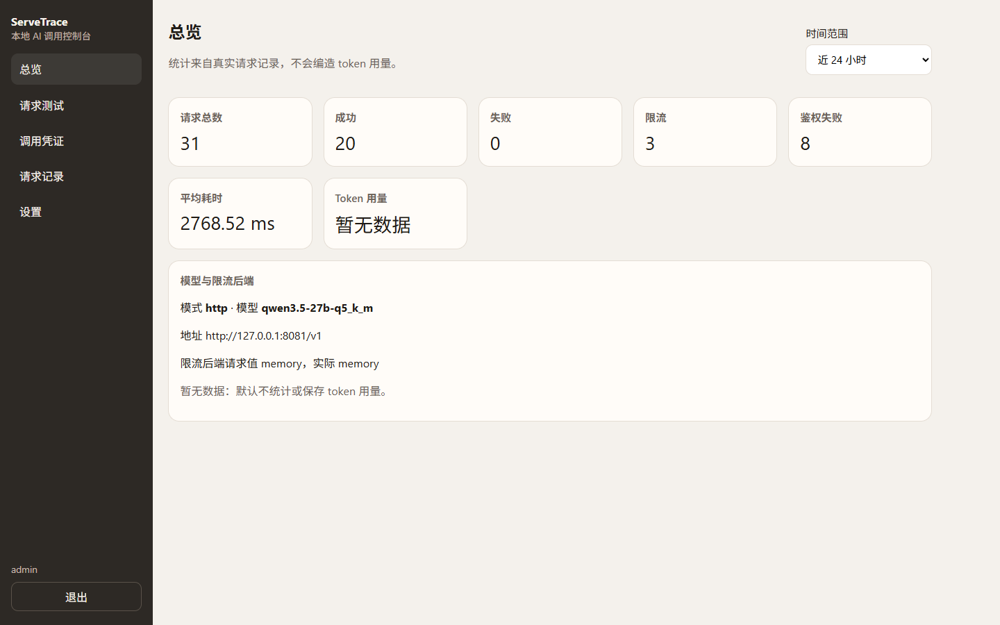
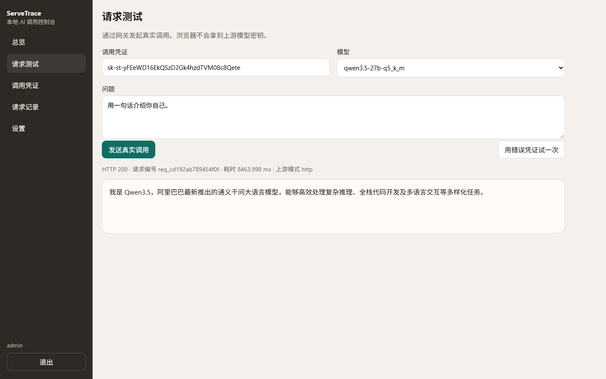
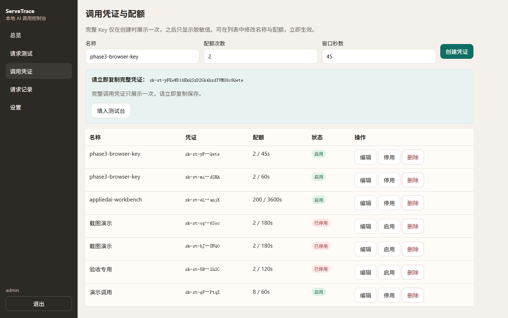
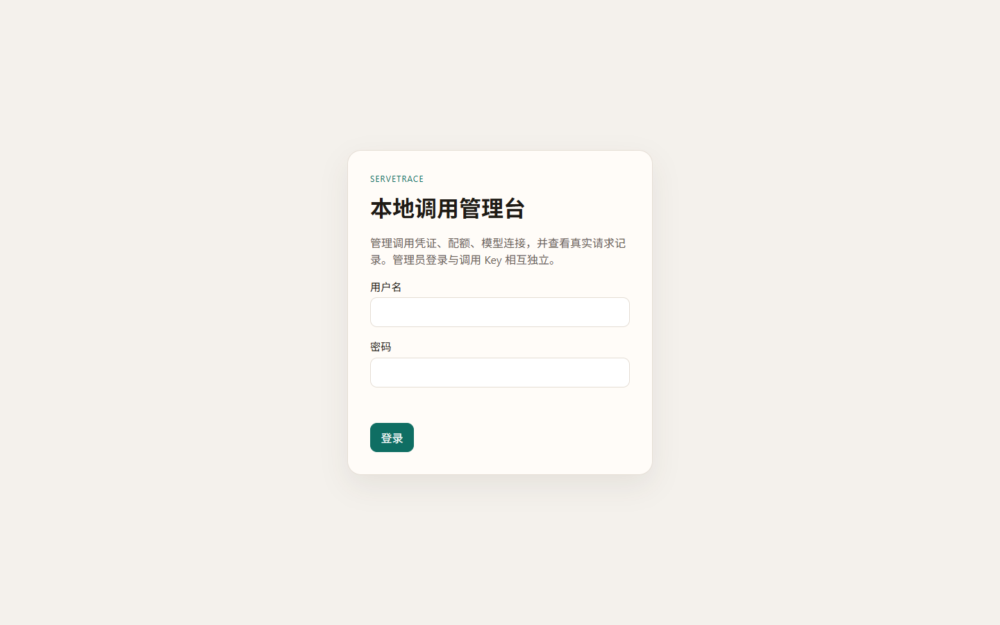
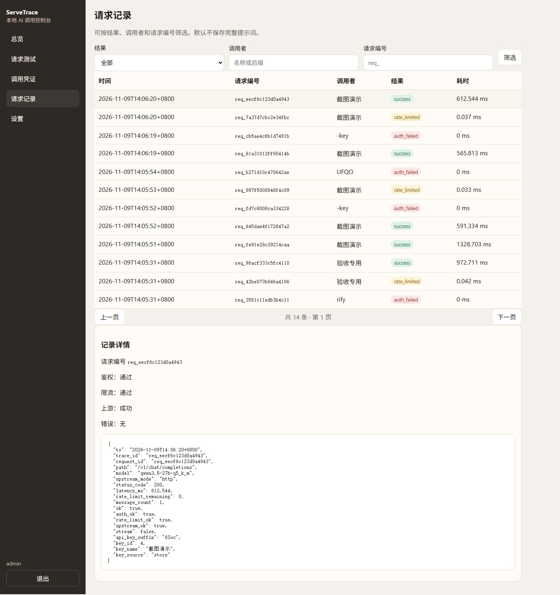
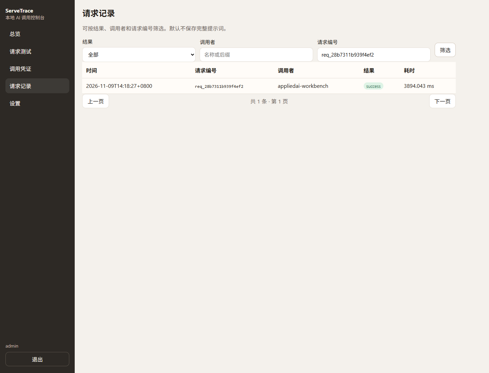
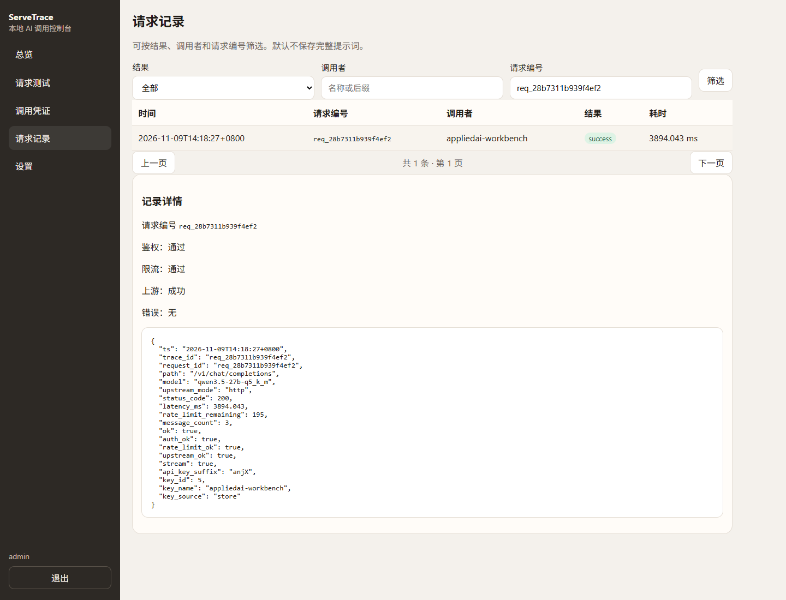

# ServeTrace｜让模型调用可控制、可定位

**个人 AI 调用网关原型 · 2026.11 至今**

我围绕“谁能调用、超限后怎么办、出错后怎样找到请求”设计了一个轻量模型网关，将鉴权、配额控制、请求记录和本地管理台放到同一入口。产品构思、需求拆解、方案取舍与修复推进由我负责；使用 AI 编程工具辅助实现与调试。

公开材料是案例说明，源码在独立仓库。管理台地址 `http://127.0.0.1:8700/` 只用于主机或局域网验收，**不是**可对外访问的在线演示。

## 场景与目标

当多个客户端接入模型服务时，各自处理身份校验、重试和日志，容易出现不同的行为口径。这个个人原型探索一种统一入口：调用者能够明确知道请求是否被接受、何时可以重试，以及如何提供排查所需的请求标识。

目标是让 **放行、拒绝和定位请求** 都有可检查的规则，覆盖正常调用与失败处理，并让管理员能在界面里管理凭证、配额和记录。

## 我负责的工作

- 将调用需求拆为身份准入、按 Key 配额、超限重试提示、请求查询与管理台操作，明确正常及失败分支。
- 设计内存与 Redis 两种限流配置下相同的验收口径；本机 Redis 未运行时，界面标明实际使用 memory，不假装已经走 Redis。
- 推进独立管理员登录、调用 Key 创建/停用/配额、真实模型测试台，以及与 AppliedAI 的联通（一条问答对应一条网关记录）。

## 关键方案与取舍

| 决策 | 选择及原因 | 需要承担的代价 |
|---|---|---|
| 统一调用入口 | 集中处理 Bearer API Key 鉴权、限流与日志，减少客户端之间的规则差异 | 网关本身增加维护成本；已有通用网关满足需求时应优先复用 |
| 按 Key 滑动窗口限流 | 提供 Memory 与 Redis 后端，按同一配额规则检查行为 | 本地双后端验证不能替代多实例一致性；当前验收环境实际为 memory |
| 超限时给出重试提示 | 返回 429 与 Retry-After，让客户端获得明确的等待信息 | 客户端仍需实现退避与重试策略，避免重复请求 |
| 用请求标识定位日志 | 请求编号关联响应、管理台列表与详情 | 请求级记录不能代替跨服务分布式追踪 |
| 管理权限与调用权限分离 | 有效调用 Key 不能访问管理员接口；完整 Key 只在创建时展示，之后脱敏哈希存储 | 需要同时验收“越权被拒”和“有权限的人确实能用” |

## 2026-11-09 管理台与真实模型验收

上游复用已运行的 `qwen3.5-27b-q5_k_m`（Q5_K_M，上下文 16384，`n-gpu-layers=16`）via `http://127.0.0.1:8081/v1`。`UPSTREAM_MODE=http`：上游失败时返回明确错误，不会静默回退 mock。限流后端申请为 memory，实际也为 memory（本机 Redis 未运行，总览/设置中已标明）。

Phase 2 记录见源码仓库 `docs/acceptance/2026-11-09-phase2.md`：

- 单元测试：`35 passed, 1 skipped`（Redis 限流测试在无 Redis 时 skip，为原有行为）。
- 接口验收脚本全部通过，包含真实模型回答「验收通过。」、超限 429 + Retry-After、停用后 403、重启后日志仍在。
- 浏览器截图 01–10 全部通过：总览、测试台真实成功调用、错误凭证、超配额、密钥列表脱敏、记录列表与详情、停用后失败、模型连接状态、重启后记录仍在。
- 完整调用 Key 未写入公开报告；列表只展示脱敏后缀。

## 与 AppliedAI 联通（Phase 3，2026-11-09 14:18 Asia/Shanghai）

AppliedAI 使用专用调用凭证 `appliedai-workbench` 经 ServeTrace 调用同一本地模型。示例：`req_617280ddf2674a1b` 端到端问答 4857 ms，网关往返 4847 ms，网关日志 `latency_ms=4140`、`status_code=200`；重启后该编号仍可查询。浏览器对照题为 `req_28b7311b939f4ef2`（端到端 4684 ms / 网关往返 4663 ms）。

网关日志里的 `latency_ms` 是网关侧统计（鉴权、限流、上游调用），不能把它当成整个问答耗时。

## 历史评测（2026-11-02，保留原样）

以下为 **2026 年 11 月 2 日留存的本地报告**；基础网关测试使用 mock 上游，Redis 结果来自本地 Compose 验证。这些不是本次真实模型管理台成绩。

| 检查 | 留存结果 | 结果说明 |
|---|---|---|
| 鉴权拒绝 | 缺失、无效、格式错误 3 个用例均返回 401 | 验证准入错误的返回行为 |
| Memory 限流 | 配额 3 次/60 秒，连续 5 次请求为 3×200、2×429 | 验证单 Key 的放行与拒绝顺序 |
| Redis 限流 | 相同协议得到 3×200、2×429，记录显示使用 Redis 后端 | 核对另一后端下的基本协议行为 |
| 重试提示 | 两种后端的超限响应均带 Retry-After | 样例中返回剩余等待时间 59 秒 |
| 请求追踪 | 成功请求返回请求标识，可查询对应记录 | 记录包含状态、上游模式等请求信息；不使用 mock 耗时推断性能 |

## 当前边界

- 当前验收环境的限流后端是 memory；配额配置写入 SQLite 后重启仍在，但窗口计数会重置。
- 默认不保存完整提示词；拿不到 token 用量时显示暂无数据，不编造数字。
- 已有结果支持本地鉴权、配额和请求查询，不证明生产吞吐、成本收益或多实例配额一致性。
- 本机 `127.0.0.1:8700` 只是本地/局域网体验入口，不能写成招聘方可直接打开的公网演示。

## 面试中可以展开的两个问题

1. 什么情况下需要自建轻量网关，什么情况下复用已有网关更合适？
2. 当请求被限流或上游出错时，哪些信息应该返回给客户端，哪些应留在服务端用于定位？

## 资料来源

- 公开案例：本页与截图。
- 源码仓库：[ServeTrace](https://github.com/suiyisuixing/ServeTrace)
- 本地体验：主机 `http://127.0.0.1:8700/`（需本机启动，不是公网演示）
- `docs/acceptance/2026-11-09-phase2.md`：管理台真实模型验收。
- `app/auth.py`、`app/rate_limit.py`、`app/trace.py`：鉴权、限流与追踪实现。
- `reports/auth_deny.json`、`reports/rate_limit.md`、`reports/rate_limit_redis.md`：历史协议样例。

[返回作品集](../README.md)

## 2026-11-09 修复与复验（相对历史 mock / Compose）

本轮本机直跑端口 **8700**，上游为真实 `http`→8081，与 Compose 默认 mock/18790 **分开表述**：

| 项 | 结果 |
|---|---|
| Key 生命周期 UI | 创建（完整 Key 仅一次）→ 脱敏列表 → 名称/配额编辑 → 启停 → 删除 |
| Trace 归属 | 按唯一 `key_id`，不再只靠后缀 |
| 失败详情 | 422/上游失败写入可查原因，页面不再只显示「错误：无」 |
| 限流 | memory 窗口：改配额立即 429 + Retry-After；停用 403；删除 401 |
| 重启复验 | Key 配额/停用/删除状态与已知 `request_id` 重启后仍可逐条核对 |
| Redis（ST-6） | **外部阻塞**：本机 Docker 引擎不可用且无 Redis；页面如实显示 memory。解除条件见交付说明 |
| 截图 | 已替换为 2026-11-09 脱敏新图；历史曾暴露的 Key 已在本机停用（报告不复述旧值） |

源码提交（GitHub `main`）：`d84b861f314db36af1be94333d29daf9ab0d9447`
