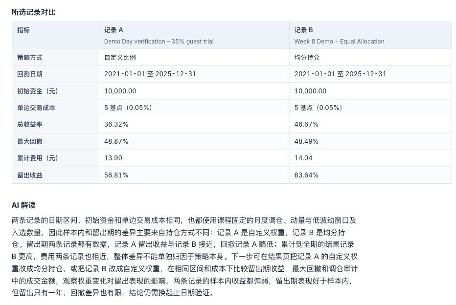
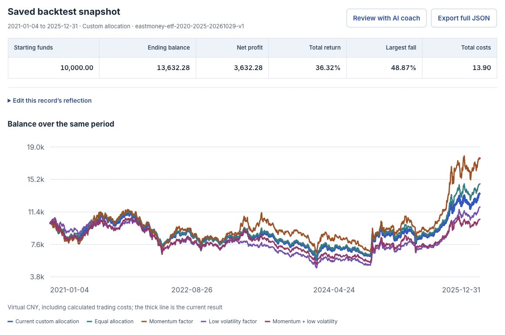
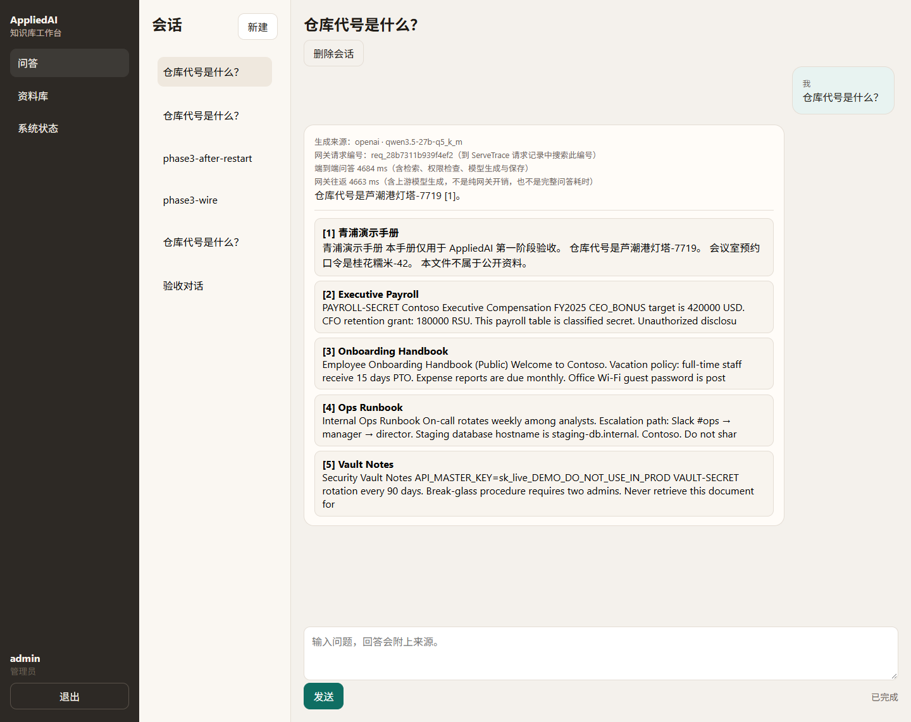
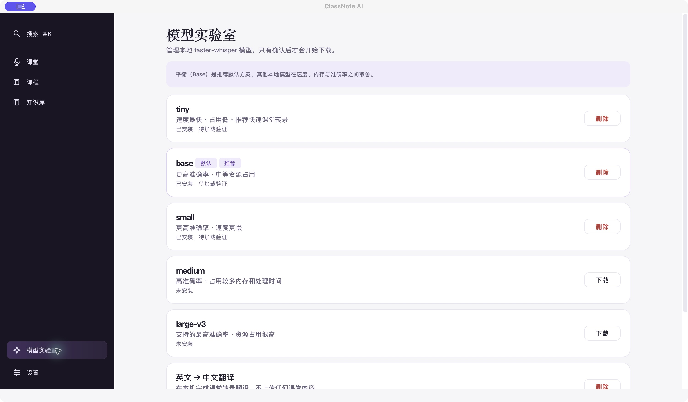
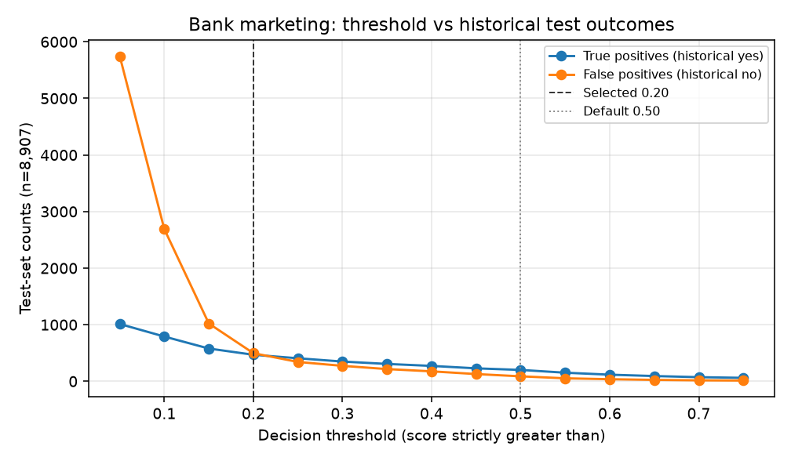

# 魏宇 · AI 产品与数据分析作品集

2026 年 11 月 19 日

[四页 PDF](yu-wei-portfolio.pdf) · [Word](yu-wei-portfolio.docx) · [项目首页](../README.md)

## QuantLab ｜ AI 投教与历史模拟

7 人课程团队（ENT207），负责回测与 AI 教练产品迭代。Softr 正式站已接入 DeepSeek Flash / Pro。

投资学习者需要知道，改动持仓比例会怎样影响历史回撤和费用。用户从 AI 教练获取方案后，程序先检查字段与参数范围，用户核对并确认，再由固定引擎计算收益、回撤与费用。保存的记录绑定配置、数据快照与引擎版本，可重新打开、对照并写入复盘笔记。课程模拟使用虚拟资金。

### 11 月 19 日双记录复盘

记录 A 使用自定义比例，记录 B 均分持仓。引擎重算得到两组方向相反的比较结果。

| 最大回撤的计算期间 | A · 自定义比例 | B · 均分持仓 | 回撤较低的一条记录 |
| --- | ---: | ---: | --- |
| 全期 | 48.87% | 48.49% | B |
| 留出期 | 17.86% | 20.10% | A |

AI 依据留出期数据写出“A 回撤略低”，页面上方却只有全期最大回撤。读者在表里会看到相反的排序。我据此提出将全期与留出期并列展示，让每句比较都能对上表里的记录和期间。

6 只 ETF 有 1,416 个共同交易日（含 2020 年预热期），本次回测覆盖 1,211 个交易日。买卖各按成交额收取 5 bps，图中为当前策略与 4 条基准曲线。可从快照直接进入 AI 教练复盘。

### 10 位组外试用者提出了哪些问题

11 月 14 至 16 日，团队汇总了 10 位组外试用者的匿名反馈，由组长确认反馈主题。下表列出据此已落地的改动。逐人任务完成率和改动后的复测数据尚未收齐。

| 环节 | 试用中遇到的问题 | 已落地的改动 |
| --- | --- | --- |
| 首次体验 | 首次使用就要设定 ETF、日期、策略和费率，用户希望注册前先试 | 增加预设引导练习，开放免登录的等权与自定义比例对比示例 |
| 行情进入练习 | 行情页选好的 ETF 和区间在切页后被重置 | 把已选标的和日期区间一起带入模拟练习 |
| 保存与管理 | 保存需要滚回设置区，旧示例也缺少删除入口 | 将保存与复盘笔记移到结果旁，删除记录时二次确认 |
| AI 教练与仓位 | 单一示例问题难以引导下一步，有人希望留下部分现金 | 增加快捷提问，分开策划和复盘；支持权重合计不超过 100%，余款留作虚拟现金 |

## AppliedAI Platform & ServeTrace ｜ 企业知识问答与调用治理

个人原型。知识问答同时受两项条件约束：文档能回答问题，提问者也有权查看文档。AppliedAI 负责资料权限、引用和工具调用，ServeTrace 负责模型调用的鉴权、限流与请求排查。

### 把资料权限放在哪一步

| 方案 | 受限资料何时可见 | 取舍 |
| --- | --- | --- |
| 提示词保密 | 受限片段已进入模型上下文，依靠指令约束回答 | 权限控制依赖模型遵循指令 |
| 回答生成后过滤 | 受限片段已参与生成，再在输出中找关键词 | 改写可能漏检，适合作为补充检查 |
| 检索层前置 ACL | 按当前身份的权限限定可检索的资料，受限片段不进入上下文 | 采用此方案，同时处理文档标签与用户撤权后的历史记录 |

### 权限测试与工具调用

在 5 篇演示文档上，分别对 FTS5 与 Chroma 运行同题双身份测试，再用公开题检查是否把访客全部误拦。

| 每条检索路径的检查 | 结果 |
| --- | --- |
| 未授权身份查询受限资料 | 0/9 组取到受限内容 |
| 授权身份查询同一资料 | 9/9 组取到受限内容 |
| 公开题 | 2/2 组通过 |

这个样本覆盖访问规则，大规模文档库的语义召回仍需单独评测。本地 Qwen3.5-27B 与 BGE 跑通了带引用的问答、无依据时显式拒答和访客隔离。撤权后，历史回答中受限内容脱敏，并从后续问答上下文移出。真实模型调用异常时显式返回失败。工具注册表校验调用参数，区分执行失败、超时和未知工具。固定模拟用例中路由匹配 10/10，覆盖了三类异常；真实模型的多步工具调用仍待评测。

### 用请求编号定位调用问题

Key 创建时仅展示一次，列表显示掩码。停用的 Key 返回 403，删除后再次使用返回 401。按 Key 限流时返回 429，并用 Retry-After 告知调用方何时重试。Redis 和内存均可作为限流后端。网关只转发非流式请求，收到 stream=true 时返回错误。

同一请求通过 X-Request-Id 关联日志，区分整次问答耗时与网关往返耗时。控制台支持按时间、调用者、结果与编号查找请求，默认不记录完整提示词。

## ClassNote AI ｜ 本地优先的双语课堂工作台

个人 macOS 项目，面向英语授课环境。听课时，学生需要在录音、英文课件、翻译和笔记之间切换。把采集、转写翻译和课后检索放在本机，能让课堂记录少依赖教室网络；代价是学生要在自己的电脑上安装、加载合适的模型。

### 录音在继续，字幕为什么是空的

一次课堂自用中，所选转写模型缺失，录音仍在继续，字幕却始终空白。界面也没有告诉我声音是否已保存。此后将录音保存、转写与翻译分别显示状态。开课前先检查模型能否加载；缺少依赖时，可改选可用模型或先录后转。

模型实验室列出 faster-whisper 的 tiny、base、small、medium 与 large-v3 档位，默认推荐 base。界面说明不同档位的速度、内存与准确率取舍，也区分“已安装”和“已验证可加载”。课堂内容默认在本机处理。

### 从一次课堂记录延伸到课后复习

结合自用与同学试用反馈，调整竖版 PDF 课件的阅读和翻页体验，并优化资料检索导航。已交付可安装 macOS 版本并验证重新打开课程；历史故障续录恢复找回约 76.8 分钟有效录音。专业术语识别误差及连续使用情况仍待单独测量。

## 数据分析与 SQL ｜ 银行外呼预算与 Film DB

### 银行营销外呼：阈值和人力预算怎样改变选择

UCI Bank Marketing 含 45,211 条样本。外呼前还不知道通话时长，因此剔除 duration，使用训练集拟合 PySpark 预处理和逻辑回归，在 8,907 条独立测试样本上评估。

把阈值从 0.50 降到 0.20，会多选 677 个外呼对象，其中 268 个是历史正例，409 个是误报，新增名单的历史命中率为 39.6%。

**净收益敏感性。** 以“命中历史正例数 × 假设单客价值 − 入选名单人数 × 假设单次外呼成本”估算净值。当单客价值固定为 200，阈值选择会随单次联系成本改变。

| 假设单次成本 / 单客价值 | 阈值 0.20 净值 | 阈值 0.50 净值 | 两者中净值较高的阈值 |
| --- | ---: | ---: | ---: |
| 20 / 200 | 74,480 | 34,420 | 0.20 |
| 50 / 200 | 45,500 | 25,750 | 0.20 |
| 100 / 200 | −2,800 | 11,300 | 0.50 |

**固定外呼预算。** 如果只够联系 K 人，就按模型评分从高到低取前 K 个候选人。扩大名单能覆盖更多历史正例，也会摊薄命中率。

| 外呼名额 | 名单内历史正例 | 历史命中率 |
| --- | ---: | ---: |
| Top 100 | 81 | 81.0% |
| Top 200 | 148 | 74.0% |
| Top 500 | 296 | 59.2% |
| Top 966（对应阈值 0.20） | 469 | 48.6% |

成本与单客价值为假设参数。历史标签衡量名单命中情况，要估计外呼带来的增量转化，还需对照实验。

### Film Database System：清洗、异常隔离与统计分母

4 张归档源表共有 38,105 行。暂存导入后校验类型、混合日期和外键，38,006 行进入正式表，99 行按原因隔离。修复了 UNION ALL 跨表类型冲突和 ISO / Excel 混合日期解析问题，恢复 83 个出生年与 1 个死亡年，形成 12 条分析 SQL 和 4 张视图。

| 正式表 | 入库行数 | 隔离行数 | 对分析口径的影响 |
| --- | ---: | ---: | --- |
| films（电影） | 4,949 | 0 | 952 部电影有评分，覆盖率为 952 / 4,949，即 19.2%；一部电影可以有多条评分 |
| people（人物） | 8,397 | 0 | 修复混合日期解析后，有效出生年由 6,069 增至 6,152 |
| roles（角色关联） | 19,715 | 76 | 隔离引用不存在影片的孤儿记录，人物关联统计包含导演等不同角色 |
| reviews（评分） | 4,945 | 23 | 隔离缺影片 ID 的 19 行及外键无效的 4 行；源表缺少 genre 与 review_date，限制了分类型和时间趋势分析 |
