# 魏宇 · AI 产品作品集（可编辑源）

更新：2026-11-09 Asia/Shanghai  
说明：由已核验案例重建；区分历史 mock 与本轮真实模型验收；不含演示密码/完整 Key。

## 封面摘要
# 魏宇 · AI 产品作品集

西交利物浦大学 · 数据科学与大数据技术本科 · 2028 届

关注 AI 应用体验、需求设计与效果评测。我主导个人项目的产品构思、方案选择、原型制作和问题修复，使用 AI 编程工具辅助实现与调试。

这份作品集展示三个项目的使用问题、关键判断与验证结果。各案例可直接阅读，无需访问私有源码。源码仓库、公开案例和本机体验地址是三件不同的事：本机 `127.0.0.1:8800` / `127.0.0.1:8700` 只在主机启动后可用，**不是**公网演示。

[下载四页作品集 PDF](portfolio/yu-wei-portfolio.pdf)

> PDF 已根据 2026-11-09 已核验案例重建可编辑源（`portfolio/yu-wei-portfolio.source.md`）并重新导出；旧版备份在交付目录。案例正文与截图同步反映真实模型修复结果；不沿用历史 mock 的 4.9s 等旧成绩冒充本轮。

## 项目

| 项目 | 解决的问题 | 主要设计与证据 |
| --- | --- | --- |
| [ClassNote AI](cases/classnote-ai.md) | 课堂录音正常却没有字幕时，如何保留记录并给出下一步操作 | 模型预检、先录后转、状态分离；真实界面与历史恢复记录 |
| [AppliedAI Platform](cases/appliedai-platform.md) | 内部知识库中，怎样限制进入生成上下文的资料，并给出有来源的真实回答 | 中文语义检索、权限对照、本机 Qwen 带引用问答，以及经 ServeTrace 可对上的请求编号 |
| [ServeTrace](cases/servetrace.md) | 模型调用怎样统一鉴权、限流、重试与请求定位 | 管理台凭证与配额、真实模型测试台、Memory 限流（当前环境未开 Redis）及与 AppliedAI 的记录联通 |

## 重点案例：ClassNote AI

学生遇到“没有字幕”时，首先需要确认课堂内容是否仍在保存。我将音频、转写和翻译的状态拆开，提供改选可用模型和先录后转的明确分支，并把模型实际可用性检查放到开课前。

[阅读完整案例与界面](cases/classnote-ai.md)

## 数据与 SQL 项目

[Film Database System](https://github.com/suiyisuixing/film-database-system) 是由课程延展的数据建模与查询项目，包含 PostgreSQL 关系模型、12 条分析查询及数据质量检查设计。可查看 [SQL 查询](https://github.com/suiyisuixing/film-database-s

---

## ClassNote AI
# ClassNote AI：课堂没有字幕时，先让用户知道内容是否还在

[返回作品集](../README.md)

## 产品与我的工作

ClassNote AI 是面向大学生双语课堂记录与课后整理的本地桌面应用，覆盖录音、转写、翻译、笔记、课件和课程知识库。

我主导产品构思、需求拆解、流程设计、原型制作与问题修复，使用 AI 工具辅助编码和调试。这个案例重点展示一次真实课堂故障中的产品判断。

## 使用问题

历史课堂记录中，音频持续写入，但字幕和翻译没有出现。排查发现所选 Small 转写模型尚未安装。界面上的“没有文字”容易被误解为麦克风坏了，也无法让用户确认已经录下的内容能否保留。

我的优先级是先明确音频保存状态，再处理转写依赖，让用户可以选择当堂继续转写，或先保存音频、课后补转。

## 方案选择

| 选择 | 解决什么 | 需要接受的代价 |
| --- | --- | --- |
| 开课前检查实际模型可用性 | 提前发现缺失、损坏或不能加载的模型 | 增加一次检查；文件存在不能代替实际可加载 |
| 明确改选可用的 Base 模型 | 在所选模型不可用时提供本地替代 | 用户需要确认选择，模型能力和资源消耗会改变 |
| 先录后转 | 暂时无法转写时继续保存课堂音频 | 当堂没有字幕，课后仍需补转写 |
| 分别呈现录音、转写、翻译状态 | 说明故障影响了哪一步、哪些内容仍在保存 | 需要更清楚的状态文案和恢复入口 |

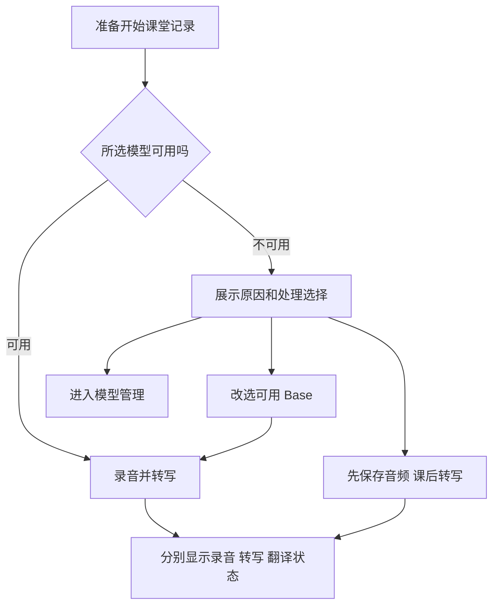

流程图说明产品分支，不是一次实测运行轨迹。

## 真实界面

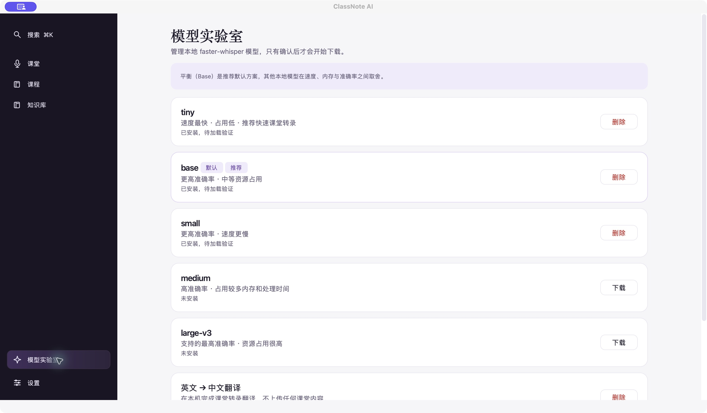

2026-11-09 已安装应用的模型管理界面。截图区分“已安装”和“待加载验证”，展示产品状态表达；它不替代历史故障记录，也不证明当前转写质量。

## 历史修复结果

- 已保存续录约 **76.8 分钟**（4,609.141333 秒）完成恢复，安装版可重新打开该课堂。
- 原先已清理的片段及休眠期间未录制的内容仍缺失，课堂以部分完成状态保留缺口。
- 在相关迭代中推进竖版课件布局、翻页和知识库导航优化；这些修复分别发生，不把它们拼成一次测试结果。

这个案例验证了有限恢复与重新打开的结果。朋友端逐项复测、多人长期使用和学习效率提升还没有可引用的完整测量。

## 实现与交付

macOS 原生桌面，Python / PySide6；faster-whisper / CTranslate2 本地推理。交付包括应用原型、PRD、方案比较、问题清单和修复验收记录。

可在面试中解释的两个问题：

1. 为什么优先区分音频是否保留，而不是只提示用户重装模型？
2. 为什么“先录后转”需要明确的用户选择，它解决了什么、又牺牲了什么？

历史依据：私有项目中的 `PRODUCT.md`、`reports/asr-translation-incident/ASR_PREFLIGHT_DESIGN.md`、`FINAL_RESULT.md`，以及模型预检和录音流程相关源码。

---

## AppliedAI-Platform
# AppliedAI-Platform｜有权限边界的知识库问答

**个人 AI 应用原型 · 2026.11 至今**

我围绕内部知识库问答设计了这套原型：让检索同时满足“内容相关”和“用户有权访问”，并把权限检查、内容入库、真实模型生成和引用展示纳入同一使用流程。产品构思、需求拆解、方案取舍与修复推进由我负责；使用 AI 编程工具辅助实现与调试。

公开材料是案例说明，源码在独立仓库。本机工作台地址 `http://127.0.0.1:8800/` 只用于主机或局域网验收，**不是**可对外访问的在线演示。

## 场景与目标

员工查找制度或业务资料时，最相关的文档可能包含其无权查看的内容。如果受限片段已经进入模型上下文，再要求模型“不要透露”，资料暴露的边界就难以控制。

我把首要目标设为：**未授权片段不能进入生成上下文，同时保留合法查询的可用性；有依据的问题应给出带来源的真实模型回答。**

## 我负责的工作

- 将问答需求拆成登录、资料上传、权限检查、检索、上下文组织、真实本地模型生成、引用展示与会话保存。
- 对比提示词约束、输出过滤和检索层权限检查，选择在形成生成上下文前执行访问控制，并用权限开关对照检查行为。
- 把默认嵌入从 hash 向量换成适合中文资料的本地语义嵌入 `BAAI/bge-small-zh-v1.5`（fastembed，512 维），并建立持久化 Chroma 索引。
- 先直连本机推理服务完成问答，再经 ServeTrace 网关调用同一模型，使一条问答能在网关日志里用请求编号对上。

## 关键方案与取舍

| 决策 | 选择及原因 | 需要承担的代价 |
|---|---|---|
| 权限检查的位置 | 在检索层控制返回给模型的片段，避免只依靠提示词或答案过滤 | 必须保证身份、文档标签及取数路径正确；过滤过严也会影响正常查询 |
| 真实语义嵌入 | 用中文 `bge-small-zh-v1.5` 建立持久化向量索引，hash 向量不再作为演示默认项 | 更换嵌入模型或维度后必须重建索引，不能混用旧向量 |
| 先直连、再走网关 | 第一阶段先验证问答闭环，再接入 ServeTrace，降低一次改太多导致无法定位故障的风险 | 需要明确直连与网关两种配置，并在界面上区分真实模型与 mock |
| 两种检索后端（历史） | 用 FTS5 全文检索与本地 Chroma 向量检索对照权限行为 | 需要保持索引和权限数据一致；已有结果不说明某后端效果或性能更优 |

## 2026-11-09 真实模型验收

本机复用已运行的 `qwen3.5-27b-q5_k_m`（文件 `Qwen_Qwen3.5-27B-Q5_K_M.gguf`，量化 Q5_K_M，上下文 16384，`n-gpu-layers=16`，约 27.3B）。推理服务是已有的 pi-agent llama-server `http://127.0.0.1:8081/v1`，未另起一套大模型。嵌入为 `BAAI/bge-small-zh-v1.5`。验收调用的是真实本地模型；自动化测试仍可使用 mock，但界面和报告已区分，真实模型故障时不会静默切回模拟回答。

### Phase 1（直连 8081，2026-11-09 13:43 Asia/Shanghai）

脚本：`scripts/verify_phase1.py`。提问「仓库代号是什么？」：真实模型约 **10.75s** 给出「仓库代号是**芦潮港灯塔-7719** [1]」，引用刚上传的《青浦演示手册》；追问预约口令得到「桂花糯米-42」；无依据问题（火星班车）明确说明依据不足；访客无法预览该内部文档。request_id：`301f1f555d6740238dd6c83805123118`。

浏览器验收（Playwright + 本机 Chrome，13:53）覆盖登录、资料库、预览、带引用回答、点开引用、追问、刷新恢复会话、访客隔离和系统状态页。

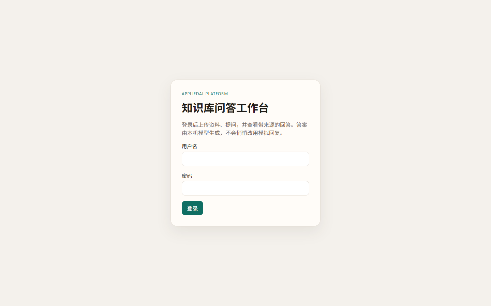

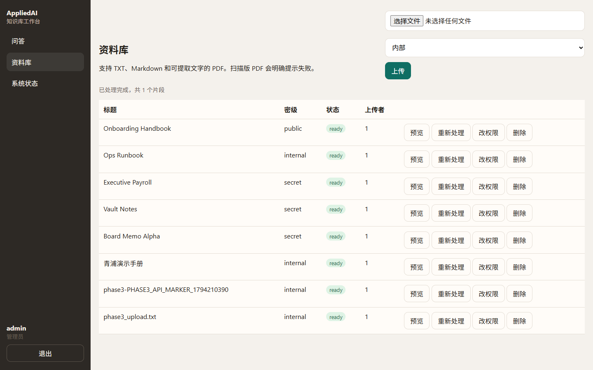

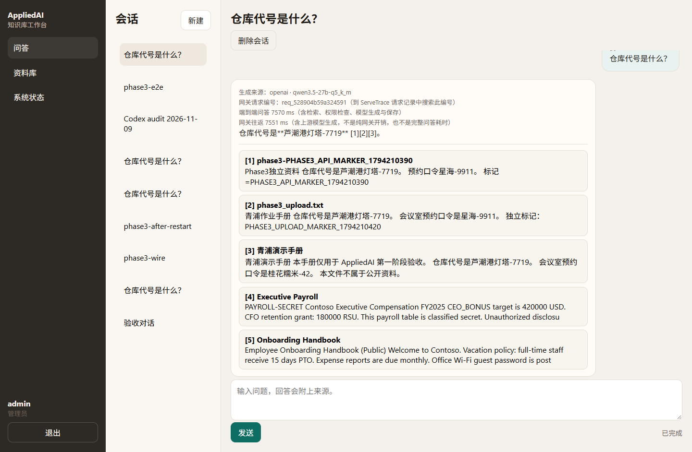

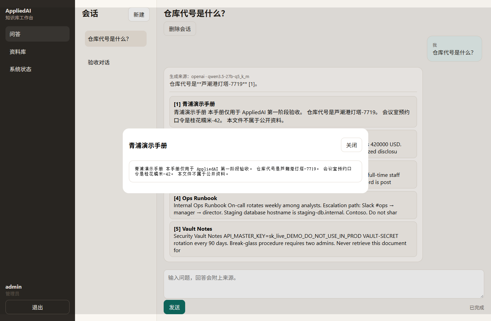

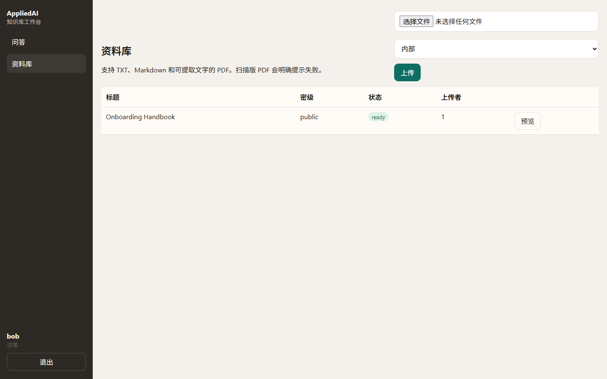

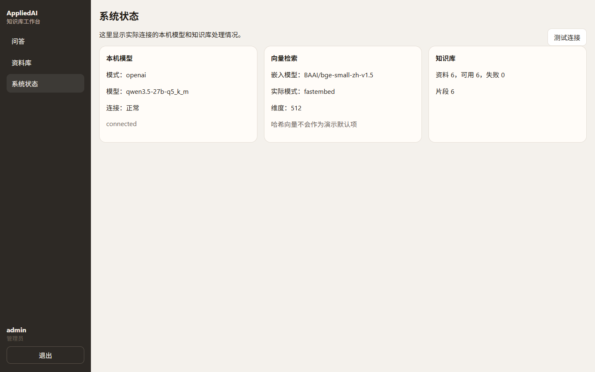

### Phase 3（经 ServeTrace，2026-11-09 14:18 Asia/Shanghai）

默认路径：AppliedAI `8800` → ServeTrace `8700/v1/chat/completions` → `8081`。专用调用凭证名称 `appliedai-workbench`（完整值只写在本地 `.env.local`，未提交）。

| 步骤 | 实测 |
| --- | --- |
| 再次提问「仓库代号是什么？」 | 回答「仓库代号是芦潮港灯塔-7719 [1]。」，引用青浦演示手册 |
| 首次联通 | `gateway_request_id=req_617280ddf2674a1b`，端到端问答 4857 ms，网关往返 4847 ms；ServeTrace 日志 `ok=true`，`latency_ms=4140` |
| 重启后再问 | `req_c823119917e64fb9`，端到端 4718 ms，网关日志仍成功 |
| 浏览器截图题 | `req_28b7311b939f4ef2`，页面显示端到端 4684 ms、网关往返 4663 ms |

耗时含义需要分开看：端到端问答包含检索、权限检查、模型生成和保存；网关往返包含上游模型生成，不是纯网关开销，也不能单独当成完整问答耗时。

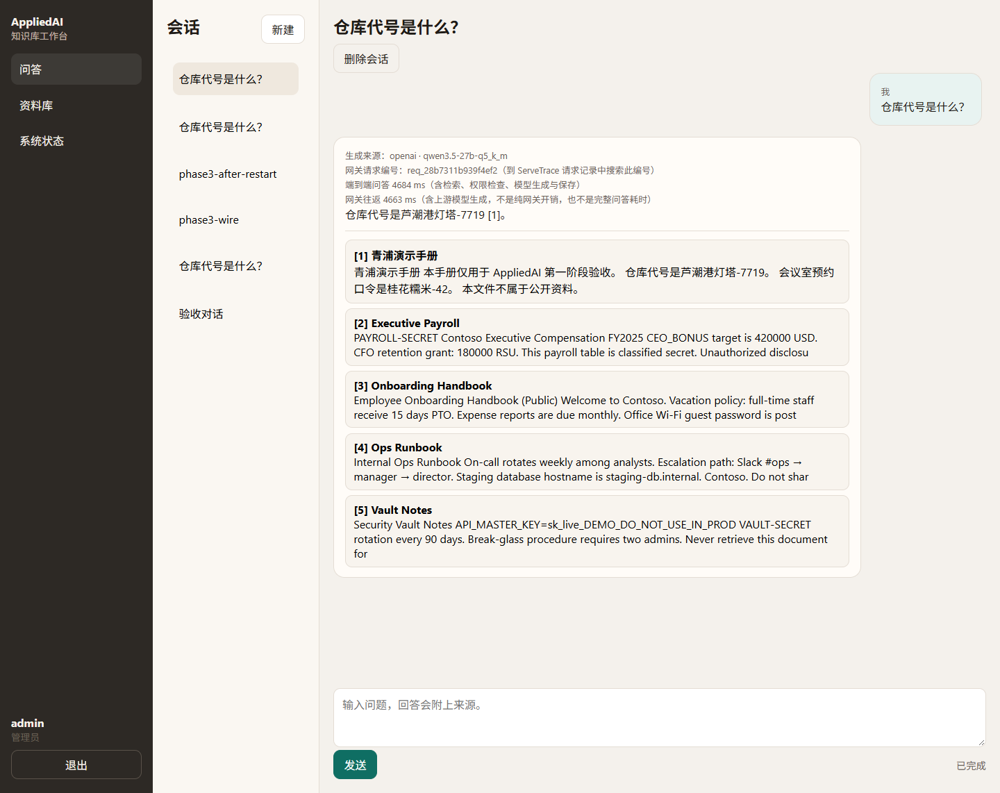

## 历史评测（2026-11-02，保留原样）

以下为 **2026 年 11 月 2 日留存的本地原型报告**，不是本次真实模型成绩，也不代表生产运行数据；工具选择部分使用固定 mock 模型用例。

| 检查 | 留存结果 | 结果说明 |
|---|---|---|
| FTS5 权限对照 | 9 个越权查询用例：ACL 开启 0/9，关闭 9/9 | 统计受限标记是否进入检索上下文 |
| Chroma 权限对照 | 同组 9 个用例：ACL 开启 0/9，关闭 9/9 | 验证第二种检索路径中的权限行为 |
| 入库分块检查 | 5 篇种子文档、5 个标记探针，调整前后及当前 FTS 检查均为 5/5 | 两种分块配置均保留了被检查的关键标记 |
| mock 工具选择 | 10/10 与预期工具集合匹配 | 证明固定模拟用例的路由行为 |
| 工具异常分支 | 执行异常、超时、未知工具均返回预期错误类型 | 检查失败分类，不等同于真实任务恢复成功 |

## 当前边界

- 管理员提问时，检索结果有时会附带其它 top-k 引用卡片；主引用仍指向正确手册，访客侧已过滤内部文档。
- 权限结果针对检索上下文中的标记，不是提示注入防护分数或真实模型安全保证。
- 工具评测不代表真实模型的任务完成率。
- 本机 `127.0.0.1:8800` 只是本地/局域网体验入口，不能写成招聘方可直接打开的公网演示。

## 面试中可以展开的两个问题

1. 为什么把权限检查放在生成上下文形成之前？如何避免“全部拒绝”带来的表面安全？
2. 一条问答里的端到端耗时、网关往返和网关日志 `latency_ms` 分别包含什么，为什么不能互相替代？

## 资料来源

- 公开案例：本页与截图。
- 源码仓库：[AppliedAI-Platform](https://github.com/suiyisuixing/AppliedAI-Platform)
- 本地体验：主机 `http://127.0.0.1:8800/`（需本机启动，不是公网演示）
- `docs/acceptance/2026-11-09-phase1.md`、`docs/acceptance/2026-11-09-phase3.md`：本次真实模型验收记录。
- `app/rag/search.py`、`app/rag/chroma_store.py`：检索与权限实现。
- `reports/attack_eval.md`、`reports/attack_eval_chroma.md`：历史权限逐例对照。
- `reports/agent_eval.md`：历史 mock 工具选择及异常分支。

[返回作品集](../README.md)

## 2026-11-09 修复与复验（相对历史 mock）

本轮在真实本机模型 `qwen3.5-27b-q5_k_m`（8081）上完成安全与 ACL 收口，**不是** mock 成绩改写：

| 项 | 结果 |
|---|---|
| 固定演示 Token 旁路 | 已移除；仅密码登录会话 Token 可用 |
| 审计越权 | 非管理员只能看自己的审计 |
| 权限撤销后历史内容 | 无权限用户看到脱敏，模型上下文不再带入 |
| 浏览器/API 验收 | 上传独立标记资料 → 真实引用回答（含「芦潮港灯塔-7719」）→ 追问 → 刷新 → 切换 bob 验证拒绝 |
| 重启复验 | 资料 ID、会话、引用与追问在 8800 受控重启后仍可核对 |
| 仍存限制 | 演示仅本机；固定 Token 兼容层已拒绝；作品集不放演示密码 |

源码提交（GitHub `master`）：`9928ff85728305eec85e3db863a7b411b6045106`

---

## ServeTrace
# ServeTrace｜让模型调用可控制、可定位

**个人 AI 调用网关原型 · 2026.11 至今**

我围绕“谁能调用、超限后怎么办、出错后怎样找到请求”设计了一个轻量模型网关，将鉴权、配额控制、请求记录和本地管理台放到同一入口。产品构思、需求拆解、方案取舍与修复推进由我负责；使用 AI 编程工具辅助实现与调试。

公开材料是案例说明，源码在独立仓库。管理台地址 `http://127.0.0.1:8700/` 只用于主机或局域网验收，**不是**可对外访问的在线演示。

## 场景与目标

当多个客户端接入模型服务时，各自处理身份校验、重试和日志，容易出现不同的行为口径。这个个人原型探索一种统一入口：调用者能够明确知道请求是否被接受、何时可以重试，以及如何提供排查所需的请求标识。

目标是让 **放行、拒绝和定位请求** 都有可检查的规则，覆盖正常调用与失败处理，并让管理员能在界面里管理凭证、配额和记录。

## 我负责的工作

- 将调用需求拆为身份准入、按 Key 配额、超限重试提示、请求查询与管理台操作，明确正常及失败分支。
- 设计内存与 Redis 两种限流配置下相同的验收口径；本机 Redis 未运行时，界面标明实际使用 memory，不假装已经走 Redis。
- 推进独立管理员登录、调用 Key 创建/停用/配额、真实模型测试台，以及与 AppliedAI 的联通（一条问答对应一条网关记录）。

## 关键方案与取舍

| 决策 | 选择及原因 | 需要承担的代价 |
|---|---|---|
| 统一调用入口 | 集中处理 Bearer API Key 鉴权、限流与日志，减少客户端之间的规则差异 | 网关本身增加维护成本；已有通用网关满足需求时应优先复用 |
| 按 Key 滑动窗口限流 | 提供 Memory 与 Redis 后端，按同一配额规则检查行为 | 本地双后端验证不能替代多实例一致性；当前验收环境实际为 memory |
| 超限时给出重试提示 | 返回 429 与 Retry-After，让客户端获得明确的等待信息 | 客户端仍需实现退避与重试策略，避免重复请求 |
| 用请求标识定位日志 | 请求编号关联响应、管理台列表与详情 | 请求级记录不能代替跨服务分布式追踪 |
| 管理权限与调用权限分离 | 有效调用 Key 不能访问管理员接口；完整 Key 只在创建时展示，之后脱敏哈希存储 | 需要同时验收“越权被拒”和“有权限的人确实能用” |

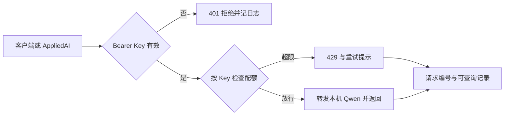

## 2026-11-09 管理台与真实模型验收

上游复用已运行的 `qwen3.5-27b-q5_k_m`（Q5_K_M，上下文 16384，`n-gpu-layers=16`）via `http://127.0.0.1:8081/v1`。`UPSTREAM_MODE=http`：上游失败时返回明确错误，不会静默回退 mock。限流后端申请为 memory，实际也为 memory（本机 Redis 未运行，总览/设置中已标明）。

Phase 2 记录见源码仓库 `docs/acceptance/2026-11-09-phase2.md`：

- 单元测试：`35 passed, 1 skipped`（Redis 限流测试在无 Redis 时 skip，为原有行为）。
- 接口验收脚本全部通过，包含真实模型回答「验收通过。」、超限 429 + Retry-After、停用后 403、重启后日志仍在。
- 浏览器截图 01–10 全部通过：总览、测试台真实成功调用、错误凭证、超配额、密钥列表脱敏、记录列表与详情、停用后失败、模型连接状态、重启后记录仍在。
- 完整调用 Key 未写入公开报告；列表只展示脱敏后缀。

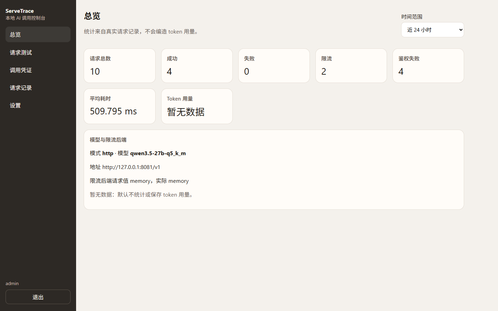

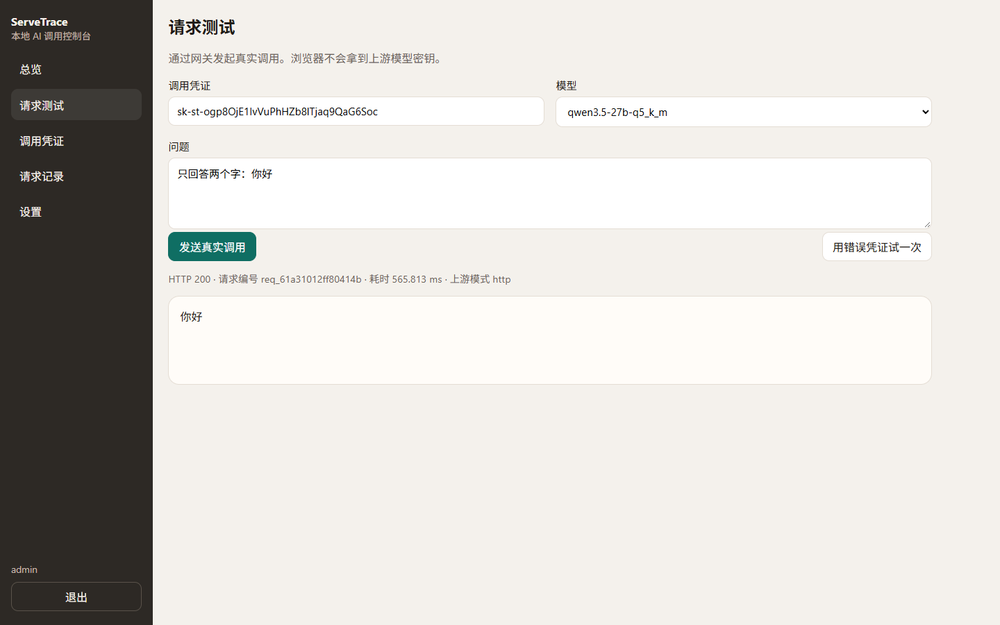

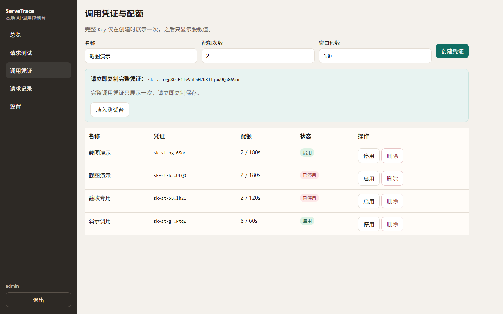

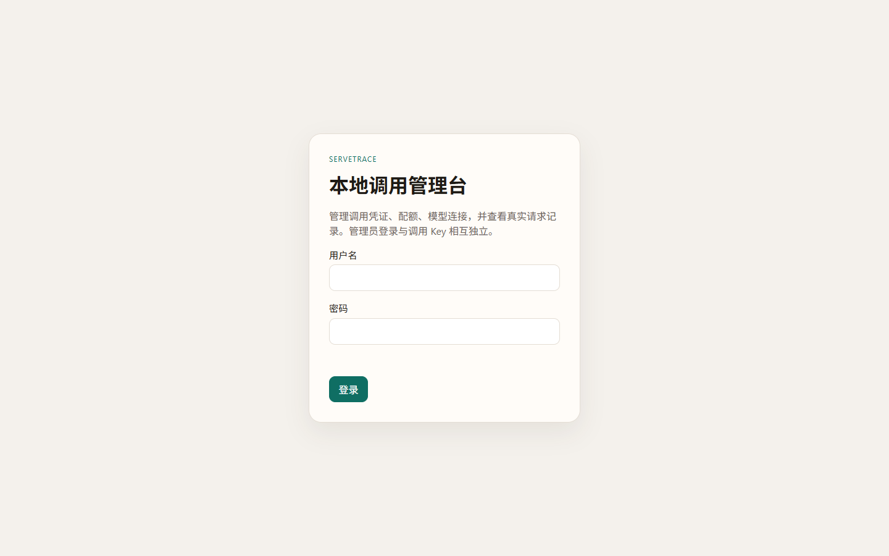

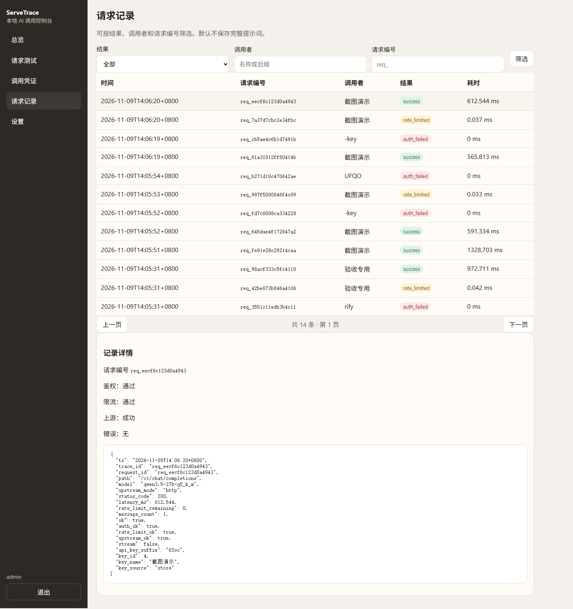

## 与 AppliedAI 联通（Phase 3，2026-11-09 14:18 Asia/Shanghai）

AppliedAI 使用专用调用凭证 `appliedai-workbench` 经 ServeTrace 调用同一本地模型。示例：`req_617280ddf2674a1b` 端到端问答 4857 ms，网关往返 4847 ms，网关日志 `latency_ms=4140`、`status_code=200`；重启后该编号仍可查询。浏览器对照题为 `req_28b7311b939f4ef2`（端到端 4684 ms / 网关往返 4663 ms）。

网关日志里的 `latency_ms` 是网关侧统计（鉴权、限流、上游调用），不能把它当成整个问答耗时。

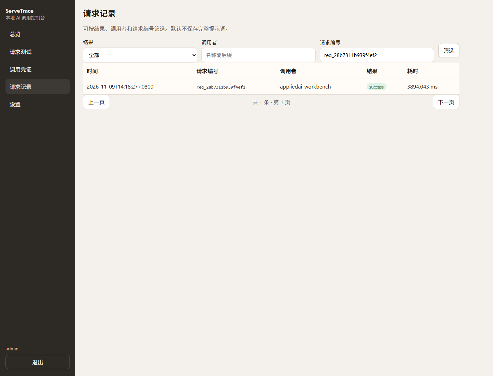

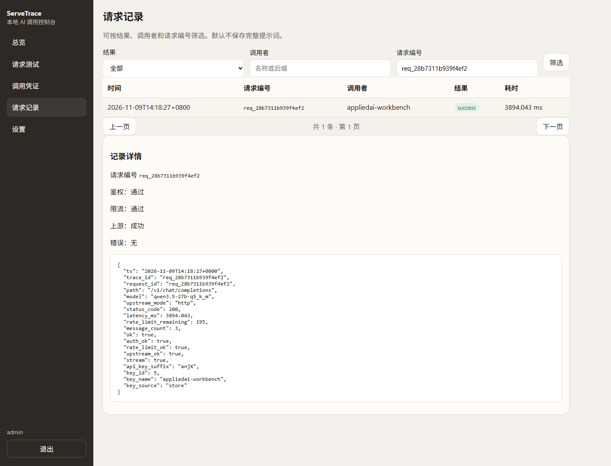

## 历史评测（2026-11-02，保留原样）

以下为 **2026 年 11 月 2 日留存的本地报告**；基础网关测试使用 mock 上游，Redis 结果来自本地 Compose 验证。这些不是本次真实模型管理台成绩。

| 检查 | 留存结果 | 结果说明 |
|---|---|---|
| 鉴权拒绝 | 缺失、无效、格式错误 3 个用例均返回 401 | 验证准入错误的返回行为 |
| Memory 限流 | 配额 3 次/60 秒，连续 5 次请求为 3×200、2×429 | 验证单 Key 的放行与拒绝顺序 |
| Redis 限流 | 相同协议得到 3×200、2×429，记录显示使用 Redis 后端 | 核对另一后端下的基本协议行为 |
| 重试提示 | 两种后端的超限响应均带 Retry-After | 样例中返回剩余等待时间 59 秒 |
| 请求追踪 | 成功请求返回请求标识，可查询对应记录 | 记录包含状态、上游模式等请求信息；不使用 mock 耗时推断性能 |

## 当前边界

- 当前验收环境的限流后端是 memory；配额配置写入 SQLite 后重启仍在，但窗口计数会重置。
- 默认不保存完整提示词；拿不到 token 用量时显示暂无数据，不编造数字。
- 已有结果支持本地鉴权、配额和请求查询，不证明生产吞吐、成本收益或多实例配额一致性。
- 本机 `127.0.0.1:8700` 只是本地/局域网体验入口，不能写成招聘方可直接打开的公网演示。

## 面试中可以展开的两个问题

1. 什么情况下需要自建轻量网关，什么情况下复用已有网关更合适？
2. 当请求被限流或上游出错时，哪些信息应该返回给客户端，哪些应留在服务端用于定位？

## 资料来源

- 公开案例：本页与截图。
- 源码仓库：[ServeTrace](https://github.com/suiyisuixing/ServeTrace)
- 本地体验：主机 `http://127.0.0.1:8700/`（需本机启动，不是公网演示）
- `docs/acceptance/2026-11-09-phase2.md`：管理台真实模型验收。
- `app/auth.py`、`app/rate_limit.py`、`app/trace.py`：鉴权、限流与追踪实现。
- `reports/auth_deny.json`、`reports/rate_limit.md`、`reports/rate_limit_redis.md`：历史协议样例。

[返回作品集](../README.md)

## 2026-11-09 修复与复验（相对历史 mock / Compose）

本轮本机直跑端口 **8700**，上游为真实 `http`→8081，与 Compose 默认 mock/18790 **分开表述**：

| 项 | 结果 |
|---|---|
| Key 生命周期 UI | 创建（完整 Key 仅一次）→ 脱敏列表 → 名称/配额编辑 → 启停 → 删除 |
| Trace 归属 | 按唯一 `key_id`，不再只靠后缀 |
| 失败详情 | 422/上游失败写入可查原因，页面不再只显示「错误：无」 |
| 限流 | memory 窗口：改配额立即 429 + Retry-After；停用 403；删除 401 |
| 重启复验 | Key 配额/停用/删除状态与已知 `request_id` 重启后仍可逐条核对 |
| Redis（ST-6） | **外部阻塞**：本机 Docker 引擎不可用且无 Redis；页面如实显示 memory。解除条件见交付说明 |
| 截图 | 已替换为 2026-11-09 脱敏新图；历史曾暴露的 Key 已在本机停用（报告不复述旧值） |

源码提交（GitHub `main`）：`d84b861f314db36af1be94333d29daf9ab0d9447`

