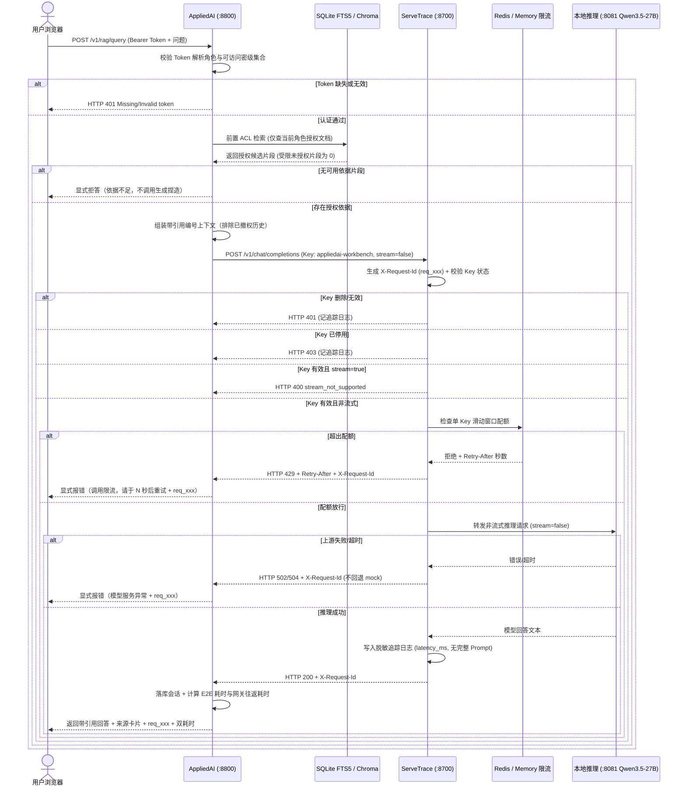
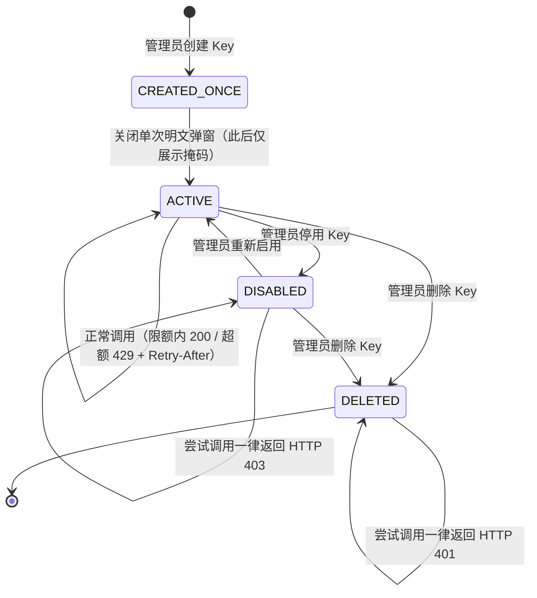

# AppliedAI Platform & ServeTrace 企业权限问答与调用治理 · 全线产品需求文档（PRD）

| 文档属性 | 内容 |
| --- | --- |
| 文档版本 | `v2.0`（Phase 1–3 真实模型联调基线 + 相关性阈值过滤与治理迭代规格） |
| 产品负责范围 | 企业 RAG 权限边界设计、工具调用契约、大模型网关治理与对照评测（个人全栈原型） |
| 更新日期 | 2026-11-20 |
| 适用读者 | 后端与网关研发、RAG/AI 算法工程师、前端研发、安全与 QA 测试 |
| 关联案例文档 | [AppliedAI & ServeTrace 案例说明](../cases/appliedai-platform.md) · [PRD 总目录](README.md) |

> **状态标注约定**：文中每条需求严格区分 `[已落地·已验证]`、`[已落地·待复测]`、`[本版规格·待研发落地]` 与 `[规划·P1/P2]`。小语料规则验证不代表大规模语义召回评测，非流式协议不宣称已支持生产并发吞吐。

---

## 1. 背景、核心痛点与产品定位

### 1.1 业务背景与问题定义

企业在将大模型接入内部制度、财务、研发运维手册等私有知识库时，面临两层相互耦合的失控风险：

1. **知识层越权风险（“召回相关”不等于“有权查看”）**：普通 RAG 系统仅按语义/关键词相似度召回片段。如果访客或低权限员工提问命中薪酬表、密钥备忘录等机密文档，哪怕在 Prompt 中写「请勿泄露机密」，受限片段一旦进入模型上下文就面临提示词注入或改写泄露风险；即便事后过滤输出，也难以拦截同义改写，且权限撤销后历史对话仍可能残留敏感片段。
2. **调用层治理真空（黑盒调用、配额失控与耗时难归因）**：业务应用直连模型服务时，缺少统一的凭证生命周期管理、按调用方限流与请求级追踪。发生超时或异常时，团队无法区分耗时究竟卡在「检索与业务落库」还是「网关与上游模型推理」，且业务方容易把静默回退的 mock 响应误当作真实模型输出。

### 1.2 产品定位与系统边界

本方案由两个职责解耦、通过标准 HTTP 协议联通的子系统构成：
- **AppliedAI Platform（知识库问答与 Agent 工作台，默认 `:8800`）**：负责身份认证、文档密级管理、**检索层前置 ACL 隔离**、本地真实模型引用问答与显式拒答、撤权后历史脱敏以及工具调用契约校验。
- **ServeTrace（本地/企业 AI 调用治理网关，默认 `:8700`）**：负责 API Key 生命周期管理、非流式请求代理（上游本地推理如 `:8081/v1`）、按 Key 滑动窗口限流（`429 + Retry-After`）、`X-Request-Id` 全链路追踪与隐私优先日志（默认不记录完整提示词）。

### 1.3 角色与权限矩阵（对齐 `AppliedAI-Platform/app/api/main.py`）

| 角色 | 知识库查询范围 | 文档导入与上传 | 评测与审计接口（`/v1/eval/*`、`/v1/rag/audit`） | ServeTrace 网关控制台 |
| --- | --- | --- | --- | --- |
| **访客（`guest`）** | 仅 `public` 公开文档 | **禁止**（返回 `HTTP 403`：`guest cannot ingest / upload`） | **禁止**（`HTTP 403`） | 无权访问 |
| **普通授权员工（`employee` / 指定角色）** | `public` + 自身角色有权访问的 `internal` / 指定标签文档 | 受控允许（按接口角色校验） | **禁止**（`HTTP 403 admin only`） | 仅持有被分配的业务 API Key 调用 `/v1/chat/completions` |
| **系统管理员（`admin`）** | 全密级授权文档（含受限演示文档） | 允许导入与密级标记 | 允许触发 ACL/Agent/入库评测与审计报告 | 允许管理 Key 启停/删除、按条件排查请求日志与重置限流窗口 |

### 1.4 明确的非目标（Non-Goals）

- **不宣称已具备企业级 SSO / LDAP / AD 实时同步**：当前为本地令牌与演示身份体系，企业统一身份接入列为后续里程碑。
- **不宣称解决大模型提示词注入或大规模语料召回排序**：当前 5 篇演示文档双路径对照仅验证「检索层前置权限过滤规则」本身，不外推至万级文档语义召回率（MRR/NDCG）。
- **v1 网关不支持流式转发（SSE）与 Token 计费结算**：网关显式拒绝 `stream=true`（`HTTP 400 stream_not_supported`），不虚构未实现的流式中断处理或费用节省数据。
- **不以静默回退 mock 掩盖真实模型故障**：真实模式（`UPSTREAM_MODE=http`）下上游不可用时必须显式报错。

---

## 2. 核心方案选型与架构取舍（Trade-off Matrix）

### 2.1 受限知识权限控制放置在哪一层

| 备选方案 | 受限片段是否进入模型上下文 | 典型失效模式 | 延迟与复杂度 | 选型结论 |
| --- | --- | --- | --- | --- |
| **方案 A：提示词保密约束** | **是**（已召回进 Prompt） | 间接提示注入、角色扮演绕过直接吐出原文 | 低 | 否决：安全边界不能依赖概率模型自律 |
| **方案 B：回答生成后关键词/正则过滤** | **是**（已参与模型推理） | 同义改写、编码绕过漏检；增加额外生成后时延 | 中 | 仅作纵深辅助层，不作主防线 |
| **方案 C：检索层前置 ACL 过滤 + 撤权历史脱敏（采纳）** | **否**（在上下文构建前按密级与角色滤除） | 依赖入库文档密级标签准确性与权限撤销同步机制 | 中（需在 FTS5 与 Chroma 双后端同步实现过滤条件） | **采纳**：安全边界确定可测，可通过正反双身份对照验证 |

### 2.2 真实模型上游故障降级策略

| 策略 | 适用场景 | 风险与取舍结论 |
| --- | --- | --- |
| 静默回退 Mock 回答 | 仅限纯离线自动化单元测试 | **严禁用于真实联调与用户界面**：会把虚假回答伪装成正常结果，破坏 B 端信任 |
| **显式报错 + 保留请求编号（采纳）** | 真实模型问答链路（`UPSTREAM_MODE=http`） | 失败时界面直接呈现失败阶段与 `X-Request-Id`，引导排查网关或上游服务 |

### 2.3 限流后端选型（Memory vs Redis）

| 后端类型 | 优势 | 局限 | 当前状态 |
| --- | --- | --- | --- |
| **Memory 滑动窗口** | 零外部依赖，适合本机开发与离线冒烟测试 | 仅单进程生效，重启丢失计数 | `[已落地·已验证]`（S1：`3×200 + 2×429`） |
| **Redis 滑动窗口** | 进程重启不丢失窗口状态，具备多实例扩展基础 | 依赖本机/容器 Redis 可达；多实例并发一致性尚未压测 | `[已落地·已验证]`（S2 + Phase 2：`X-RateLimit-Backend=redis`） |

### 2.4 引用卡片展示与相关性阈值取舍（针对实测截图暴露的问题）

在 2026-11-09 联调截图（`req_28b7311b939f4ef2`）中，管理员提问「仓库代号是什么？」时，模型准确引用 `[1] 青浦演示手册` 给出答案，但回答下方同时展示了 `[2] Executive Payroll` 至 `[5] Vault Notes` 共 5 张全库授权文档卡片。原因在于 5 篇演示语料规模小于 `top_k=8` 且未设相关性得分下限。本版 PRD 新增 `AA-011 [本版规格·待研发落地]`：默认仅展示「模型正文实际引用编号」或「相关性分数高于阈值」的来源卡片，其余召回片段折叠至「查看全部检索候选（调试视图）」。

---

## 3. 全线功能架构与需求优先级清单（P0–P2）

### 3.1 AppliedAI Platform 需求表（`AA-001` 至 `AA-012`）

| 编号 | 模块 | 需求描述 | 优先级 | 当前状态 | 核心验收标准 |
| --- | --- | --- | --- | --- | --- |
| `AA-001` | 身份认证与角色鉴权 | Bearer Token 校验，区分 `guest` / 授权角色 / `admin`；缺 Token 或无效 Token 返回 `401`，越权写操作或管理接口返回 `403` | P0 | `[已落地·已验证]` | 访客调用 `/v1/rag/ingest`、`/v1/rag/upload` 返回 `403`；非 admin 调 `/v1/eval/*` 返回 `403` |
| `AA-002` | 文档入库与格式校验 | 支持文本入库与 PDF/UTF-8 文件上传，强制标注密级标签（`public` / `internal` / 受限标签），非法 PDF、非 UTF-8 或非法密级返回 `400` | P0 | `[已落地·已验证]` | 入库保留分片密级元数据，非法文件显式拒收 |
| `AA-003` | 检索层前置 ACL 隔离 | 在 SQLite FTS5 与 Chroma 持久化向量库双路径上，查询执行前按当前身份权限拼装过滤条件，禁止 `allow_fallback` 静默降级 | P0 | `[已落地·已验证]` | 5 篇演示文档双路径同题双身份对照：未授权 `0/9`、授权 `9/9`、公开题 `2/2`、关 ACL `9/9` |
| `AA-004` | 本地真实模型引用问答与拒答 | 联通本地 `Qwen3.5-27B` + `BAAI/bge-small-zh-v1.5`，回答附 `[n]` 可点击来源卡片；无证据问题显式拒答（如「火星班车」） | P0 | `[已落地·已验证]` | Phase 1/3 实测问答与引用回查通过；上游故障显式报错不静默切 mock |
| `AA-005` | 权限撤销后历史脱敏与上下文移出 | 用户某密级权限被撤销后，历史会话中对应受限回答内容脱敏遮蔽，且该受限片段从后续追问的对话上下文中移除 | P0 | `[已落地·已验证]` | 撤权后再打开旧会话与发起追问，均不再出现原受限内容 |
| `AA-006` | 网关联通与双耗时展示 | 通过专用凭证 `appliedai-workbench` 调用 ServeTrace `/v1/chat/completions`，在回答卡片展示 `gateway_request_id`、端到端问答耗时与网关往返耗时 | P0 | `[已落地·已验证]` | Phase 3 实测 `req_617280ddf2674a1b` 与 `req_28b7311b939f4ef2` 编号可跨系统反查 |
| `AA-007` | 工具注册表与参数校验 | 维护白名单工具注册表（`GET /tools`）与调用入口（`POST /v1/agent/run`），执行前校验工具名与参数 Schema | P0 | `[已落地·已验证]` | 未知工具返回 `400` 或归一化 `unknown_tool` |
| `AA-008` | 工具混沌异常兜底 | 严格区分并结构化返回三类工具异常：`execution_error`（执行失败）、`timeout`（超时，如 `0.5s`）、`unknown_tool`（未知工具） | P0 | `[已落地·已验证]` | Mock 评测集 10/10 路由匹配 + 3 类混沌分支全绿 |
| `AA-009` | 内置评测与审计端点 | 提供 `/v1/eval/acl`、`/v1/eval/agent`、`/v1/rag/audit` 等管理员接口，输出可复现评测报告 | P1 | `[已落地·已验证]` | 仅 `admin` 可调；`limit` 校验范围 `1..500` |
| `AA-010` | 会话持久化与重启恢复 | 会话历史与文档索引落 SQLite / 本地持久化目录，服务重启后可恢复查看与继续追问 | P0 | `[已落地·已验证]` | 重启后 `req_c823119917e64fb9` 续问与历史记录均正常 |
| `AA-011` | 引用相关性阈值与卡片降噪 | 引入检索相关性得分下限（如 cosine `>= 0.35`）与「仅默认展开正文实际引用 `[n]` 卡片」规则，避免无关授权文档刷屏截断 | P1 | `[本版规格·待研发落地]` | 管理员提问「仓库代号是什么？」时默认仅展示 `[1] 青浦演示手册`，其余候选折叠在调试区 |
| `AA-012` | 真实模型多步工具调用评测 | 脱离 mock fixture，在本地 `Qwen3.5-27B` 上验证多步工具选择、参数自纠与超时回退 | P1 | `[规划·P1/P2]` | 补齐真实模型 20 题多步工具评测报告 |

### 3.2 ServeTrace 网关需求表（`ST-001` 至 `ST-010`）

| 编号 | 模块 | 需求描述 | 优先级 | 当前状态 | 核心验收标准 |
| --- | --- | --- | --- | --- | --- |
| `ST-001` | API Key 生命周期管理 | 创建 Key 时完整明文**仅展示一次**；列表页永久展示掩码后缀；支持停用与删除 | P0 | `[已落地·已验证]` | 停用 Key 调用返回 `HTTP 403`；删除/无效/缺失 Key 返回 `HTTP 401`；报告不泄完整明文 |
| `ST-002` | OpenAI 兼容非流式代理 | 暴露 `GET /v1/models` 与 `POST /v1/chat/completions`，上游强制 `stream=false` 转发 | P0 | `[已落地·已验证]` | 真实本地模型问答返回 `200` 及标准 OpenAI 响应体 |
| `ST-003` | 显式拒绝流式请求 | 当客户端传入 `stream=true`（已过鉴权与限流），网关显式返回 `HTTP 400` 与 `error.code = "stream_not_supported"` | P0 | `[已落地·已验证]` | `test_stream_not_supported` 自动化通过 |
| `ST-004` | 按 Key 滑动窗口限流 | 支持 Memory 与 Redis 双限流后端，超配额返回 `HTTP 429` + 整数秒 `Retry-After`（`>= 1`）+ `X-RateLimit-Backend` 响应头 | P0 | `[已落地·已验证]` | `3 req / 60s` 突发 5 次实测稳定输出 `3×200 + 2×429`（`Retry-After=59`） |
| `ST-005` | 全链路请求编号追踪 | 每次调用（含放行与限流/拒绝）生成并回传 `X-Request-Id`（`req_<16位hex>`），写入持久化 JSONL 追踪日志并支持 `GET /v1/traces/{trace_id}` | P0 | `[已落地·已验证]` | 服务重启后原 `req_*` 仍可在日志列表和详情页查到 |
| `ST-006` | 隐私优先日志脱敏 | 请求日志默认**不保存完整 Prompt 与模型回答全文**，仅记录时间、调用者、状态码、结果标签、网关耗时与请求编号 | P0 | `[已落地·已验证]` | 控制台请求列表与详情页均无原始 Prompt 明文泄露 |
| `ST-007` | 控制台多维筛选与排查 | 请求记录页支持按「时间范围（本地时区）+ 结果（`success`/`rate_limited`/错误）+ 调用者名称 + 请求编号」组合筛选与分页 | P0 | `[已落地·已验证]` | Phase 2 浏览器截图 01–10 全部验收通过 |
| `ST-008` | 健康检查与限流复位 | 暴露 `/health`、`/health/detail`（返回 `redis_wired`、`api_key_count`）与 `/admin/reset_rate_limit` | P1 | `[已落地·已验证]` | 探活返回准确后端状态 |
| `ST-009` | 上游断连与客户端取消故障演练 | 规范上游超时（`504`）、连接拒绝（`502`）与客户端主动取消（`499`）的结构化错误码与追踪状态 | P1 | `[本版规格·待研发落地]` | 断连演练中追踪日志准确记录失败阶段，不误标 `success` |
| `ST-010` | 多实例 Redis 并发限流一致性验收 | 双网关进程共享同一 Redis 实例执行并发压测，验证配额计数无超发 | P2 | `[规划·P1/P2]` | 并发突发请求严格遵守全局单 Key 阈值 |

---

## 4. 端到端调用链路与状态机

### 4.1 跨系统端到端问答与治理时序图



### 4.2 ServeTrace API Key 生命周期状态机



### 4.3 AppliedAI 权限撤销与历史会话状态转换

| 阶段 | 用户当前权限 | 历史回答 UI 展示 | 后续追问上下文组装 | 验收准则 |
| --- | --- | --- | --- | --- |
| 正常授权态 | 持有文档密级权限 | 完整展示回答文本与可点击引用来源卡片 | 保留历史问答摘要用于多轮追问 | 点击 `[1]` 弹出原文片段 |
| 权限撤销态 | 管理员撤销该用户对受限密级的访问权 | 原受限回答及对应来源片段立刻替换为脱敏占位文案 | 组装下一轮 Prompt 时将该受限轮次与原文片段强制剔除 | 刷新页面与新发起追问均无法套出原受限信息 |

---

## 5. 核心页面交互规格、字段规则与错误码文案

### 5.1 HTTP 状态码与用户端文案映射表（对齐真实后端代码）

| 来源 | HTTP 状态码 | 后端错误明细 / Error Code | 前端精确提示文案与交互行为 |
| --- | --- | --- | --- |
| AppliedAI | `400` | `Invalid PDF` / `File must be UTF-8 text` / `bad classification` | 表单行内红字提示具体原因（文件损坏、编码非 UTF-8 或密级标签非法），阻止入库 |
| AppliedAI | `401` | `Missing token` / `Invalid token` | 清除本地失效会话，跳转登录页并提示「登录状态已失效，请重新登录」 |
| AppliedAI | `403` | `guest cannot ingest` / `guest cannot upload` / `admin only` | 隐藏对应操作按钮；若通过 API 直调则返回权限不足提示，不泄露内部表结构 |
| ServeTrace | `400` | `stream_not_supported` | 提示调用方「当前网关仅支持非流式请求，请设置 `stream=false` 后重试」 |
| ServeTrace | `401` | 无效/已删除/缺失 API Key | 提示「调用凭证无效或已删除」，记录脱敏追踪日志 |
| ServeTrace | `403` | 已停用 API Key | 提示「该调用凭证已被管理员停用，请联系管理员重新启用」 |
| ServeTrace | `429` | `rate_limited`（附 `Retry-After`） | 提示「调用过于频繁，请在 `{Retry-After}` 秒后重试（请求编号：`{X-Request-Id}`）」 |
| ServeTrace / AppliedAI | `502 / 504` | 上游本地模型不可达或超时 | 保留用户输入，显示红色故障条与 `req_*` 编号；**严禁回退 mock 假答案** |

### 5.2 引用卡片降噪与双耗时可读性规格（`AA-011` `[本版规格·待研发落地]`）

1. **相关性阈值过滤**：检索层返回带相似度分数的候选片段后，仅保留得分 `>= 阈值` 且数量不超过 `max_citations=3` 的片段进入默认引用区；若正文明确标注 `[1]`，则默认仅展开被正文引用的编号卡片，其余低相关授权片段收纳至折叠抽屉「其他检索候选（管理员调试）」。
2. **来源卡片截断规则**：每张引用卡片展示文档标题、密级徽章（`公开`/`内部`/`受限`）与完整句子级摘要（按句号/换行截断并加 `…`，禁止英文单词中段生硬腰斩），点击卡片展开完整原文抽屉。
3. **双耗时语义标注**：回答元数据栏保留真实区分——`端到端问答耗时`（含检索、权限检查、模型生成与落库）与 `网关往返耗时`（含 ServeTrace 鉴权限流与上游模型生成），并附可一键复制的 `gateway_request_id` 用于跳去 ServeTrace 日志页定位。

---

## 6. 核心接口契约与数据模型（基于真实 FastAPI 源码）

### 6.1 AppliedAI Platform 已验证路由表

| 方法与路径 | 权限 | 用途 | 核心请求/响应字段 |
| --- | --- | --- | --- |
| `GET /health`、`GET /health/detail` | 公开 | 服务与检索后端（FTS5/Chroma）、嵌入模型、上游配置状态 | `vector_store`, `chroma_wired`, `effective_embed_mode` |
| `GET /me` | 登录 | 返回当前身份与角色权限 | `username`, `role`, `allowed_classifications` |
| `GET /v1/rag/documents` | 登录 | 按当前角色列出有权查看的文档清单 | `documents[]`（含 `id`, `title`, `classification`） |
| `POST /v1/rag/ingest`、`POST /v1/rag/upload` | 非 guest | 文本或文件（PDF/UTF-8）入库并打密级标签 | `title`, `classification`, `file` |
| `POST /v1/rag/query` | 登录 | 执行前置 ACL 检索 + 本地模型/网关问答 | `question`, `session_id` → `answer`, `citations[]`, `gateway_request_id`, `e2e_ms`, `gateway_rtt_ms` |
| `GET /tools`、`POST /v1/agent/run` | 登录 | 查询工具注册表、执行参数校验后的工具路由 | `query`, `tools[]` → `tool_calls[]`, `status`, `error_type` |
| `POST /v1/eval/acl`、`POST /v1/eval/agent` | `admin` | 运行 ACL 正反对照评测与工具混沌评测 | `backend (fts/vector/chroma)` → 逐题通过明细 |
| `GET /v1/rag/audit`、`POST /v1/rag/audit/report` | `admin` | 查询审计记录（`limit: 1..500`）并导出报告 | 审计明细与汇总统计 |

### 6.2 ServeTrace 网关已验证路由表与响应头契约

| 方法与路径 | 鉴权 | 用途 | 关键协议头与返回契约 |
| --- | --- | --- | --- |
| `GET /health`、`GET /health/detail` | 公开 | 网关健康、Redis 连通性与 Key 数量状态 | `redis_wired`, `api_key_count` |
| `GET /v1/models` | API Key | 列出上游可用模型 | 标准 OpenAI models 列表 |
| `POST /v1/chat/completions` | API Key | 非流式对话代理（强制 `stream=false`） | 响应头必带 `X-Request-Id`、`X-RateLimit-Backend`；超额时必带 `Retry-After`；`stream=true` 返回 `400 stream_not_supported` |
| `GET /v1/traces/{trace_id}`、`GET /admin/traces` | 鉴权/管理 | 按 `req_*` 查单条追踪详情或组合筛选日志列表 | `request_id`, `caller`, `status_code`, `result`, `latency_ms`, `timestamp`（不含完整 Prompt） |
| `POST /admin/reset_rate_limit` | 管理 | 测试与运维重置限流窗口 | 返回复位确认 |

### 6.3 工具调用契约与归一化错误枚举（对齐 `P3` 实测）

```json
{
  "tool_contract": {
    "name": "kb_search_mock",
    "timeout_s": 0.5,
    "error_enum": ["execution_error", "timeout", "unknown_tool"]
  },
  "normalized_failure_example": {
    "ok": false,
    "tool": "no_such_tool",
    "error_type": "unknown_tool",
    "message": "unknown tool: no_such_tool"
  }
}
```

---

## 7. AI 专项评测体系：正反对照 ACL、真实模型走查与工具契约

### 7.1 为什么必须采用“三向正反对照”而不是单测越权拦截

单测「未授权命中 `0/9`」存在致命漏洞——一个直接把检索功能写坏、什么文档都查不到的系统也能拿 `0/9` 满分。因此本评测体系强制绑定四个对照维：
1. **未授权身份查受限题（越权防线）**：目标受限标记命中必须为 `0/9`；
2. **授权身份查同一受限题（可用性基线）**：同题目标受限标记命中必须为 `9/9`（证明没有一刀切误拦）；
3. **双身份查公开题（公共可用性）**：访客与授权用户均须通过 `2/2`；
4. **刻意关闭 ACL 开关（实验有效性反证）**：关闭保护后受限命中恢复 `9/9`（证明测试题本身确实能召回目标文档）。

### 7.2 已验证基线汇总与可执行评测集（`AS-TC-01` 至 `AS-TC-15`）

| 用例编号 | 评测模块 | 测试输入 / 场景 | 预期结果与放行门槛 | 实测结果与状态 |
| --- | --- | --- | --- | --- |
| `AS-TC-01` | FTS5 前置 ACL 正反对照 | 5 篇演示文档、9 组受限题双身份 + 2 组公开题 | 未授权 `0/9`、授权 `9/9`、公开 `2/2`、关 ACL `9/9` | `[已落地·已验证]`（全通过） |
| `AS-TC-02` | Chroma 前置 ACL 正反对照 | 同 5 篇文档持久化 Chroma（`allow_fallback=false`） | 未授权 `0/9`、授权 `9/9`、公开 `2/2`、关 ACL `9/9`，`fallback_calls=0` | `[已落地·已验证]`（2026-11-17 补验全通过，见局限声明） |
| `AS-TC-03` | 真实本地模型引用问答 | Phase 1/3 提问「仓库代号是什么？」（《青浦演示手册》） | 回答「芦潮港灯塔-7719 [1]」，可点击引用查看原文 | `[已落地·已验证]`（`req_28b7311b939f4ef2`） |
| `AS-TC-04` | 真实模型无依据显式拒答 | 提问语料外问题（「火星班车」） | 显式说明资料库无相关依据，不编造答案 | `[已落地·已验证]`（Phase 1 走查通过） |
| `AS-TC-05` | 访客隔离与文档预览拦截 | 访客登录访问资料库并查询内部手册 | 不可预览内部文档，不可检索受限片段，上传返回 `403` | `[已落地·已验证]` |
| `AS-TC-06` | 撤权后历史脱敏与上下文移出 | 撤销用户受限权限后刷新旧会话并发起追问 | 历史受限内容脱敏，追问上下文不再带入原受限片段 | `[已落地·已验证]` |
| `AS-TC-07` | 跨系统编号与双耗时核对 | AppliedAI 经 `appliedai-workbench` 调 ServeTrace 联调 | 返回 `req_*` 可在 ServeTrace 日志页反查；端到端与网关耗时分开展示 | `[已落地·已验证]`（`req_617280ddf2674a1b`：E2E `4857ms` / RTT `4847ms` / 网关日志 `4140ms`） |
| `AS-TC-08` | ServeTrace Key 启停与删除 | 停用 Key 后调用；删除 Key 后调用；无 Key 调用 | 停用返回 `403`；删除/无效/缺失返回 `401` | `[已落地·已验证]`（Phase 2 + S3 通过） |
| `AS-TC-09` | ServeTrace 非流式协议护栏 | 携带有效 Key 发送 `stream=true` | 返回 `HTTP 400` + `error.code="stream_not_supported"` | `[已落地·已验证]`（`test_stream_not_supported` 通过） |
| `AS-TC-10` | Memory / Redis 滑动窗口限流 | 单 Key `3 req / 60s`，连续突发 5 次请求 | 精确返回 `3×200 + 2×429` 且 `429` 含 `Retry-After`（实测 `59`） | `[已落地·已验证]`（S1/S2/Phase 2 均通过，`35 passed, 1 skipped`） |
| `AS-TC-11` | Mock 工具路由与混沌分支 | 10 条固定路由题 + failure / timeout(`0.5s`) / unknown_tool | 路由匹配 `10/10`，三类异常归一化状态精准命中 | `[已落地·已验证]`（P3 全通过） |
| `AS-TC-12` | 引用卡片相关性降噪 | 管理员在 5 篇语料下提问「仓库代号是什么？」 | 默认仅展示正文引用的 `[1]` 卡片，不平铺无关机密卡片 | `[本版规格·待研发落地]`（对应 `AA-011`） |
| `AS-TC-13` | 上游断连故障演练 | 关闭 `:8081` 本地模型服务后在前端发起问答 | 界面显式报上游失败与 `req_*`，`0` 次静默回退 mock，日志标记失败 | `[本版规格·待研发落地]`（对应 `ST-009`） |
| `AS-TC-14` | 真实模型多步工具调用 | 切换 `Qwen3.5-27B` 真实推理跑 20 题多步工具调用 | 工具选择准确率、参数合法率与超时恢复单独出报告 | `[规划·P1/P2]` |
| `AS-TC-15` | 大规模语料召回与标签错配审计 | 扩充至 `>= 200` 篇多部门文档并故意注入 5 条错标文档 | 测 Recall@5、误拦率及源标签错配审计检出能力 | `[规划·P1/P2]` |

---

## 8. 审计日志、隐私规则与监控指标

### 8.1 隐私默认原则（已落地基线）

1. **Key 零明文留存展示**：创建 Key 仅在生成当次返回明文，后台列表、截图及验收报告全部只显示脱敏掩码。
2. **默认不存完整 Prompt**：ServeTrace 请求日志只记录时间戳、请求编号、调用者标识、HTTP 状态、结果分类与 `latency_ms`，避免网关日志本身成为二次数据泄露面。

### 8.2 运营监控指标规格（`[规划·P1/P2]`，尚无生产运行数据）

| 指标类别 | 指标名称 | 定义 | 告警红线（规划） |
| --- | --- | --- | --- |
| 安全护栏 | 前置 ACL 越权回归通过率 | 每日 CI 自动跑正反对照越权集通过率 | `< 100%` 阻断发布 |
| 质量指标 | 有效引用覆盖率 & 无依据拒答准确率 | 带准确原文引用回答占比 / 语料外问题正确拒答占比 | 随基准评测集迭代设定 |
| 网关稳定性 | 限流触发率 & 上游 `5xx` 异常率 | `429` 请求占比 / 上游失败占比 | 区分业务限流与上游故障，分别触发告警 |
| 延迟拆分 | `P95(端到端耗时 - 网关往返耗时)` vs `P95(网关日志耗时)` | 定位性能瓶颈是在检索/落库层还是上游推理层 | 独立监控两段耗时漂移 |

---

## 9. 风险清单、边界局限与迭代路线图

以下边界均已在实测报告中核验记录，严禁对外超范围承诺：

1. **小语料规则验证边界**：2026-11-17 Chroma 补验明确记录——语料为 5 篇演示文档/5 分片、`top_k=8` 超过语料总量，且独立补验脚本采用确定性 256 维哈希嵌入以实现零网络复现（完整工作台联调使用的是 `BAAI/bge-small-zh-v1.5` 与真实 `Qwen3.5-27B`）。该结果证明**前置 ACL 过滤规则在 FTS5 与 Chroma 双后端生效**，不代表大规模语义排序质量。
2. **源文档密级错标风险**：前置 ACL 只能严格执行已标注的密级标签；若管理员误将机密文件标为 `public`，过滤层无法自行纠错——需在后续版本补充入库敏感词预扫描与密级变更双人复核。
3. **非流式与并发压测局限**：ServeTrace 当前不支持 SSE 流式转发，也未做多实例高并发 Redis 吞吐压测；上述能力均明确归类为 P1/P2 路线图项。

[上一份 PRD：QuantLab](quantlab-prd.md) · [返回 PRD 总目录](README.md) · [下一份 PRD：ClassNote AI](classnote-ai-prd.md)
