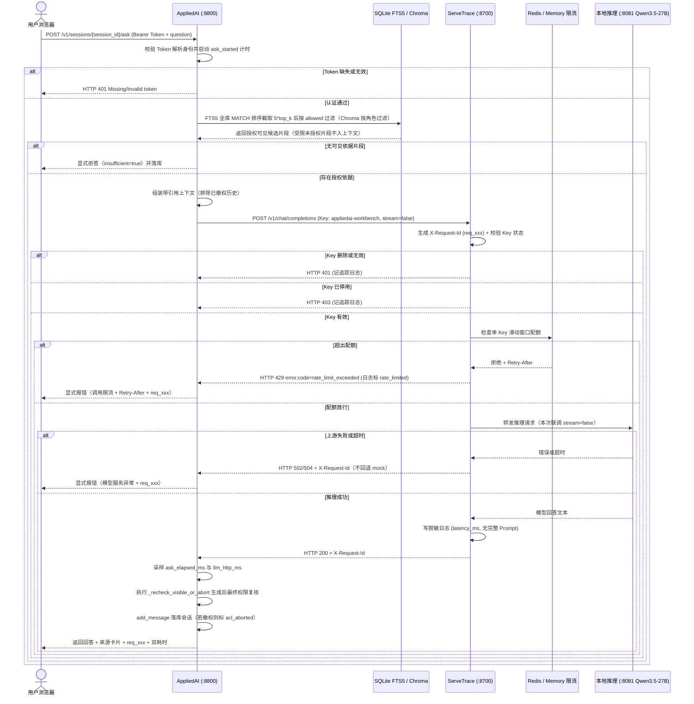
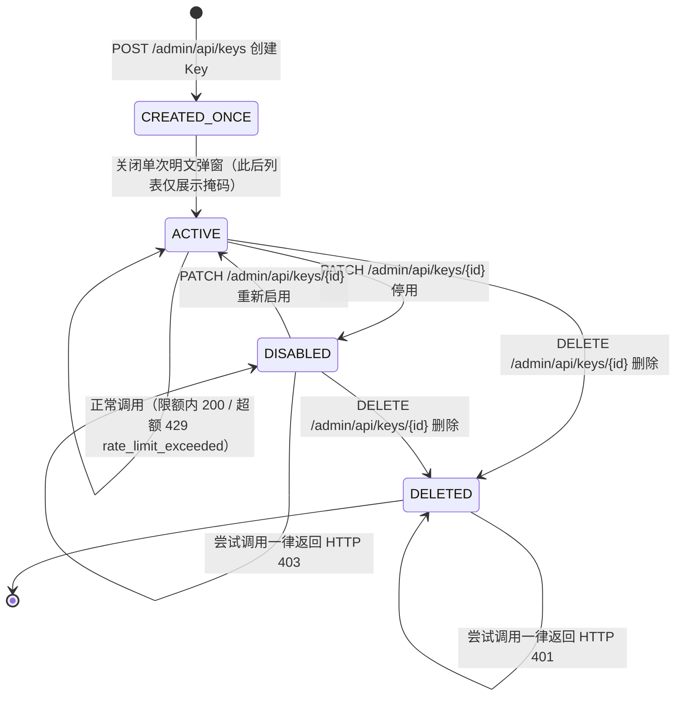

# AppliedAI Platform & ServeTrace 企业权限问答与调用治理 · 全线产品需求文档（PRD）

| 文档属性 | 内容 |
| --- | --- |
| 文档版本 | `v2.1`（Phase 1–3 真实模型联调基线 + 源码路由/版本/计时/撤权时点校准版） |
| 产品负责范围 | 企业 RAG 权限边界设计、工具调用契约、大模型网关治理与对照评测（个人全栈原型） |
| 对应源仓基线 | AppliedAI-Platform `035d67b`（2026-11-09 联调版） · ServeTrace `5392938`（2026-11-09 管理台版）及早期本地 M1 非流式版 |
| 更新日期 | 2026-11-20 |
| 适用读者 | 后端与网关研发、RAG/AI 算法工程师、前端研发、安全与 QA 测试 |
| 关联案例文档 | [AppliedAI & ServeTrace 案例说明](../cases/appliedai-platform.md) · [PRD 总目录](README.md) |

> **状态标注约定**：文中每条需求严格区分 `[已落地·已验证]`、`[已落地·待复测]`、`[本版规格·待研发落地]` 与 `[规划·P1/P2]`。不同提交版本的能力差异（如早期网关拒绝流式 vs 11-09 源仓新增 SSE 分支）按版本显式拆列，不混写。

---

## 1. 背景、核心痛点与产品定位

### 1.1 业务背景与问题定义

企业在将大模型接入内部制度、财务、研发运维手册等私有知识库时，面临两层相互耦合的失控风险：

1. **知识层越权风险（“召回相关”不等于“有权查看”）**：普通 RAG 系统仅按语义/关键词相似度召回片段。如果访客或低权限员工提问命中薪酬表、密钥备忘录等机密文档，哪怕在 Prompt 中写「请勿泄露机密」，受限片段一旦进入模型上下文就面临提示词注入或改写泄露风险；即便事后过滤输出，也难以拦截同义改写，且权限撤销后历史对话仍可能残留敏感片段。
2. **调用层治理真空（黑盒调用、配额失控与耗时难归因）**：业务应用直连模型服务时，缺少统一的凭证生命周期管理、按调用方限流与请求级追踪。发生超时或异常时，团队无法区分耗时究竟卡在「检索与业务处理」还是「网关与上游模型推理」，且业务方容易把静默回退的 mock 响应误当作真实模型输出。

### 1.2 产品定位与系统边界

本方案由两个职责解耦、通过标准 HTTP 协议联通的子系统构成：
- **AppliedAI Platform（知识库问答与 Agent 工作台，默认 `:8800`）**：负责身份认证、文档密级管理、**上下文构建前 ACL 隔离与生成后二次验权**、本地真实模型引用问答与显式拒答、撤权后历史脱敏以及工具调用契约校验。
- **ServeTrace（本地/企业 AI 调用治理网关，默认 `:8700`）**：负责 API Key 生命周期管理、OpenAI 兼容代理（上游本地推理如 `:8081/v1`）、按 Key 滑动窗口限流（`429` + `error.code="rate_limit_exceeded"` + `Retry-After`）、`X-Request-Id` 全链路追踪与隐私优先日志（默认不记录完整提示词）。

### 1.3 角色与权限矩阵（对齐 `AppliedAI-Platform@035d67b` 真实实现）

| 角色 | 知识库检索与问答 | 文档导入与上传 | 审计记录查询（`GET /v1/rag/audit`） | 导出审计报告与评测（`/v1/rag/audit/report`、`/v1/eval/*`） | ServeTrace 网关控制台（`/admin/*`） |
| --- | --- | --- | --- | --- | --- |
| **访客（`guest`）** | 仅 `public` 公开文档 | **禁止**（`403 guest cannot ingest / upload`） | 仅可查本人审计记录（需登录 Token） | **禁止**（`403 admin only`） | 无权访问 |
| **普通授权员工（`analyst` / 授权角色）** | `public` + 自身角色有权访问的文档 | 受控允许（按角色校验） | 仅可查**本人**审计记录 | **禁止**（`403 admin only`） | 仅持有分配的业务 API Key 调用 `/v1/chat/completions` |
| **系统管理员（`admin`）** | 全密级授权文档（含受限演示文档） | 允许导入与密级标记 | 可查**全局**审计记录 | **允许**导出审计报告并触发评测 | 允许管理 Key 启停/删除、多维筛选 `/admin/api/logs` 与复位限流 |

> **注（公开只读端点边界）**：`GET /tools` 在 `035d67b` 实现中无登录依赖，仅返回已注册工具元数据；是否将其收口为需登录鉴权作为 `AA-014 [规划·P1/P2]` 评估。

### 1.4 明确的非目标（Non-Goals）

- **不宣称已具备企业级 SSO / LDAP / AD 实时同步**：当前为本地令牌与演示身份体系，企业统一身份接入列为后续里程碑。
- **不宣称解决大模型提示词注入或大规模语料召回排序**：当前 5 篇演示文档双路径对照仅验证「权限过滤规则」本身，不外推至万级文档语义召回率（MRR/NDCG）。
- **不宣称已完成真实上游 SSE 压测或 Token 计费结算**：本次 AppliedAI 联调采用非流式；2026-11-09 网关源仓虽已补齐 SSE 分支与 mock 测试，但真实本地模型上游的 SSE 长连接中断与多实例并发吞吐尚未验收。
- **不以静默回退 mock 掩盖真实模型故障**：真实模式（`UPSTREAM_MODE=http`）下上游不可用时必须显式报错。

---

## 2. 核心方案选型与架构取舍（Trade-off Matrix）

### 2.1 受限知识权限控制放置在哪一层

| 备选方案 | 受限片段是否进入模型上下文 | 典型失效模式 | 选型结论 |
| --- | --- | --- | --- |
| **方案 A：提示词保密约束** | **是**（已召回进 Prompt） | 间接提示注入、角色扮演绕过直接吐出原文 | 否决：安全边界不能依赖概率模型自律 |
| **方案 B：回答生成后关键词/正则过滤** | **是**（已参与模型推理） | 同义改写、编码绕过漏检；增加额外生成后时延 | 仅作纵深辅助层，不作主防线 |
| **方案 C：上下文构建前 ACL 过滤 + 生成后二次复核（`_recheck_visible_or_abort`）+ 撤权历史脱敏（采纳）** | **否**（受限片段不进上下文；生成中撤权则在落库前拦截） | 依赖入库文档密级标签准确性；且 FTS5 现行实现先全库排序截取 `5×top_k` 再按 `allowed` 过滤，高密级大语料下存在合法候选被提前挤出风险（见 `AA-013`） | **采纳**：受限内容零进上下文，并明确记录 FTS5 先截断后过滤的召回权衡与 SQL 下推改进项 |

### 2.2 真实模型上游故障降级策略

| 策略 | 适用场景 | 风险与取舍结论 |
| --- | --- | --- |
| 静默回退 Mock 回答 | 仅限纯离线自动化单元测试 | **严禁用于真实联调与用户界面**：会把虚假回答伪装成正常结果 |
| **显式报错 + 保留请求编号（采纳）** | 真实模型问答链路（`UPSTREAM_MODE=http`） | 失败时界面直接呈现失败阶段与 `X-Request-Id`，便于按编号去网关排查 |

### 2.3 流式协议版本演进说明（按源仓提交诚实拆分）

| 网关版本 | 收到 `stream=true` 时的行为 | 测试与联调状态 |
| --- | --- | --- |
| **早期本地 M1 版（`/ServeTrace` 旧快照）** | 仅支持非流式，显式返回 `HTTP 400` + `error.code="stream_not_supported"` | `[已落地·已验证]`（早期单元测试） |
| **2026-11-09 源仓版（`5392938`）** | 已实现 SSE 流式分支（返回 `text/event-stream`），本次 AppliedAI Phase 3 联调仍显式发送 `stream=false` 走非流式路径 | Mock SSE 测试断言 `200` 与结束标记已过；**真实本地模型上游的 SSE 转发与客户端中途取消尚未复测** `[已落地·待复测]` |

### 2.4 引用卡片展示与相关性阈值取舍（针对实测截图暴露的问题）

在 2026-11-09 联调截图（`req_28b7311b939f4ef2`）中，管理员提问「仓库代号是什么？」时，模型准确引用 `[1] 青浦演示手册` 给出答案，但回答下方同时展示了 `[2]` 至 `[5]` 共 5 张全库授权文档卡片（因 5 篇演示语料规模小于 `top_k` 且无相关性阈值裁剪）。本版 PRD 新增 `AA-011 [本版规格·待研发落地]` 定义分后端校准的相关性过滤与正文引用展开优先级规则。

---

## 3. 全线功能架构与需求优先级清单（P0–P2）

### 3.1 AppliedAI Platform 需求表（`AA-001` 至 `AA-014`）

| 编号 | 模块 | 需求描述 | 优先级 | 当前状态 | 核心验收标准 |
| --- | --- | --- | --- | --- | --- |
| `AA-001` | 身份认证与角色鉴权 | Bearer Token 校验，区分 `guest` / 授权角色 / `admin`；缺或无效 Token 返回 `401`，访客写操作与非管理员导出/评测返回 `403` | P0 | `[已落地·已验证]` | 访客调 `/v1/rag/ingest`、`/v1/rag/upload` 返回 `403`；非 admin 调 `/v1/eval/*` 与 `/v1/rag/audit/report` 返回 `403` |
| `AA-002` | 文档入库与格式校验 | 支持文本入库与 PDF/UTF-8 文件上传并标注密级标签，非法 PDF、非 UTF-8 或非法密级返回 `400` | P0 | `[已落地·已验证]` | 入库保留分片密级元数据，非法文件显式拒收 |
| `AA-003` | 上下文前 ACL 过滤（双后端） | 在 SQLite FTS5 与 Chroma 持久化向量库双路径上按当前身份过滤受限文档；补验严格设 `allow_fallback=false` 禁止静默降级 | P0 | `[已落地·已验证]` | 5 篇演示文档双路径成对对照：未授权 `0/9`、授权 `9/9`、1 道公开题 `NEG-01` 双身份 `2/2`、关 ACL `9/9` |
| `AA-004` | 本地真实模型会话问答与拒答 | 工作台 `POST /v1/sessions/{session_id}/ask` 联通本地 `Qwen3.5-27B` + `BAAI/bge-small-zh-v1.5`，带 `[n]` 来源引用；无依据问题显式拒答（如「火星班车」） | P0 | `[已落地·已验证]` | Phase 1/3 实测问答与引用回查通过；上游故障显式报错不静默切 mock |
| `AA-005` | 生成后二次验权与撤权历史脱敏 | ① 生成后、落库前执行 `_recheck_visible_or_abort`，发现生成期间撤权即中止输出并标 `aborted_due_to_acl=true`、`llm_mode="acl_aborted"`；② 撤权后历史会话受限内容脱敏并移出后续追问上下文 | P0 | `[已落地·已验证]`（撤权后刷新与追问已验；生成中竞态与混合来源见 `AA-015` 扩展用例） | 4 时点撤权生命周期矩阵见 §4.3 |
| `AA-006` | 网关联通与分段耗时记录 | 通过专用凭证 `appliedai-workbench` 调用 ServeTrace `/v1/chat/completions`（非流式），记录 `gateway_request_id`、`ask_elapsed_ms` 与 `llm_http_ms` | P0 | `[已落地·已验证]` | Phase 3 实测 `req_617280ddf2674a1b`（4857 / 4847 / 网关日志 4140 ms）与 `req_28b7311b939f4ef2`（4684 / 4663 ms）跨系统对齐 |
| `AA-007` | 工具注册表与参数校验 | 维护白名单工具注册表（`GET /tools`）与调用入口（`POST /v1/agent/run`），执行前校验工具名与参数 | P0 | `[已落地·已验证]` | 未知工具返回 `400` 或归一化 `unknown_tool` |
| `AA-008` | 工具混沌异常兜底 | 严格区分并结构化返回三类工具异常：`execution_error`（执行失败）、`timeout`（超时 `0.5s`）、`unknown_tool`（未知工具） | P0 | `[已落地·已验证]` | Mock 评测集 10/10 路由匹配 + 3 类混沌分支全绿 |
| `AA-009` | 分权审计与内置评测端点 | 普通用户查本人审计、管理员查全局审计（`GET /v1/rag/audit`，`limit: 1..500`）；管理员专属导出报告与评测端点 | P1 | `[已落地·已验证]` | 三级审计权限分测通过 |
| `AA-010` | 会话持久化与重启恢复 | 会话历史与文档索引落 SQLite / 本地持久化目录，重启后可恢复查看与继续追问 | P0 | `[已落地·已验证]` | 重启后 `req_c823119917e64fb9` 续问与历史记录正常 |
| `AA-011` | 分后端相关性校准与引用展开优先级 | 区分 FTS5（BM25 相对落差/阈值）与向量后端（cosine 阈值）校准相关性；明确先验权→验支撑→优先展开正文已引用 `[n]` 卡片（硬上限 5），再按分数补足至 3 张 | P1 | `[本版规格·待研发落地]` | 管理员提问「仓库代号是什么？」默认仅展示 `[1] 青浦演示手册`，低相关卡片收纳至折叠调试区 |
| `AA-012` | 真实模型多步工具调用评测 | 脱离 mock fixture，在本地 `Qwen3.5-27B` 上跑 20 题含对抗样例的真实多步工具评测（逐题定义允许工具、参数 Schema、支撑句与拒答条件） | P1 | `[规划·P1/P2]` | 越权与错选工具对象为 0 容忍阻断项 |
| `AA-013` | FTS5 SQL 层权限下推优化 | 将当前 `search.py` 的「全库 `LIMIT 5×top_k` 排序截断 → Python 过滤 `allowed`」优化为 SQL 查询阶段 `WHERE c.document_id IN (...)` 下推，消除大语料下合法候选被受限文档挤出前列的召回损失 | P1 | `[本版规格·待研发落地]` | 注入 30 篇高匹配受限文档 + 1 篇合法目标文档，授权用户仍 100% 召回合法目标 |
| `AA-014` | `GET /tools` 鉴权收口与落库耗时拆分 | 评估将 `GET /tools` 纳入 Bearer Token 鉴权；在 `add_message` 提交后增采 `db_save_ms` 与 `ask_elapsed_ms` 区分 | P2 | `[规划·P1/P2]` | 明确区分推理完成耗时与最终持久化提交耗时 |

### 3.2 ServeTrace 网关需求表（`ST-001` 至 `ST-010`）

| 编号 | 模块 | 需求描述 | 优先级 | 当前状态 | 核心验收标准 |
| --- | --- | --- | --- | --- | --- |
| `ST-001` | API Key 生命周期管理 | 控制台通过 `/admin/api/keys` 创建 Key 时完整明文**仅展示一次**；列表页永久展示掩码后缀；支持 `PATCH` 停用/启用与 `DELETE` 删除 | P0 | `[已落地·已验证]` | 停用 Key 调用返回 `HTTP 403`；删除/无效/缺失 Key 返回 `HTTP 401` |
| `ST-002` | OpenAI 兼容调用代理 | 暴露 `GET /v1/models` 与 `POST /v1/chat/completions`；本次联调以 `stream=false` 走非流式路径 | P0 | `[已落地·已验证]` | 真实本地模型问答返回 `200` 及标准 OpenAI 响应体 |
| `ST-003` | 流式协议版本兼容与边界 | 早期本地旧版对 `stream=true` 返回 `HTTP 400 stream_not_supported`；11-09 源仓 `5392938` 已实现 SSE（`text/event-stream`）并通过 mock 测试；真实上游 SSE 中断/取消恢复列为待复测项 | P1 | 旧版拒流 `[已落地·已验证]`；新版 SSE `[已落地·待复测]` | 严禁混写两个版本行为；真实上游 SSE 需补故障演练 |
| `ST-004` | 按 Key 滑动窗口限流 | 支持 Memory 与 Redis 双限流后端，超配额返回 `HTTP 429`、`error.code="rate_limit_exceeded"`、整数秒 `Retry-After`（`>= 1`）与 `X-RateLimit-*` 响应头，日志结果记为 `rate_limited` | P0 | `[已落地·已验证]` | `3 req / 60s` 突发 5 次实测稳定输出 `3×200 + 2×429`（`Retry-After=59`），`35 passed, 1 skipped` |
| `ST-005` | 全链路请求编号追踪 | 每次调用（含放行与限流/拒绝）生成并回传 `X-Request-Id`（`req_<16位hex>`），写入持久化日志并支持 `GET /v1/traces/{trace_id}` 与 `GET /admin/api/logs/{request_id}` | P0 | `[已落地·已验证]` | 服务重启后原 `req_*` 仍可在日志列表和详情页查到 |
| `ST-006` | 隐私优先日志脱敏 | 请求日志默认**不保存完整 Prompt 与模型回答全文**，仅记录时间、调用者、状态码、结果标签、网关耗时与请求编号 | P0 | `[已落地·已验证]` | 控制台请求列表与详情页均无原始 Prompt 明文泄露 |
| `ST-007` | 控制台多维组合筛选 | 管理台日志列表走 `GET /admin/api/logs` 支持 `limit`、`offset`、`result`、`caller`、`request_id`、`ts_from`、`ts_to` 组合查询；兼容端点 `GET /admin/traces` 仅按 `limit` 截取 | P0 | `[已落地·已验证]` | Phase 2 浏览器截图 01–10 全部验收通过 |
| `ST-008` | 健康检查与限流复位 | 暴露 `/health`、`/health/detail`（`redis_wired`、`api_key_count`）与 `POST /admin/reset_rate_limit` | P1 | `[已落地·已验证]` | 探活返回准确后端状态 |
| `ST-009` | 上游断连与客户端取消故障演练 | 规范上游超时（`504`）、连接拒绝（`502`）与客户端主动取消（`499`）的结构化错误码与追踪状态 | P1 | `[本版规格·待研发落地]` | 断连演练中追踪日志准确记录失败阶段，不误标 `success` |
| `ST-010` | 多实例 Redis 并发限流一致性验收 | 双网关进程共享同一 Redis 实例执行并发压测，验证配额计数无超发 | P2 | `[规划·P1/P2]` | 并发突发请求严格遵守全局单 Key 阈值 |

---

## 4. 端到端调用链路与状态机

### 4.1 跨系统端到端会话问答时序图（对齐 `035d67b` & `5392938` 真实路由）



### 4.2 ServeTrace API Key 生命周期状态机



### 4.3 AppliedAI 四时点撤权生命周期矩阵（含混合来源与屏幕边界）

| 撤权发生时点 | 用户当次可见内容 | 数据库持久化内容 | 后续追问上下文 | 审计日志结果 | 对照断言（允许 vs 撤销） |
| --- | --- | --- | --- | --- | --- |
| **时点 1：检索前撤权** | 受限片段不进入检索结果；无公开/其他授权依据时返回 `insufficient=true` 拒答 | 仅落库拒答消息或纯公开依据回答 | 0 受限片段 | 记录无受限命中 | 授权态命中目标原文；撤权态命中 `0` |
| **时点 2：生成中撤权**（模型仍在推理） | 由时点 3 最终复核拦截（非流式响应尚未下发至前端） | 不落库原受限回答，见时点 3 | 不进入后续上下文 | 记录 `acl_aborted` | 正常态返回原回答；生成中撤权态阻断原回答 |
| **时点 3：落库前最终复核**（`_recheck_visible_or_abort`） | 替换为权限中止提示（不返回原受限文本与受限引用） | 落库中止文案，`llm_mode="acl_aborted"`，`meta.aborted_due_to_acl=true` | 标记受限源 ID 闭包，后续追问强制剔除 | 记录 `acl_aborted` 事件 | 正常态 `llm_mode` 为模型模式；复核失败态 `aborted_due_to_acl=true` |
| **时点 4：历史重开与追问**（已落库后撤权） | 刷新或重开会话时，原受限回答与受限片段脱敏遮蔽（**注：对于撤权前已经渲染在用户浏览器屏幕上的旧页面像素，系统无法远程抹除，仅在刷新、重新拉取历史或下次请求时生效**） | 保留审计关联，查询返回层按实时权限脱敏 | 从后续多轮历史上下文中彻底移出该受限轮次与源文档 | 审计可查撤权前后状态 | 正常态展示全文与引用；撤权后重开与追问均 0 泄露 |
| **混合来源回答（1 公开 + 1 受限）** `[本版规格]` | 撤权受限文档后，整条混合回答因受限信息可能已融合进生成句中，**按整条脱敏处理**（仅保留纯公开文档独立片段入口），禁止只删引用卡片而留原句 | 标记关联的 `source_document_ids` 闭包 | 整条混合回答从后续上下文剔除 | 记录受限源触发脱敏 | 撤权公开外唯一受限源即触发整条遮蔽，防隐性泄露 |

---

## 5. 核心页面交互规格、字段规则与错误码文案

### 5.1 HTTP 状态码、错误码与日志标签三列映射表（对齐真实源码）

| 系统 | HTTP Status | 响应体 `error.code` / `detail` | 控制台日志 `result` 标签 | 前端提示文案与交互行为 |
| --- | --- | --- | --- | --- |
| AppliedAI | `400` | `Invalid PDF` / `File must be UTF-8 text` / `bad classification` / `unknown tools` | — | 表单行内红字提示具体校验错误，阻止提交 |
| AppliedAI | `401` | `Missing token` / `Invalid token` | — | 清除失效会话，跳转登录页提示重新登录 |
| AppliedAI | `403` | `guest cannot ingest` / `guest cannot upload` / `admin only` | — | 隐藏越权按钮；直调 API 返回权限不足提示 |
| ServeTrace（旧 M1 版） | `400` | `stream_not_supported` | 错误记录 | 提示「该版本网关仅支持非流式请求，请传 `stream=false`」 |
| ServeTrace | `401` | 缺失/无效/已删除 API Key | `unauthorized` / 鉴权拒绝 | 提示「调用凭证无效或已删除」 |
| ServeTrace | `403` | 已停用 API Key | `forbidden` / 停用拒绝 | 提示「该调用凭证已被停用，请联系管理员」 |
| ServeTrace | `429` | **`rate_limit_exceeded`**（附 `Retry-After` 与 `X-RateLimit-*`） | **`rate_limited`** | 提示「调用过于频繁，请在 `{Retry-After}` 秒后重试（编号：`{X-Request-Id}`）」 |
| ServeTrace / AppliedAI | `502 / 504` | 上游本地模型不可达或超时 | 上游失败 | 保留用户输入，显示红色故障条与 `req_*` 编号；**严禁静默回退 mock** |

### 5.2 分后端相关性校准与引用卡片展开优先级规格（`AA-011` `[本版规格·待研发落地]`）

为避免将向量余弦相似度误套在 FTS5 BM25 上，以及避免 `max_citations=3` 与「展开正文已引用 `[4]`」冲突，本规格定义严格四步渲染管线：

1. **第一步（权限硬锁）**：所有候选先过检索 ACL 与生成后 `_recheck_visible_or_abort`，未授权片段绝对禁止进入任何展示层或调试折叠区。
2. **第二步（分后端相关性校准）**：
   - **Chroma / 向量后端**：使用余弦相似度阈值（如 `cosine >= 0.35`）过滤低相关片段；
   - **SQLite FTS5 后端**：BM25 为负值/无界排序分，**不共用 cosine 阈值**，改用「相对最高分落差比例（保留与 Top-1 BM25 差值在配置阈值内的片段）+ 最小词项命中覆盖率」做相关度裁剪。
3. **第三步（引用编号与证据支撑校验）**：解析回答正文中的 `[n]` 编号，校验编号存在于授权候选集中；在离线评测中另核验对应原文片段是否语义支撑该句结论（防「编号合法但指向错句」）。
4. **第四步（展示数量与优先级仲裁）**：
   - 正文实际引用的已验权 `[n]` 卡片**最高优先级默认全部展开**（单次回答硬上限 `5` 张，防止模型滥引）；
   - 若正文引用数 `< 3`，按校准相关性从高到低补足其余高相关授权片段至最多 `3` 张；
   - 其余通过权限但低相关的候选统一折叠至「查看其余检索候选（调试视图）」。

### 5.3 三段耗时精确采样边界（对齐 `workbench_routes.py:425-445`）

| 指标字段 | 采集位置 | 精确涵盖范围 | 明确不含范围 |
| --- | --- | --- | --- |
| `ask_elapsed_ms`（AppliedAI 问答端耗时） | `session_ask` 函数启动至 `llm.chat` 返回后**立刻采样** | Token 校验、检索与前置 ACL、Prompt 组装、经 ServeTrace 调用本地模型 | **不包含**紧随其后的 `_recheck_visible_or_abort` 二次复核与 `add_message` 数据库落库（若需度量落库耗时，规划新增 `db_save_ms` 独立采样） |
| `llm_http_ms`（AppliedAI 记录的网关往返耗时） | AppliedAI HTTP 客户端发往 ServeTrace 到收到响应 | 局域网传输 + ServeTrace 鉴权限流 + 上游本地模型推理 | 不包含 AppliedAI 侧检索与落库 |
| `latency_ms`（ServeTrace 网关日志耗时） | ServeTrace 网关请求进入至上游返回写日志 | ServeTrace 内部鉴权、限流与上游模型调用 | 不包含 AppliedAI 侧检索、序列化与落库 |

---

## 6. 核心接口契约与数据模型（按服务 + 提交版本拆分）

### 6.1 AppliedAI Platform 接口契约（基线提交 `035d67b`）

| 端点 | 鉴权要求 | 真实请求样例（脱敏） | 真实核心响应字段 |
| --- | --- | --- | --- |
| `GET /health`、`GET /health/detail` | 公开 | 无 | `vector_store`, `chroma_wired`, `effective_embed_mode` |
| `GET /me` | Bearer Token | 无 | `id`, `username`, `role`（**不含** `allowed_classifications`） |
| `GET /v1/rag/documents` | Bearer Token | 无 | 当前角色可见文档清单（`id`, `title`, `classification`） |
| `POST /v1/rag/ingest`、`POST /v1/rag/upload` | 非 `guest` | `{"title":"青浦演示手册","classification":"internal","text":"..."}` 或 multipart PDF/UTF-8 | 入库文档 ID 与切块数；`guest` 返回 `403` |
| `POST /v1/rag/query` | Bearer Token | `{"query":"仓库代号是什么？","top_k":5,"backend":"fts"}` | 底层检索结果：`hits[]`、`context`（**不负责多轮会话落库**） |
| **`POST /v1/sessions/{session_id}/ask`** | Bearer Token | `{"question":"仓库代号是什么？","top_k":5}` | 工作台真实问答：`answer`, `citations[]`, `insufficient`, `request_id`, `ask_elapsed_ms`, `llm_http_ms`, `message` |
| `GET /tools` | 当前无登录依赖（`AA-014` 评估收口） | 无 | 已注册工具元数据列表 |
| `POST /v1/agent/run` | Bearer Token | `{"query":"...","tools":["calculator"]}` | `tool_calls[]`, `status`, 归一化错误 `execution_error / timeout / unknown_tool` |
| `GET /v1/rag/audit` | Bearer Token（分权） | `?limit=50`（`1..500`） | 普通用户仅返回本人审计记录；`admin` 返回全局记录 |
| `POST /v1/rag/audit/report`、`POST /v1/eval/*` | `admin` 专属 | `{"backend":"fts"}` | 审计报告或评测汇总；非 admin 返回 `403` |

### 6.2 ServeTrace 网关接口契约（基线提交 `5392938`）

| 端点 | 鉴权要求 | 真实请求/查询参数 | 真实核心响应与协议头 |
| --- | --- | --- | --- |
| `GET /health`、`GET /health/detail` | 公开 | 无 | `redis_wired`, `api_key_count` |
| `GET /v1/models` | API Key | 无 | OpenAI 兼容模型清单 |
| `POST /v1/chat/completions` | API Key | `{"model":"qwen3.5-27b-q5_k_m","messages":[...],"stream":false}` | `200` 响应必带 `X-Request-Id`、`X-RateLimit-Backend`；超限返回 `429`（`error.code="rate_limit_exceeded"` + `Retry-After`）；`5392938` 对 `stream=true` 返回 `text/event-stream`（旧 M1 版返回 `400 stream_not_supported`） |
| `GET /v1/traces/{trace_id}` | API Key / 鉴权 | 路径 `req_*` | 单条脱敏追踪详情 |
| **`GET /admin/api/keys`**、`POST`、`PATCH/DELETE /admin/api/keys/{key_id}` | Admin 会话 | Key 名称/启停状态 | 创建仅显一次明文；列表掩码；停用 `403`、删除 `401` |
| **`GET /admin/api/logs`**、`GET /admin/api/logs/{request_id}` | Admin 会话 | `limit`（1..100）、`offset`、`result`、`caller`、`request_id`、`ts_from`、`ts_to` | `{"items":[...],"total":77,"limit":20,"offset":0}`（脱敏无完整 Prompt） |
| `GET /admin/traces` | Admin 会话 | 仅 `limit` | 兼容追踪列表端点 |
| `POST /admin/reset_rate_limit` | Admin 会话 | 无 | 复位限流窗口 |

### 6.3 工具调用契约与归一化错误枚举（对齐 `P3` 实测）

```json
{
  "tool_contract": {
    "name": "kb_search_mock",
    "timeout_s": 0.5,
    "error_enum": ["execution_error", "timeout", "unknown_tool"]
  },
  "normalized_failure_example": {
    "ok": false,
    "tool": "no_such_tool",
    "error_type": "unknown_tool",
    "message": "unknown tool: no_such_tool"
  }
}
```

---

## 7. AI 专项评测体系：正反对照 ACL、真实模型走查与对抗评测

### 7.1 四维正反对照逻辑

单测「未授权命中 `0/9`」无法排除检索失效的假阴性，因此必须联动四项验证：
1. **未授权身份查 9 条受限题**：目标受限标记命中 `0/9`；
2. **授权身份（`admin`）查同一 9 条受限题**：目标受限标记命中 `9/9`；
3. **公开题对照**：对 1 道公开题 `NEG-01`（Onboarding Handbook）分别以 `guest`、`admin` 各查 1 次，共 `2/2` 次通过；
4. **关闭 ACL 开关反证**：关闭 ACL 后受限命中恢复 `9/9`。

### 7.2 已验证基线与可执行评测集（`AS-TC-01` 至 `AS-TC-16`）

| 用例编号 | 评测模块 | 测试输入 / 场景 | 预期结果与放行门槛 | 实测结果与状态 |
| --- | --- | --- | --- | --- |
| `AS-TC-01` | FTS5 成对 ACL 对照 | 5 篇演示文档、9 条受限题双身份 + 1 道公开题 `NEG-01` × 2 身份 | 未授权 `0/9`、授权 `9/9`、公开 `2/2`、关 ACL `9/9` | `[已落地·已验证]`（检索层直接传角色，见局限） |
| `AS-TC-02` | Chroma 成对 ACL 对照 | 同 5 篇文档持久化 Chroma（256 维确定性哈希、`allow_fallback=false`、`top_k=8`） | 未授权 `0/9`、授权 `9/9`、公开 `2/2`、关 ACL `9/9`，`fallback_calls=0` | `[已落地·已验证]`（2026-11-17 补验通过） |
| `AS-TC-03` | 真实本地模型引用问答 | `POST /v1/sessions/{id}/ask` 提问「仓库代号是什么？」 | 回答「芦潮港灯塔-7719 [1]」，可点开引用原文 | `[已落地·已验证]`（`req_28b7311b939f4ef2`） |
| `AS-TC-04` | 真实模型无依据显式拒答 | 提问语料外问题（「火星班车」） | 显式说明依据不足，不捏造回答 | `[已落地·已验证]`（Phase 1） |
| `AS-TC-05` | 访客隔离与写操作拦截 | 访客登录查资料库并调 `/v1/rag/upload` | 不可预览内部文档，上传返回 `403` | `[已落地·已验证]` |
| `AS-TC-06` | 四时点撤权与混合来源 | 分别覆盖检索前、生成中、落库前复核、历史重开及混合来源撤权 | 满足 §4.3 矩阵全部 Allow vs Revoke 断言 | 历史重开与追问 `[已落地·已验证]`；生成中竞态与混合来源 `[本版规格·待研发落地]` |
| `AS-TC-07` | 跨系统编号与三段耗时核对 | AppliedAI 经 `appliedai-workbench` 调 ServeTrace | `req_617280ddf2674a1b` 在 `/admin/api/logs` 可查；`ask_elapsed_ms=4857`、`llm_http_ms=4847`、网关日志 `latency_ms=4140` 语义清晰 | `[已落地·已验证]` |
| `AS-TC-08` | ServeTrace Key 启停与删除 | 停用 Key 后调用；删除/缺失 Key 调用 | 停用 `403`；删除/无效/缺失 `401` | `[已落地·已验证]`（Phase 2 + S3） |
| `AS-TC-09` | 流式协议版本对照 | ① 旧 M1 版发 `stream=true`；② `5392938` 发 mock `stream=true`；③ 真实本地模型上游 SSE | ① `400 stream_not_supported`；② mock `200 text/event-stream` + 结束标记；③ 真实上游 SSE 断连/取消无误标 | ①② `[已落地·已验证]`；③ `[已落地·待复测]` |
| `AS-TC-10` | Memory / Redis 滑动窗口限流 | 单 Key `3 req / 60s`，突发 5 次请求 | 返回 `3×200 + 2×429`（`error.code="rate_limit_exceeded"` + `Retry-After=59`），日志标 `rate_limited` | `[已落地·已验证]`（S1/S2/Phase 2，`35 passed, 1 skipped`） |
| `AS-TC-11` | Mock 工具路由与混沌分支 | 10 条固定路由题 + failure / timeout(`0.5s`) / unknown_tool | 路由匹配 `10/10`，三类归一化错误精准命中 | `[已落地·已验证]`（P3） |
| `AS-TC-12` | 引用卡片分后端校准与展开优先级 | 管理员 5 篇语料提问；另测正文引用 `[4]` 与低分候选冲突 | 按 §5.2 四步管线优先展开正文已引用且验权通过的 `[n]`，无无关卡片刷屏 | `[本版规格·待研发落地]`（对应 `AA-011`） |
| `AS-TC-13` | 上游断连故障演练 | 关闭 `:8081` 本地模型服务后发起 `/ask` | 显式报上游失败与 `req_*`，`0` 次静默回退 mock，日志不误标 `success` | `[本版规格·待研发落地]`（对应 `ST-009`） |
| `AS-TC-14` | 真实模型 20 题多步工具与对抗评测 | 逐题标注 `allowed_tools`、`expected_args_schema`、`supporting_span`、`refusal_condition`；含文档提示词注入、合法 JSON 选错工具对象、正确 `[1]` 编号引用错句 | **阻断红线**：越权泄露 `0%`、选错工具/目标对象 `0%`；其余给出参数合法率、引用支撑率（人工抽检复核）与拒答准确率分母与阈值 | `[规划·P1/P2]`（对应 `AA-012`） |
| `AS-TC-15` | 大规模语料召回与标签错配审计 | 扩充至 `>= 200` 篇多部门文档并注入 5 条故意错标密级文档 | 分别报告 Recall@5、误拦率与入库标签错配检出率 | `[规划·P1/P2]` |
| `AS-TC-16` | FTS5 受限文档挤出合法候选回归 | 构造 30 篇高 BM25 匹配受限文档 + 1 篇低一档匹配公开/授权文档，`top_k=5` | 验证 `AA-013` SQL 下推上线后，授权用户仍 100% 召回合法目标而非在 `5×top_k` 阶段被挤出 | `[本版规格·待研发落地]`（对应 `AA-013`） |

---

## 8. 审计日志、隐私规则与监控指标

### 8.1 隐私默认原则（已落地基线）

1. **Key 零明文留存展示**：创建 Key 仅当次展示明文，管理台列表、截图及验收报告只保留脱敏掩码。
2. **默认不存完整 Prompt**：ServeTrace 请求日志仅记录时间、请求编号、调用者、HTTP 状态、结果标签与 `latency_ms`，避免网关日志成为二次数据泄露面。

### 8.2 运营监控指标规格（`[规划·P1/P2]`，尚无生产运行数据）

| 指标类别 | 指标名称 | 定义 | 放行/告警红线（规划） |
| --- | --- | --- | --- |
| 安全护栏 | 前置 ACL + 撤权复核 CI 回归通过率 | 自动化正反对照与四时点撤权集通过率 | `< 100%` 阻断发布 |
| 质量指标 | 引用原文支撑率 & 无依据拒答准确率 | 人工/规则抽检回答引用 `[n]` 与原文一致率 / 语料外正确拒答率 | 随基准评测集定档 |
| 网关稳定性 | 限流触发率（`rate_limited`）vs 上游 `5xx` 异常率 | 严格拆分业务配额触发与上游故障，分别告警 | 分别配置阈值 |
| 延迟拆分 | `P95(ask_elapsed_ms - llm_http_ms)` / `P95(latency_ms)` / `P95(db_save_ms)` | 独立追踪检索侧、网关/模型侧与持久化提交侧延迟 | 独立监控三段漂移 |

---

## 9. 风险清单、验证边界与迭代路线图

以下为当前实测验证的适用边界，需在研发联调与验收中严格遵守：

1. **小语料规则验证边界**：2026-11-17 Chroma 补验与 FTS5 成对验证均基于 5 篇演示文档/5 分片、`top_k=8`（大于语料切块数），且补验脚本直接向检索函数传角色、使用确定性 256 维哈希嵌入（完整工作台联调使用的是 `BAAI/bge-small-zh-v1.5` 与真实 `Qwen3.5-27B`）。该结果证明**检索层权限规则生效**，不代表大规模语义排序质量或端到端提示注入免疫。
2. **FTS5 现行先截断后过滤权衡**：`search.py:59-83` 先按全局 BM25 截取 `5×top_k` 再按 `allowed` 过滤；虽能阻止受限内容进入上下文，但大规模多受限语料下可能挤出合法结果，已纳入 `AA-013` 优先改造。
3. **源文档密级错标风险**：前置 ACL 依赖文档密级标签准确性；若管理员将机密文件错标为 `public`，过滤层无法自行纠错，后续需引入入库敏感扫描与密级变更复核。
4. **流式与并发压测局限**：`5392938` 的真实本地模型上游 SSE 及多实例共享 Redis 并发压测尚未执行，均列为待复测/P2 项。

[上一份 PRD：QuantLab](quantlab-prd.md) · [返回 PRD 总目录](README.md) · [下一份 PRD：ClassNote AI](classnote-ai-prd.md)
