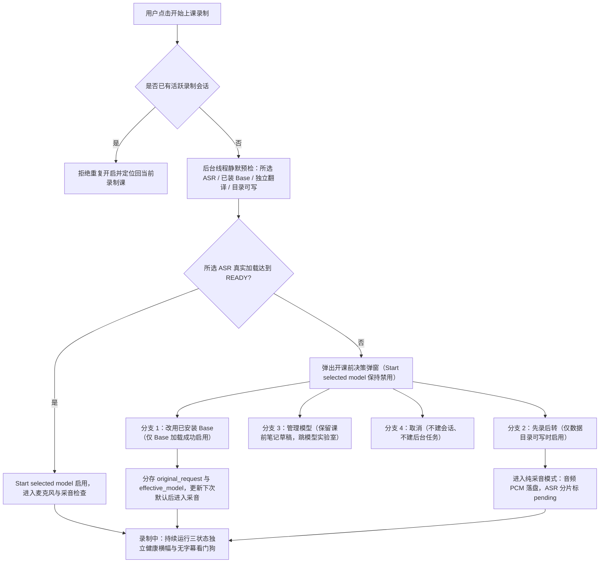
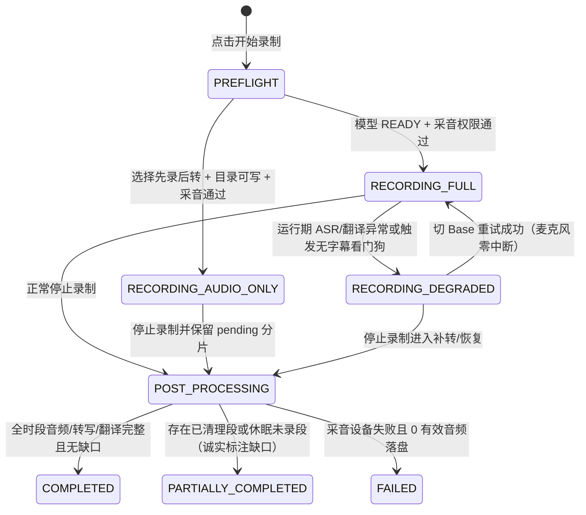

# ClassNote AI 本地优先双语课堂工作台 · 全线产品需求文档（PRD）

| 文档属性 | 内容 |
| --- | --- |
| 文档版本 | `v2.0`（2026-09-07 故障驱动预检与三状态解耦基线 + 评测/布局迭代规格） |
| 产品负责范围 | 产品定位、端侧模型取舍、AI 失效降级状态机、交互迭代与恢复验收（个人 macOS 项目） |
| 目标平台 | macOS 桌面应用（本地优先架构，默认不上云） |
| 更新日期 | 2026-11-20 |
| 适用读者 | macOS 客户端研发、端侧音频与 ASR 工程师、UI/UX 设计、QA 测试 |
| 关联案例文档 | [ClassNote AI 案例说明](../cases/classnote-ai.md) · [PRD 总目录](README.md) |

> **状态标注约定**：文中每条需求严格区分 `[已落地·已验证]`、`[已落地·待复测]`、`[本版规格·待研发落地]` 与 `[规划·P1/P2]`。所有历史恢复数据均严格对应原始故障恢复记录，不编造未测的术语 WER 或留存率。

---

## 1. 背景、真实故障复盘与产品定位

### 1.1 场景痛点与产品定位

全英文授课环境下的大学生在听课与复习过程中同时面临三类高频痛点：
1. **教室弱网与隐私顾虑**：教学楼 Wi-Fi 波动频繁，依赖云端实时流的会议工具容易断流丢段；同时课堂讲义、未公开课件与讨论音频默认上传第三方云端存在隐私与学术合规顾虑。
2. **多工具窗口割裂**：学生往往同时打开系统录音机、竖版 PDF 课件、划词翻译与笔记软件，课中来回切屏极易漏听，课后音频、课件与专业术语检索完全脱节。
3. **端侧 AI 失效导致的核心资产信任危机（2026-09-07 真实故障触发）**：
   - 2026 年 9 月 7 日课堂自用中，设备以 `48 kHz mono signed 16-bit PCM` 正常持续录音，但用户选中的本地 `Small` 转写模型并未安装，导致全部 `262` 个音频分片在推理前静默失败，字幕与翻译输出持续为 `0`。
   - 由于旧版界面只展示「录制中」计时器，未将「音频是否落盘」「转写是否工作」「翻译是否工作」解耦展示，学生无法判断究竟是麦克风坏了、录音丢了还是模型缺了，甚至在排查时手动清空了首段录音。

### 1.2 核心产品设计铁律

由 2026-09-07 真实故障确立 ClassNote AI 的第一性原则：

> **核心资产（原始课堂音频与用户手写笔记）的保存可靠性，绝对优先于一切 AI 增强能力（实时转写、双语翻译、AI 总结）。本地模型缺失或崩溃时，绝不允许阻塞录音，绝不允许伪装正常，更绝不允许用模型生成内容伪造“已恢复”的缺失片段。**

### 1.3 目标用户与核心场景

| 用户画像 | 课前场景 | 课中场景 | 课后场景 |
| --- | --- | --- | --- |
| **全英文授课本科/研究生（主用户）** | 导入竖版英文 PDF 课件、提前确认本机 ASR 模型就绪、写课前预习草稿 | 边看竖版课件翻页、边本地录音并查看双语实时字幕与记笔记；弱网/缺模型时一键降级先录后转 | 重开历史课程回听音频、用快捷键 `⌘K` 跨课程检索专业术语、对先录后转课程补跑离线转写与结构化复习笔记 |

### 1.4 明确的非目标（Non-Goals）

- **不做云端多人协作与默认上云同步**：全部音频、字幕、翻译与索引默认留在本机磁盘，不默认上传课堂内容。
- **不做未经用户确认的静默大文件下载**：`faster-whisper` 模型（尤其是 `medium` / `large-v3`）体积与内存占用大，必须经用户在模型实验室显式确认后才开始下载。
- **不做 AI 脑补填补缺失音频**：对于已被用户手动清空或系统休眠期间未采音的区间，必须诚实记录并标示缺失区间，严禁用 LLM 生成看似连贯的文字掩盖缺口。

---

## 2. 方案选型与架构取舍（Trade-off Matrix）

### 2.1 产品架构定位对比

| 方案形态 | 弱网 / 离线可用性 | 课堂隐私控制 | 竖版课件 + 双语复习贴合度 | 核心代价与定位结论 |
| --- | --- | --- | --- | --- |
| **云端通用 AI 会议笔记** | 弱（强依赖稳定上行网络） | 音频默认上云 | 低（偏横屏会议纪要，不贴合竖版 PDF 课件翻页） | 不与之正面竞争云协作 |
| **本地录音 + 文件夹 + 系统搜索** | 强 | 强 | 极差（音频、PDF 与笔记完全割裂，无法搜术语） | 仅作基线参照 |
| **本地优先 macOS 课堂工作台（采纳）** | **强（全链路本机闭环）** | **强（默认零外传）** | **高（单一工作台整合课件、录音、双语字幕与知识库）** | **采纳**：代价是端侧算力与内存受限，必须把模型管理与失效降级做成一等产品界面 |

### 2.2 端侧模型档位与交互取舍（模型实验室）

| 模型档位（`faster-whisper`） | 速度 / 资源占用 | 准确率预期 | 默认策略与面向学生的非技术文案 |
| --- | --- | --- | --- |
| `tiny` | 速度最快 · 占用低 | 较低 | 可选：「推荐快速课堂转录」 |
| **`base`（默认推荐）** | **中等资源占用** | **均衡** | **默认推荐**：「平衡（Base）是推荐默认方案，其他本地模型在速度、内存与准确率之间取舍。」 |
| `small` | 速度更慢 | 更高准确率 | 可选：适合较强 Mac 且追求更高英文识别率 |
| `medium` | 占用较多内存与处理时间 | 高准确率 | 未默认安装：需用户显式点击下载 |
| `large-v3` | 资源占用很高 | 支持的最高准确率 | 未默认安装：适合课后离线精转，不推荐课中实时 |

- **关键状态区分**：模型实验室、设置页与录制选单必须严格区分 **`未安装`**、**`已安装，待加载验证`**（磁盘有文件但未经过真实推理初始化）与 **`已验证可用（READY）`**，防止把空文件、损坏文件或缺失依赖误报为可用。

---

## 3. 全线功能架构与需求优先级清单（P0–P2）

| 编号 | 模块 | 需求描述 | 优先级 | 当前状态 | 核心验收标准 |
| --- | --- | --- | --- | --- | --- |
| `CN-001` | 开课前 5 分支模型预检 | `RecordingDialog.request_and_start` 在创建会话前于后台线程校验所选 ASR、已安装 Base 与独立翻译模块加载能力，提供 5 项明确用户决策分支 | P0 | `[已落地·已验证]` | 缺模型/损坏文件/不兼容 manifest 均判定不可用；`Start selected model` 仅在真实加载达 `READY` 时启用 |
| `CN-002` | 先录后转降级链路 | 模型不可用时允许用户显式选择「先录后转」，仅在数据目录可写时启用；音频持续以 48 kHz 16-bit PCM 落盘，ASR 分片持久化为 `pending` 供课后补转 | P0 | `[已落地·待复测]` | 预检设计已落盘并过离屏校验；新无敏感样例端到端录制链路待补跑复测 |
| `CN-003` | 录制中三状态独立健康横幅 | 与计时器视觉分离，分别独立展示「音频保存状态」「转写暂停/待处理计数」「翻译等待/错误状态」，故障期间持久驻留不自动消失 | P0 | `[已落地·待复测]` | 音频写入与无字幕彻底解耦，用户一眼确认录音安全 |
| `CN-004` | 无字幕看门狗告警 | 累计采音 `>= 30 秒` 且音频信号 `RMS >= 0.005`（非静音）而转写事件仍为 `0` 时，自动触发持久无字幕警告横幅与一键切 Base 重试（**不重启麦克风**） | P0 | `[已落地·待复测]` | Base 重试仅派发至既有 worker，录音流零中断 |
| `CN-005` | 重复会话防护与采音权限解耦 | 拒绝重复启动活跃录制会话；模型就绪检查与麦克风权限/设备打开/磁盘写入检查职责分离，模型可用绝不冒充麦克风已授权 | P0 | `[已落地·已验证]` | 数据目录不可写时「先录后转」禁用；活跃中再次点录制拦截 |
| `CN-006` | 模型实验室可视化管理 | 展示 5 档 `faster-whisper` 与本地英译中模块，显式标注资源取舍、安装/加载验证状态、需确认才下载与「本机处理、不上传课堂内容」声明 | P0 | `[已落地·已验证]` | 界面截图实测清晰呈现 5 档模型与删除/下载入口 |
| `CN-007` | 原始请求与实际模型分存 | 预检选择「改用已安装 Base」时，分别持久化 `original_request` 与 `effective_model`，仅在用户明确选择后更新下次默认模型 | P0 | `[已落地·已验证]` | 不会静默篡改用户偏好且保留故障回溯元数据 |
| `CN-008` | 竖版 PDF 课件阅读与知识库导航 | 优化竖版英文课件阅读视角、翻页流畅度、课程列表与 `⌘K` 全局知识库检索导航 | P0 | `[已落地·已验证]` | 基于自用与同学试用反馈迭代交付可安装版本 |
| `CN-009` | 课程重开与故障续录恢复 | 支持可安装版本从 Finder 重开真实课程并原子保留手写笔记草稿；对已落盘分片执行无重复、无乱序恢复，缺失段诚实标为 `PARTIALLY_COMPLETED` | P0 | `[已落地·已验证]` | 历史续录恢复找回 `4,609.14s`（~76.8 分钟 / 461 分片），`0` 序列断层、`0` 重复字幕、`360/360` 有效翻译 |
| `CN-010` | 本地扎根/抽取式复习笔记兜底 | 在完整或部分恢复课程上生成分段复习笔记（历史恢复产出 8 个章节），显式写明缺失时间段，绝不编造未录内容 | P1 | `[已落地·已验证]` | 历史恢复验证 8 章节覆盖 360 条有效事件且如实声明两段缺口 |
| `CN-011` | 窄屏工具栏裁切修复（1280px P2） | 修复 `1280px` 宽窗口下顶部工具栏文字标签被裁切的既有视觉问题，改为响应式图标+Tooltip 或溢出收纳菜单 | P2 | `[本版规格·待研发落地]` | `1280×800` 分辨率下所有主工具栏控件无截断重叠 |
| `CN-012` | 主工作台演示脱敏截图包 | 基于无敏感公开英文课程样例生成「竖版课件 + 实时双语字幕 + 三状态横幅 + 笔记」主视图标准演示素材 | P1 | `[本版规格·待研发落地]` | 补齐当前作品集仅展示「模型实验室」设置页的视觉缺口 |
| `CN-013` | 专业术语 WER/CER 与同学复测包 | 构建带人工标注的英文专业课音频评测集（测 Base vs Small 术语识别率）与逐人同学任务复测记录表 | P1 | `[规划·P1/P2]` | 产出可核对的术语错误率对比与改版后逐人任务完成率 |

---

## 4. 核心交互流程与完整三状态机

### 4.1 开课前 5 分支模型预检流程（对齐 `RecordingDialog.request_and_start`）

### 4.2 课程完整性生命周期状态机

### 4.3 三轨独立状态组合矩阵（`音频落盘` × `本地 ASR 转写` × `本地双语翻译`）

该矩阵是防「录音继续但字幕全空导致误判」的核心交互规范，任何状态组合下横幅均独立于计时器展示：

| 场景编号 | 音频采集与落盘状态 | ASR 转写状态 | 双语翻译状态 | 健康横幅级别 | 界面三枚独立徽章文案 | 主操作按钮（CTA） | 是否重启麦克风 |
| --- | --- | --- | --- | --- | --- | --- | --- |
| `S1` 正常全链路 | 正常写入 PCM | 实时转写中 | 实时翻译中 | 浅绿（正常） | `音频已实时保存` · `转写运行中 (Base)` · `翻译正常` | 无（静默护航） | — |
| `S2` 先录后转 | 正常写入 PCM | 已暂停（待课后转写） | 等待转写输入 | 浅蓝（降级可控） | `音频已实时保存` · `待课后转写 (已暂存 N 片)` · `翻译待命` | 「切换可用模型立即转写」 | **否**（派发至既有 worker） |
| `S3` 无字幕看门狗触发 | 正常写入（`>=30s` 且 `RMS>=0.005`） | 失败 / 0 产出 | 无输入（等待中） | 橙色告警（持久驻留） | `音频正在安全保存` · `未产出字幕（模型加载异常）` · `翻译暂停` | 「改用 Base 重试（不中断录音）」 / 「保持先录后转」 | **绝对禁止重启麦克风** |
| `S4` 仅翻译异常 | 正常写入 PCM | 实时转写中 | 翻译模块出错/缺失 | 浅黄提示 | `音频已实时保存` · `英文字幕正常` · `中文翻译暂停（错误可重试）` | 「重试翻译队列」 | **否** |
| `S5` 麦克风权限被拒 / 设备断开 | **未采音 / 写入中断** | 等待音频 | 等待转写 | 红色阻断告警 | `录音未启动：未获得麦克风权限/设备断开` · `转写停机` · `翻译停机` | 「前往系统设置授权」 / 「重选输入设备」 | 需恢复设备后重连 |
| `S6` 磁盘不可写 / 空间耗尽 | **落盘失败** | 暂停 | 暂停 | 红色严重告警 | `警告：音频无法写入磁盘，请立即释放空间` · `已暂停` · `已暂停` | 「导出已安全落盘分片」 | 立即停止写入并保护已落盘文件 |
| `S7` 合盖休眠后唤醒 | 休眠期无采音，唤醒后显式断段 | 标记休眠缺口 | 跳过空缺段 | 橙色信息条 | `检测到系统休眠（{t1}–{t2} 未录音）` · `后续分段继续保存` | 「查看缺口时间线」 | 按新分片续录，诚实记录缺口 |

---

## 5. 核心页面交互规格、字段规则与逐字 UI 文案

### 5.1 预检弹窗（Preflight Dialog）交互规格

1. **后台非阻塞检测**：点击开始录制后立即弹出轻量预检提示（耗时目标 `< 1.5s`），不得卡死主线程 UI。
2. **明确禁用态解释**：当所选模型文件缺失、零字节、manifest 不兼容或加载抛出异常时，`开始录制（使用所选模型）` 按钮置灰禁用，下方直接展示失败原因（如「所选 `small` 模型文件未安装或加载校验未通过」）。
3. **跳去模型实验室不丢草稿**：用户点击「管理模型」离开预检时，必须完整保留已输入的课程标题、关联 PDF 与课前手写笔记草稿。
4. **明确区分“关闭自动转写”与“故障”**：若用户在设置中主动关闭自动转写，预检与横幅应明确标识为「纯录音模式（用户设置）」，不触发故障告警。

### 5.2 主工作台与模型实验室关键 UI 规格

| 区域 | 交互规则与字段要求 | 空态 / 异常态文案 |
| --- | --- | --- |
| **竖版 PDF 课件区** | 支持竖版滚动/翻页、缩放与页码跳转；支持将当前课件绑定至本堂课程 | 未导入课件时展示虚线拖放区：「拖入英文 PDF 课件，支持边听课边翻页与课后联合检索」 |
| **实时双语字幕与笔记区** | 英文原字幕与中文翻译成对展示；右侧「我的笔记」采用原子写入防崩溃丢字；支持随时点击字幕时间戳回听对应音频 | 无字幕但音频正常时，字幕区显式提示：「音频正在安全保存到本机。当前为先录后转模式，下课后可一键补转字幕。」 |
| **模型实验室** | 列出 `tiny / base（默认·推荐）/ small / medium / large-v3` 与 `英文 → 中文翻译`；未安装显示「下载」（二次确认模型体积后启动），已安装显示「删除」（二次确认）与状态字样（`已安装，待加载验证` / `已验证可用`） | 删除当前正在使用的默认模型时弹窗拦截：「该模型为当前默认方案，删除后将切换至其他可用模型或先录后转模式，确认删除？」 |
| **全局搜索（`⌘K`）** | 支持按关键词跨课程检索字幕、中文翻译、手写笔记与课件文本，完全离线执行 | 无命中时提示：「本地知识库中未找到“{keyword}”。注：处于待转写状态的纯录音课程需先完成转写后方可全文检索。」 |

---

## 6. 本地数据模型、音频落盘可靠性与隐私边界

### 6.1 核心本地持久化实体（SQLite + 文件系统）

| 实体 / 存储层 | 核心字段 | 可靠性约束 |
| --- | --- | --- |
| `lectures`（课程） | `lecture_id`, `title`, `pdf_path`, `completeness_status (RECORDING/COMPLETED/PARTIALLY_COMPLETED/FAILED)`, `missing_intervals_json` | 重启与 Finder 重开幂等加载；外键约束全开启（历史核验外键错误 `0`） |
| `recording_sessions`（录制会话） | `session_id`, `lecture_id`, `original_request_model`, `effective_model`, `capture_mode (full/record_only)`, `started_at`, `ended_at` | 同时记录活跃锁，禁止同课并发双录 |
| `audio_chunks`（音频分片） | `chunk_id`, `session_id`, `seq_no`, `pcm_path`（48 kHz mono 16-bit PCM）, `duration_s`, `rms`, `asr_status (pending/done/failed)` | 分片顺序提交落盘，支持只读在线备份不中断采集 |
| `transcript_events` & `translation_events` | `event_id`, `chunk_id`, `text_en`, `text_zh`, `is_non_linguistic`, `status` | 非语言事件（如静音/环境音）保留标记并跳过翻译，不产生孤儿翻译记录 |
| `my_notes`（手写笔记） | `lecture_id`, `content_md`, `updated_at`, `atomic_draft_sha256` | 写入采用临时文件原子替换，崩溃或恢复流程中严禁覆写用户原笔记（历史核验 SHA 不变） |
| `model_inventory`（模型清单） | `model_name`, `install_state (not_installed/installed_unverified/ready/corrupt)`, `last_verified_at` | 不把目录存在等同于可加载 |

### 6.2 本地隐私默认规范

- **零默认上云**：录音 PCM、转写字幕、翻译文本、课件 PDF 与手写笔记 100% 存储于本机应用数据目录，应用运行时不向任何第三方云端发送课堂正文。
- **最小网络出口**：仅当用户在「模型实验室」显式确认下载开源权重文件时发起模型文件下载，且界面明确标注「在本机完成课堂转写翻译，不上传任何课堂内容」。

---

## 7. AI 专项设计：降级边界、历史恢复实证与评测体系

### 7.1 真实故障恢复实证基线（2026-09-07 历史事故交付核验）

| 核验维度 | 真实核验数据与结论 | 口径边界声明 |
| --- | --- | --- |
| **已保存续录音频恢复** | 找回 **`4,609.14` 秒（约 76.8 分钟）**、**`461` 个分片**；`0` 新增恢复失败、`0` 异常序列断层、`0` 重复字幕 | 衡量的是单次故障续录找回的有效音频时长，**不是**模型识别准确率 |
| **本地双语翻译完整性** | **`360 / 360`** 条有效转写事件全部完成翻译、`0` 孤儿记录；`4` 条非语言源事件保留并跳过 | 衡量的是流水线完整性与零丢条，不代表专业术语翻译人工评分 |
| **AI 复习笔记与诚实缺口** | 覆盖全部 360 条有效事件、生成 `8` 个章节（本地扎根/抽取式兜底），显式声明两段缺失区间（用户已清空原段 + 休眠未录段） | 整堂课如实标记为 **`PARTIALLY_COMPLETED`** |
| **原笔记保护与数据库一致性** | 原手写笔记与原 PCM 哈希（SHA）未改动；SQLite 完整性 `ok`，外键错误 `0` | 自动化回归 `558` 项测试通过；另有 `1` 段 28.672s 离题 QA 录制因触发源未定被主动排除在验收外 |

### 7.2 可执行 QA 与 AI 评测验收集（`CN-TC-01` 至 `CN-TC-12`）

| 用例编号 | 评测维度 | 测试场景与输入 | 预期结果与放行门槛 | 当前状态 |
| --- | --- | --- | --- | --- |
| `CN-TC-01` | 缺模型预检拦截 | 选中未安装的 `small` 模型点击开始录制 | `Start selected model` 禁用；提供「改用 Base」「先录后转」「管理模型」「取消」四项有效分支 | `[已落地·已验证]` |
| `CN-TC-02` | 损坏模型文件识别 | 将本地模型文件置为 0 字节或损坏 manifest | 预检判定不可用，绝不误判 `READY` | `[已落地·已验证]` |
| `CN-TC-03` | 管理模型保留草稿 | 输入课前笔记草稿后点「管理模型」跳转再返回 | 课前笔记草稿完整保留，无自动下载触发 | `[已落地·已验证]` |
| `CN-TC-04` | 先录后转新样例回归 | 无敏感公开英文朗读音频选「先录后转」录 5 分钟 | PCM 正常落盘、横幅明确标示「音频已保存 + 待课后转写」、无虚假字幕；课后可补转 | `[已落地·待复测]` |
| `CN-TC-05` | 无字幕看门狗触发与热切换 | 录制中故意注入 ASR 推理失败，持续输入人声 `>= 30s`（`RMS >= 0.005`） | 30s 后弹出持久无字幕告警；点「改用 Base 重试」恢复字幕且**麦克风录音零中断** | `[已落地·待复测]` |
| `CN-TC-06` | 目录不可写防护 | 将数据目录设为只读后点击开始录制 | 「先录后转」明确禁用并给出磁盘权限错误提示 | `[已落地·已验证]` |
| `CN-TC-07` | 重复会话防护 | 录制活跃期间再次触发开始录制指令 | 拦截重复创建会话，不损坏现有 PCM 流 | `[已落地·已验证]` |
| `CN-TC-08` | 安装版重开与原笔记零损 | 从 Finder 启动已安装 macOS 应用重开已恢复课程 | 完整加载历史字幕、笔记与缺口标注；原手写笔记 SHA 不变 | `[已落地·已验证]` |
| `CN-TC-09` | 缺口诚实呈现防幻觉 | 对含休眠断段的课程触发笔记生成与导出 | 课程状态标 `PARTIALLY_COMPLETED`，笔记明确写出未采集时段，禁止编造缺失内容 | `[已落地·已验证]` |
| `CN-TC-10` | 隐私零外传网络抓包 | 完整执行一次离线录课、转写、翻译与 `⌘K` 搜索 | 抓包确认 `0` 字节课堂音频/文本对外网络请求 | `[已落地·待复测]` |
| `CN-TC-11` | `1280px` 窄屏布局回归 | 在 `1280×800` 窗口下打开主工作台与录制横幅 | 工具栏全部按钮与文字标签无裁切、无重叠 | `[本版规格·待研发落地]`（对应 `CN-011`） |
| `CN-TC-12` | 专业课术语 WER/CER 评测 | 选取 30 分钟带人工精标文本的计算机/金融英文课堂音频 | 分别测算 `tiny`/`base`/`small` 的总体 WER 与核心专业术语召回率，产出档位推荐实测依据 | `[规划·P1/P2]`（对应 `CN-013`） |

---

## 8. 本地匿名诊断指标与用户体验验收体系（`[规划·P1/P2]`）

> **隐私原则**：ClassNote AI 坚持「默认不上云」，因此**不植入静默远程埋点 SDK**。所有诊断计数仅落本机轻量日志文件，仅在用户参与课程内测并主动点击「导出脱敏诊断摘要」时生成不含课堂正文的统计 JSON。

### 8.1 核心体验验收指标（规划）

| 指标层 | 指标名称 | 定义 | 验收目标方向 |
| --- | --- | --- | --- |
| **核心信任护栏** | 课堂音频零丢失率 | 正常结束或故障续录后可完整回放的录制会话 / 总录制会话 | 核心音频资产保护达 `100%` |
| **降级有效性** | 预检拦错与降级保录成功率 | 预检发现模型异常后成功转入 Base 或先录后转完成全课录制的比例 | 消除「整节课录完才发现没字幕」事故 |
| **复习效率** | 课后重开与 `⌘K` 检索命中满意率 | 同学内测中通过 `⌘K` 在 10 秒内找到目标术语/课件页的任务完成率 | 验证单工作台相对多工具切换的效率增益 |
| **识别质量** | 英文专业术语 WER（按模型档位） | 基于人工标注课堂语料的词错误率与术语准确率 | 为模型实验室默认推荐提供量化依据 |

### 8.2 同学试用结构化复测清单（规划）

针对当前仅有定性试用反馈的现状，下阶段内测需按统一任务单逐人记录「测试者匿名编号、设备芯片与内存、任务耗时、是否一次成功、卡点原话」：
1. **Task 1（首次冷启动）**：打开模型实验室看懂 `Base` 与 `Small` 区别并确认本地状态。
2. **Task 2（异常降级）**：故意选择未安装模型开课，按预检引导完成「先录后转」并确认音频在保存。
3. **Task 3（课中联读）**：边录边翻阅 20 页竖版 PDF 课件并记录 2 条手写笔记。
4. **Task 4（课后复盘）**：重启应用重开该课程，用 `⌘K` 搜出指定专业术语并回听对应音频片段。

---

## 9. 已知缺陷、技术边界与里程碑路线图

| 风险 / 已知局限 | 级别 | 现状与处理策略 |
| --- | --- | --- |
| **1280px 窄屏工具栏文字裁切** | P2（已知视觉缺陷） | 已在历史离屏检查中定位并诚实记录，不冒充通过；纳入 `CN-011` 响应式折叠修复 |
| **缺专业课术语识别率（WER）量化数据** | 评测缺口 | 76.8 分钟恢复仅证音频找回时长；对外材料明确声明术语识别误差仍待带标注录音单独评估（`CN-013`） |
| **同学端逐人任务复测记录待补齐** | 体验验证缺口 | 既有试用已驱动竖版课件阅读、翻页与知识库导航优化，下阶段按 8.2 节任务单补齐量化复测 |
| **端侧大模型算力与续航权衡** | 架构边界 | `medium`/`large-v3` 在轻薄本实时转写易发热掉帧；后续路线图探索 Apple Silicon MLX / CoreML 硬件加速与课后插电自动批处理队列 |

[上一份 PRD：AppliedAI & ServeTrace](appliedai-servetrace-prd.md) · [返回 PRD 总目录](README.md)
