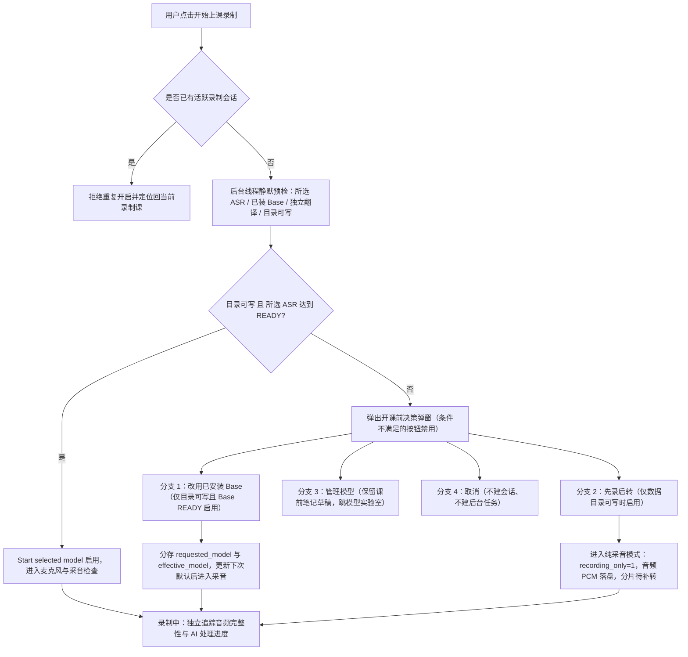
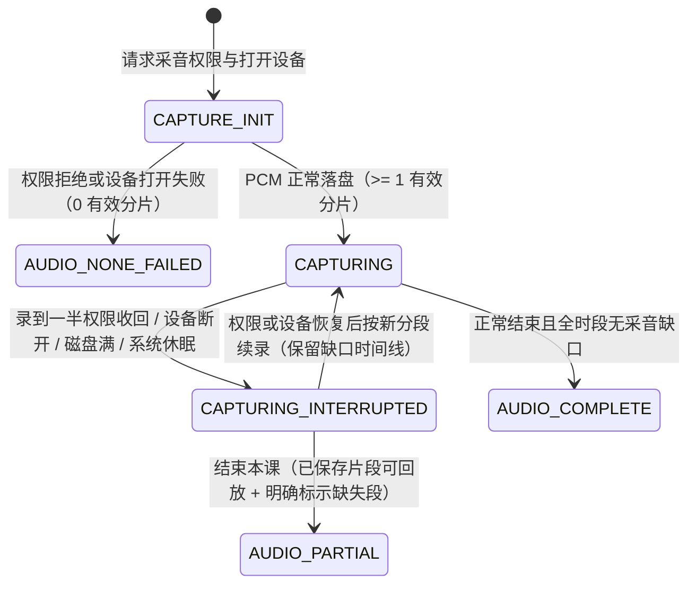

# ClassNote AI 本地优先双语课堂工作台 · 全线产品需求文档（PRD）

| 文档属性 | 内容 |
| --- | --- |
| 文档版本 | `v2.1`（2026-09-07 故障驱动预检与三状态解耦基线 + 源码表结构/看门狗/网络边界校准版） |
| 产品负责范围 | 产品定位、端侧模型取舍、AI 失效降级状态机、交互迭代与恢复验收（个人 macOS 项目） |
| 对应源码基线 | 事故验收冻结提交 `99c9a29`（`data/migrations/__init__.py`、`desktop/asr_preflight.py`、`application/asr_health.py`、`PRIVACY.md`） |
| 目标平台 | macOS 桌面应用（本地优先架构） |
| 更新日期 | 2026-11-20 |
| 适用读者 | macOS 客户端研发、端侧音频与 ASR 工程师、UI/UX 设计、QA 测试 |
| 关联案例文档 | [ClassNote AI 案例说明](../cases/classnote-ai.md) · [PRD 总目录](README.md) |

> **状态标注约定**：文中每条需求严格区分 `[已落地·已验证]`、`[已落地·待复测]`、`[本版规格·待研发落地]` 与 `[规划·P1/P2]`。所有历史恢复数据均严格对应原始事故交付与耐久性报告，不将合成测试结论与真实课堂现场混写。

---

## 1. 背景、真实故障复盘与产品定位

### 1.1 场景痛点与产品定位

全英文授课环境下的大学生在听课与复习过程中同时面临三类高频痛点：
1. **教室弱网与隐私顾虑**：教学楼 Wi-Fi 波动频繁，强依赖云端实时流的会议工具容易断流丢段；同时未公开课件与课堂音频默认上传第三方云端存在隐私与学术合规顾虑。
2. **多工具窗口割裂**：学生往往同时打开系统录音机、竖版 PDF 课件、划词翻译与笔记软件，课中切屏极易漏听，课后音频、课件与专业术语检索割裂。
3. **端侧 AI 失效导致的核心资产信任危机（2026-09-07 真实故障触发）**：
   - 2026 年 9 月 7 日课堂自用中，设备以 `48 kHz mono signed 16-bit PCM` 正常持续录音，但选中的本地 `Small` 转写模型未安装，导致首段全部 `262` 个音频分片在推理前静默失败，字幕与翻译输出持续为 `0`。
   - 由于旧版界面只展示「录制中」计时器，未将「音频是否落盘」「转写是否工作」「翻译是否工作」解耦展示，用户无法判断究竟是麦克风异常、录音未保存还是模型缺失，首段音频随后被用户手动清空；同一天后续另一段已保存的续录通过恢复流程找回约 `76.8` 分钟有效音频。

### 1.2 核心产品设计铁律

> **核心资产（原始课堂音频与用户手写笔记）的保存可靠性，绝对优先于一切 AI 增强能力（实时转写、双语翻译、AI 总结）。本地模型缺失、OOM 或崩溃时，绝不允许阻塞或重启正常采音，绝不允许伪装正常，更绝不允许用模型生成内容伪造“已恢复”的缺失片段。**

### 1.3 目标用户与核心场景

| 用户画像 | 课前场景 | 课中场景 | 课后场景 |
| --- | --- | --- | --- |
| **全英文授课本科/研究生（主用户）** | 导入竖版英文 PDF 课件、确认本机 ASR 模型就绪、写课前预习草稿 | 边看竖版课件翻页、边本地录音并查看双语实时字幕与记笔记；弱网/缺模型时一键降级先录后转 | 重开历史课程回听音频、用 `⌘K` 跨课程检索专业术语、对先录后转课程补跑离线转写与结构化复习笔记 |

### 1.4 明确的非目标（Non-Goals）

- **不做云端多人协作与默认上云同步**：普通课堂处理全程留在本机磁盘，不默认上传课堂音频、字幕、翻译或笔记。
- **不做未经用户确认的静默大文件下载**：`faster-whisper` 模型（尤其是 `medium` / `large-v3`）体积与内存占用大，必须经用户在模型实验室显式确认后才开始下载。
- **不做 AI 脑补填补缺失音频**：对于已被用户手动清空或系统休眠/权限中断期间未采音的区间，必须诚实标示缺失时间段，严禁用模型生成文字掩盖缺口。

---

## 2. 方案选型与架构取舍（Trade-off Matrix）

### 2.1 产品架构定位对比

| 方案形态 | 弱网 / 离线可用性 | 课堂隐私控制 | 竖版课件 + 双语复习贴合度 | 核心代价与定位结论 |
| --- | --- | --- | --- | --- |
| **云端通用 AI 会议笔记** | 弱（强依赖稳定上行网络） | 音频默认上云 | 低（偏横屏会议纪要，不贴合竖版 PDF 课件翻页） | 不与之正面竞争云协作 |
| **本地录音 + 文件夹 + 系统搜索** | 强 | 强 | 极差（音频、PDF 与笔记割裂，无法搜术语） | 仅作基线参照 |
| **本地优先 macOS 课堂工作台（采纳）** | **强（全链路本机闭环）** | **强（默认零外传课堂内容）** | **高（单一工作台整合课件、录音、双语字幕与知识库）** | **采纳**：代价是端侧算力与内存受限，必须把模型管理与失效降级做成一等产品界面 |

### 2.2 端侧模型档位与交互取舍（模型实验室）

| 模型档位（`faster-whisper`） | 速度 / 资源占用 | 准确率预期 | 默认策略与面向学生的非技术文案 |
| --- | --- | --- | --- |
| `tiny` | 速度最快 · 占用低 | 较低 | 可选：「推荐快速课堂转录」 |
| **`base`（默认推荐）** | **中等资源占用** | **均衡** | **默认推荐**：「平衡（Base）是推荐默认方案，其他本地模型在速度、内存与准确率之间取舍。」 |
| `small` | 速度更慢 | 更高准确率 | 可选：适合较强 Mac 且追求更高英文识别率 |
| `medium` | 占用较多内存与处理时间 | 高准确率 | 未默认安装：需用户显式点击下载 |
| `large-v3` | 资源占用很高 | 支持的最高准确率 | 未默认安装：适合课后离线精转，不推荐课中实时 |

- **库存态 vs 可加载态严格区分**：模型实验室、设置页与录制选单必须严格区分 `未安装`、`已安装，待加载验证` 与 `已验证可用（READY）`，防止把空文件、损坏文件或缺失依赖误报为可用。

---

## 3. 全线功能架构与需求优先级清单（P0–P2）

| 编号 | 模块 | 需求描述 | 优先级 | 当前状态 | 核心验收标准 |
| --- | --- | --- | --- | --- | --- |
| `CN-001` | 开课前 5 分支模型预检 | `RecordingDialog.request_and_start` 在创建会话前于后台线程校验所选 ASR、已安装 Base 与独立翻译模块加载能力，提供 5 项决策分支 | P0 | `[已落地·已验证]` | 缺模型/损坏文件/不兼容 manifest 均判定不可用；`Start selected model` 仅在真实加载达 `READY` 且目录可写时启用 |
| `CN-002` | 先录后转降级链路 | 模型不可用时允许用户显式选择「先录后转」，仅在数据目录可写时启用；音频以 PCM 落盘，ASR 分片持久化待补转 | P0 | `[已落地·待复测]` | 预检设计已落盘并过离屏校验；新无敏感样例端到端录制链路待复测 |
| `CN-003` | 录制中三状态独立健康横幅 | 与计时器视觉分离，分别独立展示「音频保存状态」「转写暂停/待处理计数」「翻译等待/错误状态」，故障期间持久驻留 | P0 | `[已落地·待复测]` | 音频写入与无字幕彻底解耦 |
| `CN-004` | 基础无字幕看门狗（现行） | 对齐 `asr_health.py:transcript_watchdog`：累计采音 `pcm_duration_ms >= 30_000` 且 `event_count == 0` 且 `signal_rms >= 0.005` 时触发提示；Base 重试派发至既有 worker 不重启麦克风 | P0 | `[已落地·待复测]` | 存在「前 10 分钟出过字幕后中途卡死漏报」及「环境声误判病因」局限，升级见 `CN-014` |
| `CN-005` | 重复会话防护与采音权限解耦 | 拒绝重复启动活跃录制会话；模型就绪检查与麦克风权限/设备打开/磁盘写入检查职责分离 | P0 | `[已落地·已验证]` | 活跃中再次点录制拦截；目录只读时禁用对应开始按钮 |
| `CN-006` | 模型实验室可视化管理 | 展示 5 档 `faster-whisper` 与本地英译中模块，显式标注资源取舍、安装/加载验证状态与需确认才下载原则 | P0 | `[已落地·已验证]` | 界面截图实测清晰呈现 5 档模型与删除/下载入口 |
| `CN-007` | 原始请求与实际模型分存 | 预检选择「改用已安装 Base」时，在 `lecture_sessions` 分别持久化 `requested_model` 与 `effective_model`，仅在用户明确选择后更新下次默认 | P0 | `[已落地·已验证]` | 保留故障回溯元数据且不静默篡改偏好 |
| `CN-008` | 竖版 PDF 课件阅读与知识库导航 | 优化竖版英文课件阅读视角、翻页流畅度、课程列表与 `⌘K` 全局知识库检索导航 | P0 | `[已落地·已验证]` | 基于自用与同学试用反馈迭代交付可安装版本 |
| `CN-009` | 课程重开与故障续录恢复 | 支持已安装 macOS 版本从 Finder 重开真实课程；已落盘续录按 `UNIQUE(session_id, sequence_id)` 无重复恢复，缺失段诚实标 `PARTIALLY_COMPLETED` | P0 | `[已落地·已验证]` | 历史续录恢复找回 `4,609.141333s`（约 76.8 分钟 / 461 分片），`0` 序列断层、`0` 重复字幕、`360/360` 有效翻译 |
| `CN-010` | 本地扎根/抽取式复习笔记兜底 | 在完整或部分恢复课程上生成分段复习笔记（历史恢复产出 8 章），显式声明缺失时间段，独立写入 `notes_versions` 不覆写个人手写笔记 | P1 | `[已落地·已验证]` | 历史恢复验证 8 章覆盖 360 条有效事件且如实声明两段缺口 |
| `CN-011` | 窄屏工具栏裁切修复（1280px P2） | 修复 `1280px` 宽窗口下顶部工具栏文字标签被裁切的既有视觉缺陷，改为响应式图标+Tooltip 或溢出收纳菜单 | P2 | `[本版规格·待研发落地]` | `1280×800` 分辨率下所有主工具栏控件无截断重叠 |
| `CN-012` | 主工作台公开样例演示图 | 基于无敏感公开英文课程样例生成「竖版课件 + 实时双语字幕 + 三状态横幅 + 笔记」主视图素材 | P1 | `[本版规格·待研发落地]` | 补齐仅展示设置页的直观视觉证据 |
| `CN-013` | 专业术语 WER/CER 与同学复测包 | 构建带人工精标文本的英文专业课音频评测集（固定归一化与术语表分母）与逐人同学任务复测记录表 | P1 | `[规划·P1/P2]` | 分别报告 `tiny`/`base`/`small` 总体 WER 与专业术语召回率及放行门槛 |
| `CN-014` | 增强版无字幕看门狗与病因解耦 | 改用「最近有效语音窗口 + 距上次成功转写时间 + 队列积压 + `ASRFailureCircuitBreaker.code`」；未获加载错误码时只报「有音频、字幕未更新」中性症状，仅捕获 `ModelReadinessError` 时报模型加载异常 | P0 | `[本版规格·待研发落地]` | 覆盖静音、背景声、正常慢推理、首次无输出及第 10 分钟中途卡死 5 类场景 |
| `CN-015` | 缺模型 + 目录不可写组合文案修复 | 修复 `asr_preflight.py` 仅按模型状态选文案导致在「缺 `small` + 目录只读」组合下可能仍提示“音频可安全保存”的缺陷，显式优先输出磁盘权限错误文案 | P0 | `[本版规格·待研发落地]` | 目录不可写时一律阻断“安全保存”承诺并给出明确磁盘权限提示 |

---

## 4. 核心交互流程与解耦双状态机

### 4.1 开课前 5 分支模型预检流程（对齐 `RecordingDialog.request_and_start`）

### 4.2 双轴解耦终态机（采音完整性 vs AI 处理进度）

为彻底消除「录了 20 分钟后麦克风权限被收回 / 端侧模型 OOM / 补转连续失败」的无终态死角，本版规格将**采音完整性**与**AI 处理进度**彻底解耦为两条独立状态轴：

**AI 处理进度轴（正交独立，绝不回退或破坏已保存音频）**：
- `ASR_PENDING`（先录后转待补转 / 模型 OOM 卸载后暂存）↔ `ASR_RUNNING`（实时或课后离线批处理）→ `ASR_DONE`（全部分片完成）或 `ASR_PARTIAL_FAILED`（单分片重试达上限后标记失败、允许用户换模型或手动重跑；受 `UNIQUE(session_id, sequence_id)` 幂等约束，同一分片重复投递最多产出 1 条有效转写事件）。

### 4.3 三轨独立状态组合与资源失效应对矩阵

| 场景编号 | 音频采集与落盘 | ASR 转写进度 | 双语翻译进度 | 健康横幅级别与独立徽章 | 主操作按钮与资源处理规则 | 是否重启麦克风 |
| --- | --- | --- | --- | --- | --- | --- |
| `S1` 正常全链路 | 正常写入 PCM | 实时转写中 | 实时翻译中 | 浅绿：`音频已实时保存` · `转写运行中 (Base)` · `翻译正常` | 无（静默护航） | — |
| `S2` 先录后转 | 正常写入 PCM | `PENDING`（待课后补转） | 等待输入 | 浅蓝：`音频已实时保存` · `待课后转写 (已暂存 N 片)` · `翻译待命` | 「切换可用模型立即转写」 | **否** |
| `S3a` 看门狗触发（无加载错误码） `[CN-014]` | 正常写入（最近语音窗口有声） | 字幕超时未更新（慢推理或队列卡滞） | 等待输入 | 浅黄：`音频正在安全保存` · `有音频，字幕暂未更新（积压 N 片）` · `翻译等待` | 「查看队列状态」 / 「切更轻模型重试」 | **否** |
| `S3b` 看门狗触发 + 捕获 `ModelReadinessError` | 正常写入 | 断路器打开（明确模型加载失败） | 暂停 | 橙色持久：`音频正在安全保存` · `模型加载异常（{code}）` · `翻译暂停` | 「改用 Base 重试（不中断录音）」 / 「保持先录后转」 | **绝对禁止重启麦克风** |
| `S4` 端侧模型 OOM `[本版规格]` | 正常写入 PCM | 捕获 OOM，立即释放模型内存切 `PENDING` | 暂停 | 橙色持久：`音频仍在安全保存` · `内存不足已卸载转写模型，改为先录后转` · `翻译暂停` | 「下课后使用轻量 Base 补转」 | **绝对禁止中断采音** |
| `S5` 录了 20 分钟后麦克风权限收回 / 设备断开 | **中断**（已录 20 分钟保留） | 暂停新分片 | 追平已有转写 | 红色告警：`录音已中断（已安全保存前 20 分钟）` · `待恢复权限/设备` | 「前往系统设置授权」；恢复后**创建新分段续录**，终态记 `AUDIO_PARTIAL` | 恢复设备后按新段续录 |
| `S6` 磁盘只读 / 空间耗尽 | **落盘失败** | 暂停 | 暂停 | 红色严重告警：`磁盘不可写或空间不足，已停止写入新音频`（**严禁出现“音频可安全保存”**） | 「导出已落盘分片」；预检阶段若与缺模型同时出现，**优先报磁盘权限错误**（`CN-015`） | 立即停写并保护已落盘文件 |
| `S7` 合盖休眠后唤醒 | 休眠期无采音，唤醒后显式断段 | 标记休眠缺口 | 跳过空缺段 | 橙色信息条：`检测到系统休眠（{t1}–{t2} 未录音）` · `后续分段继续保存` | 终态记 `AUDIO_PARTIAL` / `PARTIALLY_COMPLETED` | 按新分片续录 |

---

## 5. 核心页面交互规格、字段规则与逐字 UI 文案

### 5.1 预检弹窗（Preflight Dialog）交互规格

1. **后台非阻塞检测**：点击开始录制后在后台线程执行预检，不卡死主线程 UI。
2. **目录可写性最高优先级文案（`CN-015` `[本版规格·待研发落地]`）**：当数据/模型目录不可写时，无论当前所选模型是否安装，弹窗顶部**必须优先显示红色磁盘权限错误**（「数据目录当前不可写，无法保存录音，请检查目录权限或可用空间」），且禁用「开始录制」「改用 Base」「先录后转」，**绝不展示“音频可安全保存”文案**。
3. **跳去模型实验室不丢草稿**：点击「管理模型」离开预检时完整保留课前手写笔记草稿与关联课件。
4. **明确区分“关闭自动转写”与“故障”**：用户主动关闭自动转写时标识为「纯录音模式（用户设置）」，不触发异常告警。

### 5.2 主工作台与模型实验室关键 UI 规格

| 区域 | 交互规则与字段要求 | 空态 / 异常态文案 |
| --- | --- | --- |
| **竖版 PDF 课件区** | 支持竖版滚动/翻页、缩放与页码跳转；支持将当前课件绑定至本堂课程 | 未导入课件时展示虚线拖放区：「拖入英文 PDF 课件，支持边听课边翻页与课后联合检索」 |
| **实时双语字幕与笔记区** | 英文原字幕与中文翻译成对展示；个人笔记采用原子写入 + 保存失败阻止离开/切课保护；支持点击字幕回听音频 | 先录后转态提示：「音频正在安全保存到本机。当前为先录后转模式，下课后可一键补转字幕。」 |
| **模型实验室** | 列出 `tiny / base（默认·推荐）/ small / medium / large-v3` 与 `英文 → 中文翻译`；下载与删除均须二次确认；展示状态字样（`已安装，待加载验证` / `已验证可用`） | 删除默认模型时弹窗拦截：「该模型为当前默认方案，删除后将切换至其他可用模型或先录后转模式，确认删除？」 |
| **全局搜索（`⌘K`）** | 按关键词离线检索字幕、中文翻译、手写笔记与课件文本 | 无命中时提示：「本地知识库中未找到“{keyword}”。注：待转写状态的纯录音课程需完成转写后方可全文检索。」 |

---

## 6. 本地数据模型、音频落盘可靠性与网络隐私边界

### 6.1 真实 SQLite 表结构映射（对齐冻结提交 `99c9a29`：`data/migrations/__init__.py`）

| 真实 SQLite 表名 | 核心真实字段与单位 | 可靠性与幂等约束 |
| --- | --- | --- |
| `lectures` | `id`, `duration_ms`（毫秒，展示换算秒 `/1000`）等课程元信息 | 重启与 Finder 重开幂等加载；外键约束全开启（历史核验外键错误 `0`） |
| **`lecture_sessions`** | `id`, `lecture_id`, `status`, `performance_mode`, `model_name`, **`requested_model`**, **`effective_model`**, **`recording_only`**（0/1）, **`asr_state`**（默认 `PENDING`）, **`translation_state`**（默认 `WAITING_FOR_TRANSCRIPT`）, **`completion_state`**（默认 `AUDIO_SAVED`）, `failure_code`, `recovery_reason`, `sample_rate`, `channels`, `sample_width`, `chunk_seconds`, `elapsed_ms`, `last_sequence_id`, `started_at`, `updated_at`, `paused_at`, `stopped_at` | 同时区分用户原始请求模型与实际生效模型；拒绝重复开启活跃会话 |
| **`audio_chunks`** | `id`, `session_id`, `lecture_id`, **`sequence_id`**, `path`, `timestamp_ms`, **`duration_ms`**（单位毫秒，`>= 0`）, `byte_count`, `status`（默认 `queued`）, `requested_model`, `effective_model`, `error_message`, `created_at`, `updated_at`, `processed_at` | **`UNIQUE(session_id, sequence_id)`** 保证分片顺序唯一，防止恢复或重试产生重复转写事件 |
| `transcript_events` & `translation_events` | `id`, `session_id`, `sequence_id`, `duration_ms`, 文本与状态字段 | 非语言源事件保留并跳过翻译，不产生孤儿翻译记录 |
| `notes_versions`、`quick_notes`、`recording_recovery`、`local_ai_models`、`asr_failure_history` | AI 笔记独立版本表、快记表、恢复记录表、本地模型表与 ASR 失败历史表 | 生成的 AI 笔记仅写入独立版本历史，绝不覆写个人手写笔记文件 |

### 6.2 联网环境下的三类网络行为边界（对齐 `PRIVACY.md`）

| 网络行为类别 | 默认开关 | 联网环境下预期网络流量 | 是否附带课堂内容 |
| --- | --- | --- | --- |
| **1. 普通课堂处理**（录音、转写、翻译、笔记、`⌘K` 搜索） | 始终本地执行 | **`0` 字节**对外网络请求 | **绝不上传** |
| **2. 模型实验室主动下载权重** | 关闭（仅用户显式确认点击下载后触发） | 仅从开源模型源拉取所选权重文件 | **绝不附带**任何课堂音频、字幕、笔记或数据库 |
| **3. 所有者本机可选更新检查**（`PRIVACY.md` 定义） | **默认关闭**（仅所有者本机显式点 `Check Now` 或主动开启后最多每 6 小时检查受信任本地仓 `origin/main`） | 不含硬编码 GitHub Token/密钥，复用本机 Git 认证；非面向公众的二进制更新服务 | **绝不附带**课堂音频、字幕、笔记、数据库或模型数据 |

---

## 7. AI 专项设计：降级边界、历史恢复实证与评测体系

### 7.1 真实故障恢复实证基线（2026-09-07 历史事故交付核验）

| 核验维度 | 真实核验数据与结论 | 口径边界声明 |
| --- | --- | --- |
| **已保存续录音频恢复** | 找回 **`4,609.141333` 秒（约 76.8 分钟）**、**`461` 个分片**；`0` 新增恢复失败、`0` 异常序列断层、`0` 重复字幕 | 衡量的是单次已保存续录找回的有效音频时长（首段 262 分片因用户清空不可恢复），**不是**识别准确率 |
| **本地双语翻译完整性** | **`360 / 360`** 条有效转写事件完成翻译、`0` 孤儿记录；`4` 条非语言源事件保留并跳过 | 衡量流水线完整性与零丢条，不代表专业术语人工评分 |
| **AI 复习笔记与诚实缺口** | 覆盖全部 360 条有效事件、生成 `8` 个章节（本地扎根/抽取式兜底），显式声明两段缺失区间（用户已清空原段 + 休眠未录段） | 整堂课总验收标记为 **`PARTIAL` / `PARTIALLY_COMPLETED`** |
| **个人笔记保护证据（真实 vs 合成严格分列）** | **真实课堂**：最终检查时可见编辑器与持久文件均为空，恢复与安装版重开前后空内容 SHA-256（`e3b0c442...`）一致，已验证课程重开且 AI 笔记不覆写个人笔记（原录制窗口已关闭，旧内存是否有未保存文字无法追证）；**独立合成 Qt 门禁测试**：以非课堂合成文本通过「编辑→强制保存失败→保留文本与 dirty 态→阻断切课/退出→原子导出恢复草稿→重试成功保存」全分支 | 两类证据分列，不将合成非空草稿测试倒推为真实课堂现场非空原笔记 |
| **自动化回归与排除项** | 历史自动化回归 **`558` 项**测试通过，SQLite 外键错误 `0`；另有一段 `28.672` 秒**触发来源未明、从验收中排除的真机采音**，按原报告如实保留不确定性 | 历史事故冻结版本回归数，非本轮新跑 |

### 7.2 可执行 QA 与 AI 评测验收集（`CN-TC-01` 至 `CN-TC-14`）

| 用例编号 | 评测维度 | 测试场景与输入 | 预期结果与放行门槛 | 当前状态 |
| --- | --- | --- | --- | --- |
| `CN-TC-01` | 缺模型预检拦截 | 选中未安装的 `small` 模型点击开始录制 | `Start selected model` 禁用；提供「改用 Base」「先录后转」「管理模型」「取消」四项有效分支 | `[已落地·已验证]` |
| `CN-TC-02` | 损坏模型文件识别 | 将本地模型文件置为 0 字节或损坏 manifest | 预检判定不可用，绝不误判 `READY` | `[已落地·已验证]` |
| `CN-TC-03` | 管理模型保留草稿 | 输入课前笔记草稿后点「管理模型」跳转再返回 | 课前笔记草稿完整保留，无自动下载触发 | `[已落地·已验证]` |
| `CN-TC-04` | 先录后转新样例回归 | 无敏感公开英文朗读音频选「先录后转」录 5 分钟 | PCM 正常落盘、横幅明确标示「音频已保存 + 待课后转写」、无虚假字幕；课后补转且重复投递同分片产出 `0` 重复事件 | `[已落地·待复测]` |
| `CN-TC-05` | 增强看门狗 5 场景回归（`CN-014`） | 分别测试：① 纯静音 ② 纯背景声（高 RMS 无人声）③ 正常慢推理 ④ 首次零输出加载失败 ⑤ 前 10 分钟正常后中途卡死 | ①② 不误报加载异常；③ 仅报队列排队；④ 报明确错误码且切 Base 不中断录音；⑤ 检出中途停滞并告警 | `[本版规格·待研发落地]` |
| `CN-TC-06a` | 目录不可写按钮禁用 | 将数据/模型目录设为只读后打开预检 | 开始录制与改用 Base 按钮按 `asr_preflight.py` 禁用 | `[已落地·已验证]` |
| `CN-TC-06b` | 缺模型 + 目录只读组合文案 | 同时满足「选中未安装 `small`」与「目录只读」 | 优先提示磁盘权限错误，**严禁**出现“音频可安全保存”提示 | `[本版规格·待研发落地]`（对应 `CN-015`） |
| `CN-TC-07` | 重复会话防护 | 录制活跃期间再次触发开始录制指令 | 拦截重复创建会话，不损坏现有 PCM 流 | `[已落地·已验证]` |
| `CN-TC-08` | 课程重开与非空草稿保护 | ① 安装版 Finder 重开真实历史恢复课；② 独立合成 Qt 门禁测非空草稿保存失败阻断与原子恢复 | ① 课程重开通过、空文件 SHA 一致且 AI 笔记不覆写个人笔记；② 合成非空草稿全分支通过 | `[已落地·已验证]` |
| `CN-TC-09` | 缺口诚实呈现防幻觉 | 对含休眠或中断断段的课程触发笔记生成与导出 | 课程标 `AUDIO_PARTIAL` / `PARTIALLY_COMPLETED`，笔记明确写出未采集时段，禁止编造缺失内容 | `[已落地·已验证]` |
| `CN-TC-10` | **联网默认设置**零外传验收 | **保持电脑联网、默认关闭更新检查**，用公开样例跑完录课、转写、翻译与 `⌘K`；另单独核验手动下载模型与可选更新检查 | 普通课堂流程对外网络请求 `0` 字节；下载与可选更新仅访问声明目标且 `0` 课堂数据附带 | `[本版规格·待执行]` |
| `CN-TC-11` | `1280px` 窄屏布局回归 | 在 `1280×800` 窗口下打开主工作台与录制横幅 | 工具栏全部按钮与文字标签无裁切、无重叠 | `[本版规格·待研发落地]`（对应 `CN-011`） |
| `CN-TC-12` | 录到一半权限收回与 OOM | ① 录 20 分钟后系统撤销麦克风权限；② 推理中注入 OOM 异常 | ① 保留前 20 分钟可回放音频，恢复授权新段续录，终态 `AUDIO_PARTIAL`；② OOM 卸载模型保采音不中断 | `[本版规格·待研发落地]` |
| `CN-TC-13` | 专业课术语 WER/CER 评测 | 30 分钟人工精标英文专业课音频（固定标点/大小写归一化 + 50 词专业术语表分母） | 分别报告 `tiny`/`base`/`small` 总体 WER 与专业术语召回率；默认档位 `base` 目标设定为总体 WER `<= 15%`、术语召回 `>= 80%`（未达标则调整默认档位或提示词表） | `[规划·P1/P2]`（对应 `CN-013`） |

---

## 8. 本地匿名诊断指标与用户体验验收体系（`[规划·P1/P2]`）

> **隐私原则**：ClassNote AI 坚持默认不上云，不植入静默远程埋点 SDK。所有诊断计数仅落本机轻量日志，仅在用户参与内测并主动导出脱敏诊断摘要时生成不含课堂正文的统计 JSON。

### 8.1 核心体验验收指标（规划）

| 指标层 | 指标名称 | 定义 | 目标验收标准（规划） |
| --- | --- | --- | --- |
| **核心信任护栏** | 课堂音频可回放完整性 | 正常结束或故障续录后可回放区间与实际有效采音区间一致率，且重复转写事件数 `= 0` | `100%` |
| **降级有效性** | 预检拦错与降级保录成功率 | 预检发现模型异常后成功转入 Base 或先录后转完成全课录制的比例 | 消除「录完整课才知无字幕」事故 |
| **复习效率** | **`⌘K` 10 秒限时任务完成率** | 同学内测中用 `⌘K` 在 10 秒内定位到目标专业术语/课件页的任务完成率 | 量化验证单工作台检索效率 |
| **识别质量** | 总体 WER 与专业术语召回率 | 固定归一化与术语表分母下按 `tiny`/`base`/`small` 分别报告 | 驱动模型实验室默认推荐与术语表优化 |

### 8.2 同学试用结构化复测清单（规划）

下阶段内测按统一任务单逐人记录「匿名编号、Mac 芯片与内存、任务耗时、是否一次成功、卡点原话」：
1. **Task 1（首次冷启动）**：打开模型实验室看懂 `Base` 与 `Small` 区别并确认本地状态。
2. **Task 2（异常降级）**：故意选择未安装模型开课，按预检引导完成「先录后转」并确认音频在保存。
3. **Task 3（课中联读）**：边录边翻阅 20 页竖版 PDF 课件并记录 2 条手写笔记。
4. **Task 4（课后复盘）**：重启应用重开该课程，在 10 秒内用 `⌘K` 搜出指定专业术语并回听对应音频片段。

---

## 9. 已知缺陷、验证边界与里程碑路线图

| 风险 / 已知局限 | 级别 | 现状与处理策略 |
| --- | --- | --- |
| **1280px 窄屏工具栏文字裁切** | P2（已知视觉缺陷） | 已在历史离屏检查中定位并保留记录，纳入 `CN-011` 响应式折叠修复 |
| **缺模型 + 目录只读组合提示瑕疵** | P0（待修复规格） | 当前 `asr_preflight.py` 禁用按钮逻辑正确但文案按模型状态选择，已纳入 `CN-015` 优先修复 |
| **缺专业课术语识别率（WER）量化数据** | 评测缺口 | 当前 76.8 分钟恢复仅衡量音频找回时长，术语识别误差尚待带标注录音单独评估（`CN-013`） |
| **同学端逐人任务复测记录待补齐** | 体验验证缺口 | 既有试用已驱动竖版课件阅读、翻页与知识库导航优化，下阶段按 8.2 节任务单补齐量化复测 |
| **端侧大模型算力与续航权衡** | 架构边界 | `medium`/`large-v3` 在轻薄本实时转写易发热掉帧；后续路线图探索 Apple Silicon MLX / CoreML 硬件加速与插电离线批处理队列 |

[上一份 PRD：AppliedAI & ServeTrace](appliedai-servetrace-prd.md) · [返回 PRD 总目录](README.md)
