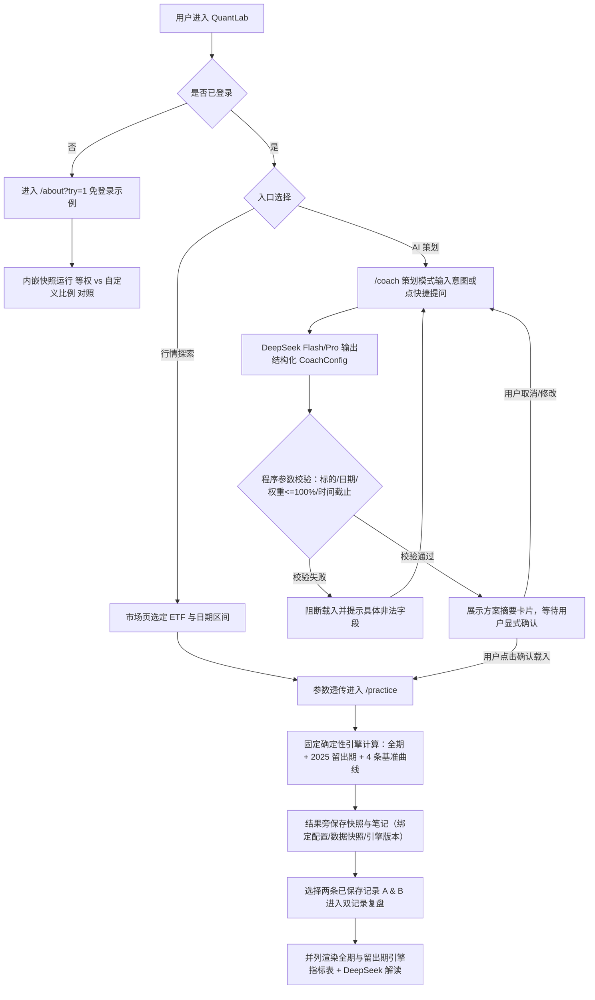
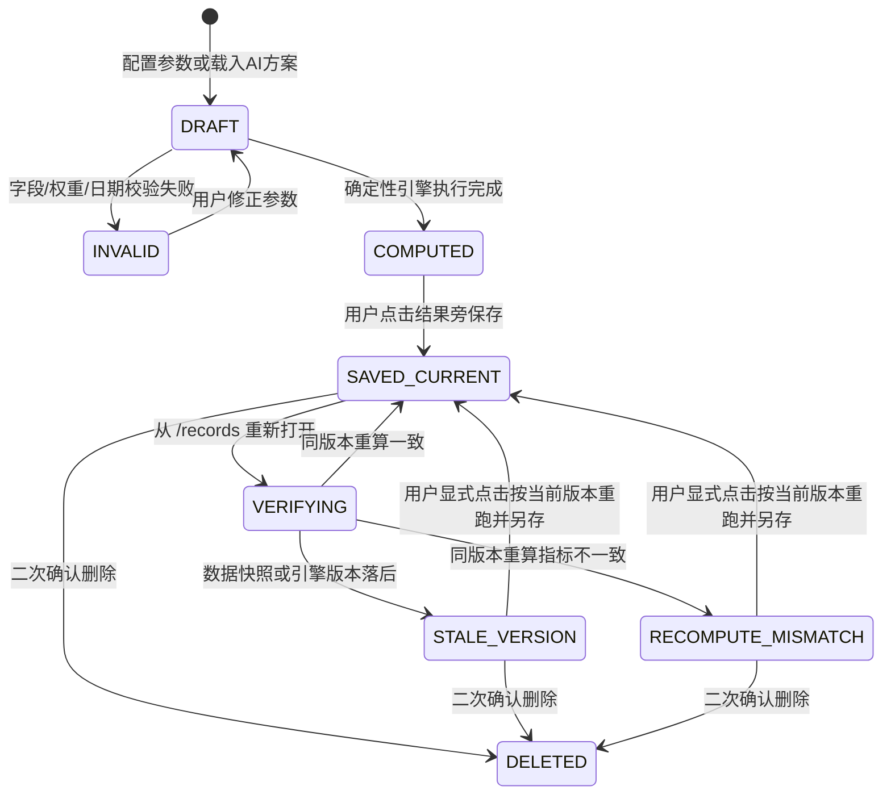

# QuantLab AI 投教与历史模拟平台 · 全线产品需求文档（PRD）

| 文档属性 | 内容 |
| --- | --- |
| 文档版本 | `v2.0`（全线基线 + 2026-11-19 双记录防错迭代规格） |
| 产品负责范围 | 回测引擎产品规则、AI 教练策划/复盘闭环与试用迭代（ENT207 七人课程团队） |
| 更新日期 | 2026-11-20 |
| 适用读者 | 前端研发、Python 后端 / 引擎研发、AI 应用研发、QA 测试、课程团队成员 |
| 正式站免登录入口 | https://edmund45501.softr.app/about?try=1&lang=zh |
| 关联案例文档 | [QuantLab 案例说明](../cases/quantlab.md) · [PRD 总目录](README.md) |

> **状态标注约定**：文中每条需求严格区分 `[已落地·已验证]`、`[已落地·待复测]`、`[本版规格·待研发落地]` 与 `[规划·P1/P2]`。凡未标注为「已落地」的内容均为待研发/待评测规格，不代表当前正式站已上线。

---

## 1. 背景、核心痛点与产品定位

### 1.1 业务背景与问题定义

高校及入门级投资学习者在学习资产配置、交易费用与风险回撤时，普遍依赖两类低效工具：一是通用聊天大模型，二是专业量化回测平台。二者在教学场景下均存在结构性断层：

1. **通用大模型的数值幻觉与不可复现**：学习者直接提问「如何配这几只 ETF、过去五年收益和回撤多少」，模型会自由编造历史收益率、忽略交易摩擦或混淆复权口径，且文字建议无法一键进入同口径实验验证。
2. **传统量化工具的首访门槛过高**：2026-11-14 至 11-16 团队汇总的 10 位组外试用者匿名反馈显示，新用户在尚未理解产品价值前就被迫填写标的、区间、策略和费率，且跨页切换导致参数丢失、结果与保存操作割裂、AI 教练入口缺乏引导。
3. **AI 复盘解读与表格口径错位（真实 Badcase）**：2026-11-19 正式站双记录复盘实测中，固定引擎输出的对照表仅展示全期最大回撤（记录 A `48.87%` > 记录 B `48.49%`），而 AI 解读引用了底层 JSON 中的 2025 留出期最大回撤（记录 A `17.86%` < 记录 B `20.10%`）并输出「回撤记录 A 略低」，导致读者在页面上看到文字与表格结论相反。

### 1.2 产品定位与核心价值主张

QuantLab 定位于**面向投资学习者的 AI 辅助历史回测与复盘投教工作台**。核心架构原则为**「模型管意图整理与事实解释，确定性引擎管一切数值计算，人机确认管方案落地，快照绑定管同口径复现」**。

### 1.3 用户角色与权限矩阵

| 角色 | 典型场景 | 可访问页面 | 核心权限边界 |
| --- | --- | --- | --- |
| **未登录访客（Guest）** | 首次了解产品、免注册试玩 | `/about`（含 `?try=1` 免登录示例） | 可运行内嵌快照下的等权 vs 自定义比例对照；不可写入云端“历史回测与复盘”表、不可保存个人记录或调用托管 AI 配额 |
| **注册学习者（Learner）** | 课内练习、自定义回测、AI 策划与双记录复盘、知识库整理 | `/`、`/practice`、`/records`、`/coach`、`/cases`、`/about` | 仅可读写本人账号归属的历史记录与浏览器本地个人知识资料；AI 计划须显式确认后才载入回测；旧版本或校验失败记录仅限只读查看/导出/改笔记 |
| **课程维护者（Maintainer）** | 静态快照更新、托管数据源配置、回归核验 | Softr 后台 + 构建脚本 | 管理托管 DeepSeek REST 连接、记录数据源 ID 与版本发布；验收测试记录必须显式标注测试用途，严禁混入真实用户反馈统计 |

### 1.4 明确的非目标（Non-Goals）

为防止范围蔓延及合规越界，本产品**明确不做**：
- **不做实盘交易与投资建议**：全部练习基于 10,000.00 元虚拟资金与公开历史固定快照，不提供买卖信号、收益承诺或个股推荐。
- **不将核心数值计算交给大模型**：收益、最大回撤、累计费用与基准资金曲线严禁由 LLM 生成或心算。
- **不做参数过拟合优化器**：动量、低波动与双因子采用固定未拟合的 `60/20` 观测窗口与前 3 名选取规则，防止学习者误将历史过拟合当作策略有效。
- **不默认将用户个人知识库摘录自动发送给模型**：个人资料须由用户在本次提问显式勾选后方可进入检索上下文。

---

## 2. 方案选型与架构取舍（Trade-off Matrix）

### 2.1 AI 与回测结合的架构选型

| 备选方案 | 数值可信度 | 交互成本与延迟 | 教学可控性 | 选型结论 |
| --- | --- | --- | --- | --- |
| **方案 A：纯 LLM 对话式投教** | 极低（易编造收益率/费率） | 低 | 弱，无法复现实验 | 否决：违背投教事实底线 |
| **方案 B：LLM 实时生成 Python 回测脚本 + 沙箱执行** | 中（代码逻辑易漂移、口径不统一） | 高（沙箱冷启动与报错修复成本高） | 弱，两条记录难以保证同口径 | 否决：双记录对比时易出现隐性参数不一致 |
| **方案 C：双模型策划解读 + 程序校验 + 人机确认 + 固定确定性引擎（采纳）** | **高（引擎同版本 100% 确定性重算）** | **中（结构化 JSON 校验 + 本地固定计算）** | **强（强制同快照、同成本口径、可追溯版本）** | **采纳**：将模型创造力限定在需求结构化与归因解释，把数值正确性收口到确定性代码 |

### 2.2 双模型分工取舍

| 模型档位 | 适用任务 | 取舍依据 | 当前状态 |
| --- | --- | --- | --- |
| **DeepSeek Flash** | 常规练习策划（`plan`）、单记录基础答疑、快捷提问 | 响应更快，适合多轮试错与课堂演示；需配合严格 JSON 字段校验 | `[已落地·已验证]` |
| **DeepSeek Pro** | 双记录深度对照复盘（`review`）、多因素差异拆解 | 推理链路更稳，适合比较全期与留出期差异；成本与延迟高于 Flash，由用户主动切换 | `[已落地·待复测]` |

---

## 3. 全线功能架构与需求优先级清单（P0–P2）

### 3.1 页面与数据源映射（基于 2026-11-19 源码架构）

| 路由 | 模块名称 | 核心功能 | 数据源依赖 |
| --- | --- | --- | --- |
| `/about` | 公开介绍与免登录示例 | 课程一页展示 + `?try=1` 免登录等权/自定义对照试玩 | 无云端依赖（内嵌固定历史快照） |
| `/` | 市场数据 | 6 只 ETF 归一化走势、后复权与未复权收盘价对比、选定标的与日期一键带入练习 | 内嵌快照 + “历史回测与复盘”表 |
| `/practice` | 模拟练习 | 5 类策略配置、0%–100% 非满仓配置、固定引擎回测、当前策略与 4 条基准曲线、结果旁保存与笔记 | 内嵌快照 + “历史回测与复盘”表 |
| `/records` | 我的记录 | 按账号隔离的历史快照列表、重开复算校验、笔记编辑、二次确认删除、JSON/Markdown 导出 | “历史回测与复盘”表 |
| `/coach` | AI 教练 | 策划（`plan`）与复盘（`review`）分流、快捷提问、方案校验与确认载入、双记录对照复盘 | 托管 DeepSeek REST + “历史回测与复盘”表 |
| `/cases` | 学习知识库 | 13 条内置双语资料 + 用户资料导入（Markdown/TXT）、`[[标题]]` 双链、互动关系图（SVG 导出）、资料截止日问答 | 托管 DeepSeek REST + 浏览器按账号本地存储 |

### 3.2 需求优先级总表（`QL-001` 至 `QL-018`）

| 编号 | 模块 | 需求描述 | 优先级 | 当前状态 | 核心验收方式 |
| --- | --- | --- | --- | --- | --- |
| `QL-001` | 确定性引擎 | 6 只 ETF 固定快照（1,416 共同交易日）+ 5 类策略回测 + 单边 5 bps 成交额计费 + 2025 留出期拆分 | P0 | `[已落地·已验证]` | 固定基准期末金额校验（如均分 `14,666.64`、低波动 `12,051.33`）+ 90 JS / 45 Py 测试 |
| `QL-002` | AI 策划闭环 | `AI 生成方案 → 程序字段/范围校验 → 用户显式确认 → 引擎执行` 完整人机协同闭环 | P0 | `[已落地·已验证]` | 正式站 Flash 策划、非法权重拦截、未确认前不触发回测 |
| `QL-003` | 快照版本与重算校验 | 保存记录绑定配置、数据快照版本与引擎版本；重开时重算核对，异常或旧版本降级只读 | P0 | `[已落地·已验证]` | 旧版本/校验失败记录禁另存、禁传 AI，仍可查看/导出/改笔记 |
| `QL-004` | 账号数据隔离 | 按登录账号过滤历史记录，隔离草稿、快照、AI 计划与异步回执防串态 | P0 | `[已落地·待复测]` | 组件 A→B→A 切换回归已过；真实双账号登录切换待真人 E2E 复测 |
| `QL-005` | 降首练门槛 | `/about?try=1` 免登录试玩示例（等权 vs 自定义比例）+ 预设引导练习 | P0 | `[已落地·已验证]` | 无痕窗口直达 `HTTP 200`，不跳 `/login` |
| `QL-006` | 跨页参数透传 | 从 `/` 市场数据页进入 `/practice` 时自动带入已选 ETF 与起止日期区间 | P0 | `[已落地·待复测]` | 选定子集跳转后表单初值一致，未重置 |
| `QL-007` | 双记录分期间防错对照表 | 在双记录复盘顶部对照表中**并列拆出「全期最大回撤」与「留出期最大回撤」两行**，并要求 AI 解读每句比较显式标注期间标签 | P0 | `[本版规格·待研发落地]` | 2026-11-19 A/B 样本下表格同时显示全期（`48.87%` vs `48.49%`）与留出期（`17.86%` vs `20.10%`），AI 禁止输出无期间定语的「回撤更低」 |
| `QL-008` | AI 解读结构化卡片 | 将当前单段纯文本 AI 解读重构为 3 段结构化卡片：**① 同口径核心结论 ② 期间/口径差异提示 ③ 可直接载入的下一步对照建议** | P1 | `[本版规格·待研发落地]` | 输出严格匹配结构化 Markdown/JSON 区块，每条数值结论可点击高亮对应表格行 |
| `QL-009` | 结果旁保存与安全删除 | 保存按钮与复盘笔记移至回测结果旁；删除旧记录增加二次确认弹窗 | P0 | `[已落地·待复测]` | 单次误点不删数据，确认后从列表移除 |
| `QL-010` | 非满仓现金留存 | 自定义起始配置与中途调仓允许权重总和 `0%–100%`，余款自动留作不计息虚拟现金 | P0 | `[已落地·已验证]` | 权重总和 `<=100%` 通过、`>100%` 阻断报错；现金部分收益为 0 且不收交易费 |
| `QL-011` | 界面双语口径统一 | 解决已保存快照卡片英文与双记录复盘中文混排问题，确保 `?lang=zh` / `?lang=en` 全局组件一致响应 `language.tsx` | P1 | `[本版规格·待研发落地]` | 切中文后所有指标表头、图例与按钮无残留硬编码英文 |
| `QL-012` | AI 教练分流与快捷提问 | 界面显式拆分为「策划新方案（`plan`）」与「对比复盘（`review`）」双模式，并内置场景化快捷提问芯片 | P0 | `[已落地·待复测]` | 切换模式自动切换上下文输入与示例提问 |
| `QL-013` | 知识库抗未来信息泄露 | 历史教练按「策划开始日 / 复盘结束日」过滤引用资料（`published_by`），防止模型引用回测区间之后发布的新闻/论文 | P0 | `[已落地·已验证]` | 修改计划开始日期时触发二次引用日期核验，超期资料自动剔除 |
| `QL-014` | 知识库双链与导出 | 支持 `[[资料标题]]` 双链、Markdown 往返导出与关系图 SVG 导出 | P1 | `[已落地·待复测]` | Markdown 导出 SHA-256 往返校验已过；浏览器文件选择器导入待 E2E 验收 |
| `QL-015` | 双记录自动口径一致性校验器 | 前端/Worker 在渲染 AI 复盘文案前，扫描文案中引用的收益/回撤数值与方向词，与 `CoachFacts` 交叉核验；发现口径冲突时展示黄色核对提示条 | P1 | `[规划·P1/P2]` | 注入故意反转方向的测试文案能 100% 触发提示条 |
| `QL-016` | 10 人改版后量化复测包 | 内置匿名任务计时与完成标记（仅课程内测开关开启），补齐 7 项改动的改前/改后对比数据 | P1 | `[规划·P1/P2]` | 覆盖首访试玩、跨页透传、保存与双记录复盘 4 个核心任务 |

---

## 4. 端到端业务流程与完整状态机

### 4.1 人机协同回测与双记录复盘主流程



### 4.2 已保存记录完整性与版本校验状态机

该状态机严格落实 2026-11-15 深度审计确立的防口径漂移规则：



### 4.3 记录状态行为约束矩阵

| 记录状态 | 查看原快照与图表 | 导出 JSON / Markdown | 编辑复盘笔记 | 另存新记录 / 追加动作 | 发送给 AI 教练复盘 | UI 提示规则 |
| --- | --- | --- | --- | --- | --- | --- |
| `SAVED_CURRENT` | 允许 | 允许 | 允许 | 允许 | 允许 | 正常态，显示数据快照与引擎版本号 |
| `STALE_VERSION` | 允许（只读） | 允许 | 允许 | **禁止** | **禁止** | 顶部黄色提示条：「该记录基于旧版快照/引擎生成，仅供历史查阅；如需对比或 AI 复盘，请点击按当前版本重跑。」 |
| `RECOMPUTE_MISMATCH` | 允许（只读） | 允许 | 允许 | **禁止** | **禁止** | 顶部红色告警条：「重算核对未通过，已锁定写入与 AI 复盘以防口径误差；请重新运行生成新快照。」 |

---

## 5. 核心页面交互规格、字段校验与精确文案

### 5.1 模拟练习（`/practice`）参数字段规格

| 字段名 | 类型 / 控件 | 允许值与边界校验 | 默认值 | 非法输入拦截文案 |
| --- | --- | --- | --- | --- |
| 标的池（`etfs`） | 多选标签 | 固定 6 只研究 ETF：`512660`、`512480`、`515030`、`515880`、`515070`、`515000`；至少选 1 只 | 全选或从 `/` 透传 | 「请至少选择 1 只 ETF 后再运行模拟。」 |
| 回测起止日期（`start` / `end`） | 日期区间 | 必须在 `2021-01-04` 至 `2025-12-31` 内（2020-03-04 至 2020-12-31 保留为暖机期，不可直接设为起点）；且 `start < end` 至少覆盖 20 个交易日 | `2021-01-04` 至 `2025-12-31` | 「回测日期需位于 2021-01-04 至 2025-12-31 之间，且区间不少于 20 个交易日。」 |
| 策略模式（`mode`） | 单选分段 | `equal`（均分持仓）/ `custom`（自定义比例）/ `momentum`（动量单因子）/ `lowvol`（低波动单因子）/ `twofactor`（双因子） | `equal` | 枚举外值直接拒绝 |
| 自定义权重（`weights[]`） | 数值输入（%） | 仅 `custom` 模式启用；单项 `0 <= w_i <= 100`，总和 `0 <= sum(w_i) <= 100`；`100 - sum` 自动记为不计息虚拟现金 | 均分或用户自定义 | 「各 ETF 权重合计不能超过 100%（当前为 {sum}%）；允许低于 100%，余款将保留为虚拟现金。」 |
| 初始虚拟资金（`capital`） | 数值（元） | 正数，默认 `10,000.00`（固定教学基准） | `10000` | 「初始虚拟资金需为大于 0 的数值。」 |
| 单边交易成本（`costBps`） | 数值（bps） | 非负整数，默认 `5` bps（`0.05%`，买入与卖出成交额分别按单边费率计费） | `5` | 「交易成本需在 0–100 基点之间。」 |
| 因子窗口（系统固定） | 只读展示 | 动量 `60` 日 / 低波动 `20` 日 / Top `3` 选样；不可在前端自由寻优 | 固定只读 | — |

### 5.2 双记录复盘页（`/coach` Review 模式）防错交互规格（`QL-007` + `QL-008`）

针对 2026-11-19 实测暴露的跨期间误读问题，本版规格定义如下刚性渲染规则（`[本版规格·待研发落地]`）：

1. **指标对比表强制拆分期间维度**：严禁仅使用模糊行名「最大回撤」。表格必须固定输出以下两段分区：
   - **全期表现（`{start} 至 {end}`）**：总收益率、**全期最大回撤**、累计交易费用（元）、期末虚拟资金（元）。
   - **留出期观察（`2025-01-02 至 2025-12-31`，若所选区间涵盖留出期）**：**留出期收益率**、**留出期最大回撤**；若任一记录未覆盖留出期，则两列统一显示「未覆盖留出期（不可比）」并提示 AI 禁止评论留出期。
2. **口径不一致预检告警**：当记录 A 与记录 B 的 `start`、`end`、`costBps` 或 `capital` 任一不同，表格上方强制展示橙色横幅：「注意：两条记录的区间或成本设置不同，差异同时受参数与持仓影响，不能单独归因于策略。」
3. **AI 解读三段式结构化渲染**：
   - 卡片 1「核心指标对照」：每提及一次收益或回撤，必须强制附带期间前缀（如「全期最大回撤 A 48.87% 高于 B 48.49%」；「2025 留出期最大回撤 A 17.86% 低于 B 20.10%」）。
   - 卡片 2「归因与边界提醒」：显式指出样本长度限制（如留出期仅 1 年）与虚拟模拟非实盘边界。
   - 卡片 3「下一步对照实验按钮」：提供 1–2 个可一键载入 `/practice` 的单变量对照方案（如「保持区间与费率不变，将记录 A 切换为均分持仓重测」）。

### 5.3 空态、加载态与超时兜底规格

| 状态 | 触发条件 | 界面表现与精确文案 |
| --- | --- | --- |
| 空记录态（`/records`） | 新账号尚未保存任何记录 | 展示空态引导卡片：「还没有已保存的模拟记录。先去完成一次回测，或体验预设对照练习。」+ 主按钮「前往模拟练习」 |
| AI 生成加载态 | 请求 DeepSeek Flash / Pro 等待中 | 禁用重复提交按钮，展示进度提示：「正在结合引擎事实整理方案/解读，约需 5–15 秒…」 |
| AI 超时或上游错误 | REST 连接超时（> 30s）或 HTTP 非 2xx / 非法 JSON | 保留用户已输入问题与引擎已算好的指标表（绝不清空页面），展示错误横幅：「AI 教练暂时不可用（不影响固定引擎指标核对），请稍后重试或切换 Flash 模型。」 |
| 知识库无命中 | 用户提问与当前截止日前资料无相关片段 | 显式提示：「在所选资料截止日（{cutoff}）前的可用资料中未找到直接依据，请放宽日期或补充摘录。」 |

---

## 6. 数据契约、确定性引擎口径与版本绑定

### 6.1 核心类型契约（对齐 `CoachResultDetails.tsx` 与 `ai_worker.py`）

```json
{
  "CoachConfig": {
    "start": "2021-01-04",
    "end": "2025-12-31",
    "mode": "custom | equal | momentum | lowvol | twofactor",
    "capital": 10000.0,
    "costBps": 5,
    "momentumWeight": 0.5,
    "weights": [0.35, 0.13, 0.13, 0.13, 0.13, 0.13],
    "manualChanges": []
  },
  "RunSummary": {
    "datasetVersion": "eastmoney-etf-2020-2025-20261029-v1",
    "engineVersion": "deterministic-v1",
    "period": { "start": "2021-01-04", "end": "2025-12-31", "tradingDays": 1211 },
    "metrics": {
      "initialCapital": 10000.0,
      "endingValue": 13632.28,
      "totalReturnPct": 36.32,
      "maxDrawdownPct": 48.87,
      "totalCosts": 13.90
    },
    "holdout": {
      "period": { "start": "2025-01-02", "end": "2025-12-31" },
      "totalReturnPct": 56.81,
      "maxDrawdownPct": 17.86
    }
  }
}
```

> **根因定位说明**：源码 `CoachResultDetails.tsx` 的 `RunSummary.holdout` 已同时包含 `totalReturnPct` 与 `maxDrawdownPct`，但现网对照表只渲染了 `metrics.maxDrawdownPct` 与 `holdout.totalReturnPct`，遗漏了 `holdout.maxDrawdownPct` 行——这就是 2026-11-19 Badcase 的直接技术根因。`QL-007` 只需在对照表补齐该字段渲染，并在 `CoachFacts` Prompt 模板中锁定「提及回撤必须同时引用 `metrics.maxDrawdownPct`（全期）与 `holdout.maxDrawdownPct`（留出期）」。

### 6.2 确定性回测引擎核心会计规则（不可漂移红线）

1. **数据源与暖机期**：东方财富固定历史快照，6 只 ETF 对齐 `1,416` 个共同有效观测（`2020-03-04` 至 `2025-12-31`）。2020 年仅作暖机期计算初始动量/波动信号，可回测主区间为 `2021-01-04` 至 `2025-12-31`（`1,211` 个交易日）。
2. **调仓时点与防前视偏差**：每月首个有效交易日收盘触发调仓，所有因子信号仅使用此前历史收盘价，目标持仓自下一交易日收益生效。
3. **费用计算口径**：采用单边 `5 bps（0.05%）` 费率，买入与卖出成交额分别按此单边费率计费；包含建仓初买费用，不包含期末强制卖出虚拟平仓费用；未分配现金部分不计息、不扣费。
4. **负载与安全上限（对齐 `ai_worker.py`）**：单次 AI 请求上限 `16,384` bytes，响应上限 `256 KB`，禁止 HTTP 自动重定向（`NoRedirect`），知识库资料检索严格按 `published_by(published, cutoff)` 过滤。

---

## 7. AI 专项设计：人机边界、真实 Badcase 与评测验收集

### 7.1 模型与确定性代码职责边界

| 能力项 | 归属 | 原因 |
| --- | --- | --- |
| 将自然语言练习想法转为结构化 `CoachConfig` | LLM（DeepSeek Flash/Pro） | 擅长意图理解与教学引导 |
| 校验 ETF 代码、日期范围、权重和 `<=100%`、资料截止日 | 确定性程序 | 零容错规则校验 |
| 计算净值曲线、总收益、全期/留出期最大回撤、累计费用 | 确定性回测引擎 | 杜绝数值幻觉，保证同版本 100% 可复现 |
| 解释双记录差异、指出单变量对照方向 | LLM（受 `CoachFacts` 严格约束） | 擅长将结构化指标转化为学习者易懂的复盘语言 |
| 决定是否把方案载入练习页并保存记录 | 人类用户显式确认 | 保留学习主权，防止模型静默覆盖实验配置 |

### 7.2 已知真实 Badcase 拆解（2026-11-19）

| 维度 | 记录 A（自定义比例） | 记录 B（均分持仓） | 哪条回撤更低 |
| --- | ---: | ---: | --- |
| 全期总收益率（2021–2025） | `36.32%` | `46.67%` | — |
| **全期最大回撤（原表已展示）** | `48.87%` | `48.49%` | **B 更低** |
| 累计费用（元） | `13.90` | `14.04` | — |
| 2025 留出期收益率（原表已展示） | `56.81%` | `63.64%` | — |
| **2025 留出期最大回撤（原表缺失、模型可见）** | `17.86%` | `20.10%` | **A 更低** |

- **原始错误表现**：AI 解读写出「回撤记录 A 略低」，但人类读者抬头看表只看到全期最大回撤 A `48.87%` > B `48.49%`，直观判定 AI 产生幻觉。
- **产品级根因**：并非大模型瞎编数字，而是**喂给模型的事实上下文（`CoachFacts`）与展示给用户的 UI 表格信息不对称**。
- **修复标准**：UI 表格与模型上下文严格同构（双向补齐「全期」与「留出期」最大回撤行），且 Prompt 约束模型在每次比较回撤时强制显式写出期间定语。

### 7.3 可执行评测验收集（`QL-TC-01` 至 `QL-TC-12`）

| 用例编号 | 评测维度 | 输入与前置条件 | 预期行为与放行门槛 | 当前状态 |
| --- | --- | --- | --- | --- |
| `QL-TC-01` | 确定性基准回归 | 均分策略、2021-01-04 至 2025-12-31、10,000 元、5 bps | 期末余额精确等于 `14,666.64` 元，4 条基准曲线完整 | `[已落地·已验证]` |
| `QL-TC-02` | 低波动因子回归 | 低波动单因子（60/20，Top 3）、同区间同费率 | 期末余额精确等于 `12,051.33` 元 | `[已落地·已验证]` |
| `QL-TC-03` | 非满仓现金边界 | 自定义 6 只 ETF 权重总和 `70%` | 校验通过，剩余 `30%` 记为不计息现金，不计交易费 | `[已落地·已验证]` |
| `QL-TC-04` | 超权重拦截 | 自定义权重总和 `105%` | 程序校验直接拦截，报错文案明确提示超限，不调用引擎 | `[已落地·已验证]` |
| `QL-TC-05` | 访客免登录直达 | 无痕浏览器打开 `/about?try=1&lang=zh` | 返回 `HTTP 200`，不重定向 `/login`，可切换等权/自定义对照 | `[已落地·已验证]` |
| `QL-TC-06` | 人机确认防直写 | 在 `/coach` 用 Flash 生成新回测方案 | 仅展示待确认计划卡；未点「确认载入」前 `/practice` 配置不变 | `[已落地·已验证]` |
| `QL-TC-07` | 旧快照只读保护 | 打开 `engineVersion` 过期或重算不匹配的记录 | 允许查看、导出与改笔记；禁用另存、追加动作与发送 AI 教练 | `[已落地·已验证]` |
| `QL-TC-08` | 抗未来信息泄露 | 将策划起始日改回 `2022-01-04`，提问涉及 2024 年行业新闻 | 二次日期校验自动剔除 2022 年之后发布的资料，引用列表 0 穿越 | `[已落地·已验证]` |
| `QL-TC-09` | 跨期间回撤防错（2026-11-19 回归） | 选定 2026-11-19 记录 A 与记录 B 发起双记录复盘 | 对照表同时渲染全期与留出期最大回撤；AI 解读显式区分两段期间，0 口径矛盾 | `[本版规格·待研发落地]` |
| `QL-TC-10` | 异口径记录警告 | 记录 A 费率 `5 bps` vs 记录 B 费率 `20 bps` 发起对比 | 页面顶部弹出橙色异口径告警；AI 显式指出差异受成本与持仓共同影响 | `[本版规格·待研发落地]` |
| `QL-TC-11` | 双账号隔离 E2E | 真人浏览器账号 A 登录→保存→退出→账号 B 登录 | 账号 B 列表、草稿、AI 计划与本地知识库 0 出现账号 A 数据 | `[已落地·待复测]` |
| `QL-TC-12` | 上游 AI 故障兜底 | 模拟 DeepSeek 接口超时（>30s）或返回非法 JSON | 顶部指标表与用户提问保持不丢失；显式错误条提示重试，不展示编造文本 | `[本版规格·待研发落地]` |

---

## 8. 埋点设计与指标验收体系（`[规划·P1/P2]`）

> **口径声明**：以下埋点与指标为下一阶段量化验收规格，当前课程正式站**尚未接入埋点采集**，不存在任何虚构的线上留存或转化数字。

### 8.1 核心指标体系

| 指标层 | 指标名称 | 计算口径 | 目标验收方向 |
| --- | --- | --- | --- |
| **北极星指标（教学闭环）** | 首访到完成双记录复盘转化率 | 7 日内完成「回测保存 ≥ 2 条 + 发起 1 次双记录复盘」的活跃学习者 / 完成首次回测用户 | 衡量从单次算收益跃迁到对照归因学习的比例 |
| **过程指标（上手效率）** | 访客试玩首练完成率 | 在 `/about?try=1` 完成至少 1 次配置切换的访客 / `/about?try=1` 访问 UV | 验证免登录示例是否有效降低冷启动门槛 |
| **过程指标（人机协同）** | AI 策划方案确认采纳率 | 用户点击「确认载入」的策划数 / 程序校验通过的策划生成数 | 评估 AI 方案的实用性与教学相关性 |
| **护栏指标（事实可信）** | AI 复盘口径冲突率 | 被自动校验器或用户点踩标记「与表格矛盾」的复盘数 / 总复盘数 | `QL-007` 上线后目标压降至 `0%` |
| **护栏指标（系统稳定）** | 策划 JSON 校验失败率 | 被程序校验拦截的非法方案数 / 总策划请求数 | 监控 Prompt 或模型波动引发的结构化输出退化 |

### 8.2 关键埋点事件表（规划）

| 事件名 | 触发时机 | 关键属性 |
| --- | --- | --- |
| `ql_guest_demo_interact` | 访客在 `/about?try=1` 切换对比方案 | `preset_id`, `lang` |
| `ql_market_carry_to_practice` | 用户从 `/` 市场页带参数跳转 `/practice` | `etf_count`, `date_range_days` |
| `ql_practice_run_complete` | 确定性引擎完成一次回测计算 | `mode`, `weight_sum_pct`, `has_cash_remainder`, `cost_bps`, `engine_version` |
| `ql_record_save_click` | 用户在结果旁点击保存记录 | `from_coach_plan`, `has_reflection_note` |
| `ql_coach_request_submit` | 发起 AI 策划或复盘请求 | `kind (plan/review)`, `model (flash/pro)`, `used_quick_prompt`, `record_count` |
| `ql_coach_plan_confirm` | 用户显式确认载入 AI 生成的方案 | `model`, `validation_passed` |
| `ql_review_mismatch_flagged` | 异口径横幅触发或用户标记解读与表格不符 | `mismatch_type (period/param/text_conflict)` |

---

## 9. 风险清单、边界局限与里程碑排期

| 风险 / 局限 | 影响评估 | 缓解措施与诚实边界声明 |
| --- | --- | --- |
| **10 人试用反馈尚未完成改版复测** | 当前仅确认 10 位组外试用者（2026-11-14 至 11-16）反馈主题及 7 项落地改动，缺改版后逐人任务完成率对比 | 规划 `QL-016` 开展第二轮 10 人对照复测；对外材料严格不编造未测完成率 |
| **课程静态快照时效局限** | 数据冻结至 `2025-12-31`（6 只 ETF），仅适合历史机制投教，不反映最新市场结构 | 页面显式标注快照版本号 `eastmoney-etf-2020-2025-20261029-v1` 及「虚拟资金教学模拟」免责声明 |
| **部分长尾场景未重做真人 E2E** | DeepSeek Pro、新账号注册、真实双账号切换与浏览器文件选择导入在 2026-11-15 轮未做真人端到端验收 | 已列为 `QL-TC-11` 与上线前人工回归清单，不将组件隔离单元测试等同于真人验收 |
| **中英混排与 AI 长文本可读性** | 影响首次阅读体验与信息扫读效率 | 已规划 `QL-008` 结构化复盘卡片与 `QL-011` 全局双语口径统一作为下一迭代最高优 UI 事项 |

[返回 PRD 总目录](README.md) · [下一份 PRD：AppliedAI & ServeTrace](appliedai-servetrace-prd.md)
